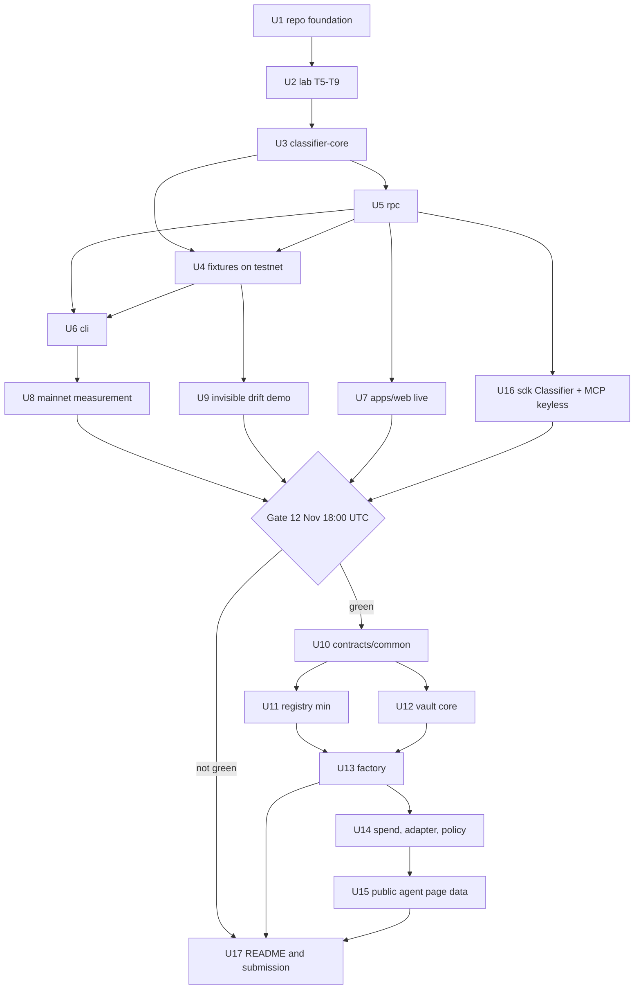

# Aruna v0 Backend and Release - Plan

**Target repo:** `Aruna-Finance/aruna` (local checkout `aruna/`). All paths below are relative to that repo.

---

## Goal Capsule

- **Objective:** By 14 November 2026, 23:59 UTC, a stranger can open Aruna's public page, paste any NEAR account, see whether its code can still change and why, and re-run the published mainnet measurement with one command. If time allows, they can also watch a testnet vault that classifies itself as `immutable_verified` refuse what an agent key cannot do.
- **Means:** classifier-first, following the stages and cut points of `docs/BUILD-PLAN.md` (KTD1). Stage 3 sits behind a dated go/no-go gate (KTD2).
- **Authority:** `CLAUDE.md` hard rules, then `docs/NEAR-FACTS.md`, then the other files in `docs/`, then this plan. When this plan disagrees with `docs/`, `docs/` wins and this plan is corrected.
- **Stop conditions:** stop and ask before (a) any mainnet transaction, (b) adding a dependency to `@aruna/classifier-core`, (c) changing an existing file under `lab/`, (d) writing a contract address, SDK method, host function or RPC shape that cannot be verified, (e) any README claim that has no command behind it.
- **Execution profile:** one backend developer working with AI agents, sequential, plus a separate frontend team working in `apps/web`. Interfaces handed to the frontend (U5, U7) are the coordination points.
- **Who finishes:** the backend owner lands U1 to U17 and submits. The frontend team owns everything inside `apps/web` except the adapter swap in U7.

---

## Product Contract

### Summary

Build the dependency-free classifier, its RPC reader and CLI, record the owed lab tests, and publish the mainnet class-distribution measurement, all in time for v0. Live classification goes into the existing `apps/web` page, and the keyless `aruna_check_target` MCP tool ships right after. A thin testnet vault is a stretch goal behind a fixed gate. Stages 4 to 8 remain roadmap, ordered but not broken into work units here.

### Problem Frame

Aruna's claim is that a class of NEAR contracts (`global_by_account`) can change with no transaction touching them while the field everyone monitors stays the same. As of 9 November 2026, 16:00 UTC, that claim exists only in lab results and docs. None of the backend packages or contracts has any code. The frontend team has a landing page, spec and proof pages, and a console shell, but the classifier box still runs on a stub adapter that returns canned results for four fake accounts.

Five comparable hackathon projects already ship spending guards (`docs/COMPETITIVE.md`). If Aruna releases with a vault and no working classifier, it reads as the sixth. Judges screen with Claude Code and Codex by running the README. Anything in it that does not run counts against the project. About 5 days and 8 hours remain.

### Requirements

**Lab evidence**
- R1. T5 to T9 from `docs/TESTING.md` are run on sandbox (nearcore 2.14, protocol 88), and their exact errors are recorded in `docs/NEAR-FACTS.md` without touching any existing lab file.
- R2. T7's compiled-import comparison (`Promise` against the low-level functions) is repeated with `cargo near build`, and the import lists are published.

**Engine**
- R3. `classify(accountId, rpc)` returns class, `mutabilityBasis` and full evidence for any account, following `docs/CLASSIFIER.md` step by step.
- R4. `@aruna/classifier-core` has zero runtime dependencies, does no I/O, and runs unchanged in a browser, Node, the MCP server and the CLI.
- R5. Unparseable WASM and accounts without code classify as `unknown`. An account with no code is never confused with a global-contract account.
- R6. The evidence carries both the monitored `view_account.code_hash` and the resolved `view_code` hash, so a consumer can show them side by side.

**Surfaces**
- R7. `@aruna/rpc` gives a fetch-based `RpcReader` for mainnet and testnet that works from a browser origin.
- R8. The CLI classifies one account, and a batch from a file, read-only, with machine-readable output.
- R9. `apps/web` classifies live from public RPC in the tab, with no backend, wallet or sign-up. The stub adapter and the duplicated types are removed.
- R10. `aruna_check_target` answers for any mainnet or testnet account with no registration, through `@aruna/sdk`'s keyless `Classifier`.

**Measurement**
- R11. A class-distribution table for the top N most-called mainnet contracts is published with source, query and date, and import-only accounts are counted apart from accounts holding a full-access key.
- R12. Both headlines from `docs/CLASSIFIER.md` are computed, and the framing is chosen after the numbers are seen.
- R13. One command regenerates the measurement from the committed raw data.
- R14. A testnet `global_by_account` example shows the monitored field unchanged and the resolved hash changed after the owner redeploys, and says plainly which field is wrong.

**Stretch: thin vault (Stage 3)**
- R15. A factory-deployed testnet vault has no full-access key, imports none of the scanned host functions, and classifies as `immutable_verified` under Aruna's own classifier, with the evidence published.
- R16. Agent keys on the vault are refused by the network for every forbidden action and every `cb_` method. A revoked key's transaction never executes.
- R17. The owner and operator split, the reservation-safe daily cap, returning refusals, class staleness and adapter proceeds behave as the Stage 3 acceptance list in `docs/BUILD-PLAN.md` states.

**Release**
- R18. The README's first screen carries the positioning sentence. Every claim has a numbered "do X, see Y" step a fresh clone can run. Both trust assumptions are stated.
- R19. The submission checklist in `docs/BUILD-PLAN.md` is complete before 14 November, 23:59 UTC.

### Key Decisions

- **Stage 0 to 2 are committed. Stage 3 is a stretch.** This follows `docs/BUILD-PLAN.md` "Release v0" (governs R15, R16, R17).
- **The keyless MCP tool runs after Stage 2 and before the vault.** It is cheap because it wraps `classify()`, it serves agents that never touch a vault, and it fills the `agents` track. This moves part of Stage 4 earlier than `docs/BUILD-PLAN.md` orders it (governs R10). (session-settled: user-approved — chosen over keeping strict stage order: proposed in the scoping synthesis and confirmed.)
- **Code lives in the git repo `aruna/`, not the skeleton folder around it.** `docs/` and `lab/` are copied in verbatim (governs R1, R18). (session-settled: user-approved — chosen over building in the parent folder: proposed in the scoping synthesis and confirmed.)
- **`apps/web` is the one app.** The docs that still say `apps/check` and `apps/console` are corrected (governs R9). (session-settled: user-approved — chosen over splitting the app again: the frontend team already merged it.)

### Success Criteria

- A judge following the README on a fresh clone gets, for each listed step, the result the step says, with no private key, paid API key or author-only state.
- The measurement table and the `global_by_account` side-by-side are viewable within ten seconds of opening the public page.

### Scope Boundaries

- Never built for v0, by the docs' own rules: human approval queues, deny-lists, TEE oracles, a generic `execute`, gas keys, meta-transactions.
- Coverage, pool, attestor, claims and simulation run on testnet only after v0. Their numbers are never shown as anything other than assumptions.
- Considered and not built: a backend cache or proxy for RPC. Rejected because the check page must stay static. Revisit only if public RPC CORS or rate limits fail in a browser during U7.
- Considered and not built: our own drift-history mining from BigQuery. The public dataset's documented `action_kind` list has no global-contract actions, so it would only give a lower bound. This is open question 1 in the docs and is out of v0.

#### Deferred to Follow-Up Work

Ordered roadmap after v0. Each stage starts only when the previous one is green.

| Stage | Work | Depends on |
|---|---|---|
| 3 remainder | Whatever of U10 to U15 missed the gate | U9 |
| 4 | Full `@aruna/sdk` (Vault, Registry, Pool), ABI-generated types, MCP Group B vault tools, `aruna_watch_target`, reason-code parity test | Stage 3 |
| 5 | Exposure checkpoints, `@aruna/indexer`, console dashboards and the policy-to-price panel on real data | Stage 4 |
| 6 | Migration: CLI and console flow, code-hash-to-vault mapping | Stage 5. Required before gate A |
| 7 | `pool`, coverage, claims, `@aruna/attestor` with heartbeat and four channels, on testnet | Stage 6 |
| 8 | `@aruna/sim` and writing `k` and the concentration limit back to `docs/DECISIONS.md` | Stage 7 |
| Standard | A NEP proposal for mutability class | after the measurement |

### Outstanding Questions

**Blocking**
- Q1. Can the owner give BigQuery access (a Google Cloud project with billing) by 11 November, 12:00 UTC? U8 needs it, and `gcloud` and `bq` are not installed on this machine yet. The fallback is in U8.
- Q2. Who controls `aruna.testnet`? It exists on testnet (about 200 NEAR, no code). `docs/CONTRACTS.md` places the factory there. If it is not ours, U13 uses a free name. `aruna-finance.testnet` was free on 9 November.

**Deferred to implementation**
- Q3. Exact `near-cli-rs` subcommands for deploying a global contract by account id and by hash. Verify them against the installed version and `docs.near.org/llms.txt` before scripting U4. The local CLI version did not print cleanly.
- Q4. The size of N and the date window for the measurement query. Pick them after seeing the bytes scanned, with the cost under the free tier.
- Q5. Whether FastNEAR's public endpoints rate-limit a browser burst. Decide fallback ordering in U5 from what is observed.

---

## Planning Contract

### Key Technical Decisions

- KTD1. **Follow `docs/BUILD-PLAN.md` stage order, with the one move recorded in Key Decisions.** Its cut points already make each stopping place whole.
- KTD2. **The Stage 3 gate is 12 November, 18:00 UTC.** If U3 to U9 are not all green by then, Stage 3 does not start and the remaining time goes to U17 and polish. Within Stage 3 there is a smaller cut, "Stage 3 minimum" (U10, U11, U12 core, U13): a vault that classifies itself `immutable_verified` and an isolation demo that prints the refusals. This is the strongest link between classifier and vault, and spend flow comes only after it.
- KTD3. **Transport failure is not a class.** A failed or timed-out RPC call makes `classify` reject with a typed error, which every surface shows as a lookup failure. `unknown` is reserved for what `docs/CLASSIFIER.md` names: no code, or code fetched but unparseable. Otherwise a flaky endpoint would inflate `unknown` in the measurement and corrupt the headline.
- KTD4. **Evidence gains `monitoredCodeHash`.** This is the raw `view_account.code_hash`, kept next to `resolvedCodeHash`. The frontend asked for it, R6 needs it, and adding it now is cheap. Adding it after the type is consumed by four surfaces is not. Update `docs/CLASSIFIER.md`'s `ClassEvidence` in the same change.
- KTD5. **The WASM import parser is hand-written inside the core.** It reads the magic and version, walks section headers by LEB128 size, and decodes only section 2 (imports). It does no validation beyond what reaching the import section needs, and no flow analysis (`docs/CLASSIFIER.md`). Any structural inconsistency means `wasmParsed: false`, which means `unknown`. A library would break R4.
- KTD6. **The core covers the scanned set from `docs/CLASSIFIER.md` exactly.** The four "still to review" names are not scanned in v0. Each is recorded as a `reviewPending` note in the core's source so the list has one owner. Changing the scanned set changes classifications, so it needs its own decision entry in `docs/DECISIONS.md`.
- KTD7. **The owed lab tests go into a new standalone crate, `lab/owed/`, with result files prefixed `owed_`.** Existing lab files stay byte-identical (CLAUDE.md rule 7, `docs/TESTING.md`).
  - `lab/owed/Cargo.toml` declares its own empty `[workspace]`, so the existing `lab/Cargo.toml` is never edited to list it.
  - `lab/.gitignore` contains `target/`, which also matches the source directory `lab/contracts/target/`. That source is force-added to git in U1 so the copy is complete. `lab/.gitignore` itself is not edited.
- KTD8. **Fixtures are real testnet accounts, plus recorded snapshots for unit tests.** `fixtures/` holds four small contracts and one script that deploys one account per class on testnet, then records each account's three RPC responses and its WASM to `fixtures/snapshots/`. Unit tests replay the snapshots offline. The live accounts are the README's example inputs, so judges paste real accounts and no stubs remain.
- KTD9. **The measurement's raw data is committed.** The BigQuery export (account list with call counts, query text, date window, export date) goes into `measurement/raw/`. "One command regenerates" means from that file through the classifier over RPC, not re-billing BigQuery. Classification results also carry the block height, because mainnet state moves.
- KTD10. **The vault uses only `env::promise_batch_*` and no full-access key** (CLAUDE.md rule 11). Immutability is checked by running our own classifier on the deployed vault, plus a test on the compiled WASM imports that reuses the core's parser through the CLI. No second check exists (rule 10).
- KTD11. **The Stage 3 adapter targets our own testnet fixture swap contract.** No third-party DEX is used. Its address is ours and verifiable, it can be made to return proceeds or fail on demand, and it is the drift target Stage 7 needs. Rule 1 forbids guessing a third-party address.
- KTD12. **TypeScript packages ship as ESM built with `tsc` only.** Tests use `vitest`, already used in `apps/web`, and `fast-check` where property tests apply. Test tooling sits in devDependencies, which keeps the core's runtime dependency list empty. The check for R4 is `pnpm --filter @aruna/classifier-core ls --prod` showing nothing.

### High-Level Technical Design

Dependency and delivery order. Solid arrows are hard dependencies.



Calendar. All times UTC.

| Day | Units | Exit signal |
|---|---|---|
| Mon 9 (evening) | U1, start U2 | repo builds, lab copied |
| Tue 10 | U2 time-boxed to 12:00, U3 | T5–T9 recorded, core green on the test list |
| Wed 11 | U5, U4, U6. Q1 answered by 12:00 | fixtures live on testnet, CLI classifies them |
| Thu 12 | U8, U9, U7 (with frontend), U16. Gate at 18:00 | measurement published, page live |
| Fri 13 | U10–U13 (Stage 3 minimum), then U14 | vault classifies itself, isolation demo prints refusals |
| Sat 14 | U15 if reached, U17. Feature freeze 18:00, submit by 22:00 | submission sent with buffer |

Classification procedure as implemented in U3. This sketch shows direction only. `docs/CLASSIFIER.md` is the authority.

```text
viewAccount ──> global_contract_hash?        ─yes─> codeRef=global_hash ──┐
            └─> global_contract_account_id?  ─yes─> global_by_account (basis global_owner)
            └─> code_hash != zero?           ─yes─> codeRef=local ────────┤
            └─> otherwise                         ─> unknown (undetermined)
                                                                          v
viewAccessKeyList ──> fullAccessKeyCount > 0 ─yes─> local_upgradeable (full_access_key)
                                                                          v
viewCode ──> parse imports fails             ─────> unknown (wasmParsed=false)
         └─> scanned import present          ─────> local_upgradeable (upgrade_imports)
         └─> clean and codeRef=global_hash   ─────> immutable_verified (no_detected_path)
         └─> clean and codeRef=local         ─────> local_upgradeable (own_code)
```

`global_by_account` still fetches `viewCode` to fill `resolvedCodeHash` and keys, but the class is fixed at step 1.

### Output Structure

```text
packages/classifier-core/src/{index,types,classify,wasm-imports,scanned}.ts
packages/classifier-core/test/
packages/rpc/src/{index,fetch-reader,endpoints,errors}.ts
packages/rpc/test/
packages/cli/src/{index,classify-cmd,measure-cmd}.ts
packages/sdk/src/{index,classifier}.ts        (keyless slice only for v0)
packages/mcp/src/{index,tools}.ts             (Group A only for v0)
fixtures/{immutable,upgradeable,global_owner,README.md}/ + fixtures/deploy.ts + fixtures/snapshots/
measurement/{query.sql,raw/,results/,REPORT.md}
lab/owed/                                       (new crate, T5–T9)
contracts/{Cargo.toml,common,registry,vault,factory,adapters/swap}/   (stretch)
scripts/testnet-setup.ts                        (stretch)
examples/{isolation-demo,honest-agent,injected-agent}.ts   (stretch)
```

### Assumptions

- The owner has, or can create, a funded testnet account for fixtures and the vault. Testnet faucet limits are assumed sufficient for about six accounts.
- Mainnet and testnet both run protocol 88 (nearcore 2.14.0, testnet 2.14.0-rc.5), measured on 9 November 2026. They match the lab, so lab facts carry over. Re-check before recording gas numbers.

### Risks and Mitigations

| Risk | Mitigation |
|---|---|
| BigQuery access arrives late (Q1) | Fallback, published as such: classify a named list of high-traffic mainnet contracts from public sources, label it "a sample, not top N by calls", and keep the query ready to re-run. Never present the fallback as the top-N figure |
| Top N contains zero `global_by_account` accounts | Expected possibility. Lead with headline 2. The finding is about monitoring correctness (`docs/CLASSIFIER.md`), and U9 demonstrates it on testnet regardless |
| T9 is inconclusive in its time box | Keep the "no detected upgrade path under these checks" wording that `docs/DECISIONS.md` D-10 already requires. Record what was observed. Never use the word *proof* unqualified |
| Public RPC rate limits during a 1,000-account batch | The CLI throttles and retries transport errors (KTD3), and records failures separately from `unknown` |
| Stage 3 eats the release buffer | The gate in KTD2, and the freeze at 14 Nov 18:00 UTC |
| Frontend and backend drift on the evidence type | `apps/web` imports the type from the core (U7). Its copy is deleted |
| A key or `.env` leaks into public history | U1 adds ignore rules and a pre-push secret scan. U17 checks history before the repo goes public |

---

## Implementation Units

| U-ID | Title | Key files | Depends on |
|---|---|---|---|
| U1 | Repo foundation | `docs/`, `lab/`, root config | none |
| U2 | Owed lab tests T5–T9 | `lab/owed/`, `docs/NEAR-FACTS.md` | U1 |
| U3 | `@aruna/classifier-core` | `packages/classifier-core/` | U2 |
| U5 | `@aruna/rpc` | `packages/rpc/` | U3 |
| U4 | Fixtures on testnet | `fixtures/` | U3, U5 |
| U6 | `@aruna/cli` | `packages/cli/` | U4, U5 |
| U7 | Live classification in `apps/web` | `apps/web/src/landing/lib/` | U5, U4 |
| U8 | Mainnet measurement | `measurement/` | U6 |
| U9 | Invisible drift demo | `fixtures/drift-demo.ts` | U4 |
| U16 | Keyless Classifier and MCP tool | `packages/sdk/`, `packages/mcp/` | U5 |
| U10 | `contracts/common` (stretch) | `contracts/common/` | gate |
| U11 | Minimal registry (stretch) | `contracts/registry/` | U10 |
| U12 | Vault core (stretch) | `contracts/vault/` | U10, U2 |
| U13 | Factory and self-classification (stretch) | `contracts/factory/`, `scripts/` | U11, U12 |
| U14 | Spend, policy, swap adapter (stretch) | `contracts/vault/`, `contracts/adapters/swap/` | U13 |
| U15 | Public agent page data (stretch) | `packages/sdk/src/vault-view.ts` | U14 |
| U17 | README and submission | `README.md`, `docs/SUBMISSION.md` | U8, U9, U16 |

### U1. Repo foundation

- **Goal:** the git repo holds the authoritative docs, the lab evidence and build tooling for TypeScript and Rust.
- **Requirements:** R1, R4, R18. Key Decisions on repo and app.
- **Dependencies:** none.
- **Files:** `docs/*.md` (copied from the parent `docs/`), `lab/**` (copied verbatim from the parent `lab/`, excluding `target/`), `CLAUDE.md`, `tsconfig.base.json`, `package.json`, `pnpm-workspace.yaml` (add `fixtures`, `measurement` if they become packages), `.gitignore`, `.env.example`, `Cargo.toml` (workspace for `contracts/*`), `rust-toolchain.toml`.
- **Approach:**
  1. Copy `docs/` and `lab/` byte-for-byte, then confirm with a recursive diff against the parent folders.
  2. Replace `apps/check` and `apps/console` with `apps/web` in `CLAUDE.md`, `docs/ARCHITECTURE.md` and `docs/FRONTEND.md`.
  3. Extend `.gitignore` for `.env*` except `.env.example`, any local credentials directory, `target/` and `lab/target/`. Keys stay in `~/.near-credentials`, outside the repo.
  4. Add a secret-scan script to the root `package.json` (grep for `ed25519:` private-key prefixes and seed-phrase shape).
- **Test expectation:** none — scaffolding. Verified by the checks below.
- **Verification:** a recursive diff of `lab/` against the parent shows no difference. `pnpm -r build` and `pnpm -r test` pass with the existing `apps/web` tests. The secret scan finds nothing.

### U2. Owed lab tests T5 to T9

- **Goal:** the claims that self-classification and the key-on-vault model rest on have measured results.
- **Requirements:** R1, R2.
- **Dependencies:** U1.
- **Files:** `lab/owed/Cargo.toml`, `lab/owed/src/main.rs`, `lab/owed/contracts/` (minimal fixture contracts: a low-level key manager, a `Promise`-based twin, a `delete_account`-capable child), `lab/results/owed_t5_fc_key_use_global.json` through `owed_t9_delete_recreate.json`, `docs/NEAR-FACTS.md` (new rows with dates), `docs/TESTING.md` (mark T5–T9 recorded).
- **Approach:**
  1. Reuse the lab's sandbox setup patterns by reading `lab/harness/src/main.rs` and `rpc.rs`. Copy what is needed into `lab/owed/`; never edit the originals (KTD7).
  2. Run classic function-call keys on a contract account, not gas keys.
  3. Have T7 print the import list of both the `Promise` and low-level builds made with `cargo near build`. This listing is R2.
  4. Time-box to 10 Nov, 12:00 UTC. Anything unresolved is recorded as observed, with the risk-table mitigation.
- **Execution note:** action-level tests against the sandbox directly, not `near-workspaces` (`docs/TESTING.md`). Assert on RPC errors, because five of the refusals never reach a block.
- **Test scenarios:**
  - T5: a function-call key on a by-hash account submits `UseGlobalContract`. Expect rejection, record the exact error string.
  - T6: a classic key with a 0.05 NEAR allowance calls a method until exhausted. Record gas drawn from the account balance per call, and the error at exhaustion.
  - T7a: a contract with no full-access key adds, then deletes, its own function-call key by low-level promise. Both succeed and `view_access_key_list` reflects each step.
  - T7b: a contract importing only `promise_batch_action_add_key_with_function_call` has no way to add a full-access key. Confirm from its import list, and record any runtime attempt as impossible to express.
  - T7c: compiled import lists for the `Promise` and low-level twins. Expect 17 against 1 `promise_batch_action_*` imports, or record the difference.
  - T8: an agent key restricted to `spend` calls each `cb_` method. Each fails with `MethodNameMismatch`.
  - T9: a child contract able to `delete_account` deletes itself, and the parent recreates the name with other code. Record whether that succeeds and what the classifier would have said before.
- **Verification:** five `owed_*.json` files exist, `docs/NEAR-FACTS.md` has each exact error, and none of the existing `lab/` files have changed.

### U3. `@aruna/classifier-core`

- **Goal:** one dependency-free engine that answers "can this contract still change?" with evidence.
- **Requirements:** R3, R4, R5, R6.
- **Dependencies:** U2 (T5, T7 and T9 outcomes may change wording, not the procedure).
- **Files:** `packages/classifier-core/package.json`, `packages/classifier-core/src/index.ts`, `packages/classifier-core/src/types.ts`, `packages/classifier-core/src/classify.ts`, `packages/classifier-core/src/wasm-imports.ts`, `packages/classifier-core/src/scanned.ts`, `packages/classifier-core/test/classify.test.ts`, `packages/classifier-core/test/wasm-imports.test.ts`, `packages/classifier-core/test/helpers/wasm-builder.ts`, `docs/CLASSIFIER.md` (evidence type, KTD4).
- **Approach:**
  - Types mirror `docs/CLASSIFIER.md`. The shape `apps/web/src/landing/lib/classifier-types.ts` already uses (`Classification`, `ClassEvidence`, `codeRef` nullable) is the starting point, plus `monitoredCodeHash` (KTD4).
  - The parser follows KTD5. The scanned set follows KTD6.
  - Byte decoding (base64 to bytes, LEB128, UTF-8 names) uses only platform globals present in both browsers and Node 20 (`atob` or a small local decoder, `TextDecoder`).
  - The `RpcReader` interface is exactly the one in `docs/CLASSIFIER.md`. The core never calls `fetch`.
  - Transport errors propagate (KTD3).
- **Execution note:** test-first. The test list in `docs/TESTING.md` "Classifier" is the spec. Build WASM fixtures in tests with a tiny module-builder helper, so each import combination is explicit.
- **Patterns to follow:** `apps/web/src/landing/lib/classifier-types.ts` for naming. The `prototype/src/core.js` is reference for flow only. Do not copy its logic without re-checking it against `docs/CLASSIFIER.md`.
- **Test scenarios:**
  - By hash, two function-call keys, clean imports. Expect `immutable_verified`, basis `no_detected_path`, `functionCallKeyCount` 2.
  - By hash, no full-access key, `promise_batch_action_deploy_contract` imported. Expect `local_upgradeable`, basis `upgrade_imports`, `upgradeImports` listing it.
  - By hash, no full-access key, `promise_batch_action_delete_account` imported. Expect `local_upgradeable`, basis `upgrade_imports`.
  - By hash, no full-access key, `promise_batch_action_add_gas_key_with_full_access` imported. Expect `local_upgradeable`.
  - Local code, one full-access key, scanned imports. Expect basis `full_access_key` (priority over `upgrade_imports`).
  - Local code, no keys, clean imports. Expect `local_upgradeable`, basis `own_code`.
  - By hash plus one full-access key. Expect `local_upgradeable`, basis `full_access_key`.
  - `global_contract_account_id` set. Expect `global_by_account`, basis `global_owner`, `codeRef.ownerAccount` set, and `resolvedCodeHash` taken from `viewCode`, differing from `monitoredCodeHash`.
  - Zero `code_hash`, no global fields. Expect `unknown`, basis `undetermined`, and specifically not `global_by_account`.
  - Truncated WASM, wrong magic, a section size past the end, and an import section with a malformed name. Each expects `unknown` with `wasmParsed: false`, and no exception.
  - `promise_batch_action_add_key_with_function_call` and `promise_batch_action_delete_key` imported, by hash, no full-access key. Expect `immutable_verified`.
  - The `RpcReader` rejects on `viewCode`. Expect `classify` to reject with the transport error, not to return `unknown` (KTD3).
  - The package has an empty production dependency list (R4).
- **Verification:** every scenario passes, the production dependency list is empty, and the package builds to ESM with no Node built-in imports.

### U5. `@aruna/rpc`

- **Goal:** a browser-safe `RpcReader` over public NEAR JSON-RPC for mainnet and testnet.
- **Requirements:** R7, R9.
- **Dependencies:** U3.
- **Files:** `packages/rpc/src/index.ts`, `packages/rpc/src/fetch-reader.ts`, `packages/rpc/src/endpoints.ts`, `packages/rpc/src/errors.ts`, `packages/rpc/test/fetch-reader.test.ts`, `packages/rpc/test/live.test.ts` (gated by `ARUNA_LIVE=1`, the convention `apps/web` already uses).
- **Approach:**
  - `query` with `view_account`, `view_access_key_list` and `view_code` at `finality: "final"`. The request and response shapes are checked against `docs.near.org/api/rpc` before coding (rule 1). The 9 November probe confirmed `view_account` on `rpc.mainnet.fastnear.com` and `rpc.testnet.fastnear.com`.
  - Expose `block_height` so the core can fill `checkedAtBlock`.
  - An ordered endpoint fallback list per network, with timeouts. Typed errors separate "account does not exist" (a normal result: `unknown`, no code) from transport failure (KTD3).
  - The frontend change log mentions an RPC client with fallback and error kinds built during F1. It is not on `main`. Ask the frontend team for that branch first and absorb it here, so only one client exists.
- **Test scenarios:**
  - A mocked `fetch` returning a `view_account` with `global_contract_account_id` maps it into the reader result unchanged.
  - The first endpoint times out and the second answers. The reader returns the second's result.
  - `UNKNOWN_ACCOUNT` from the node maps to a "no such account" result, which the core classifies `unknown`.
  - All endpoints fail. The reader rejects with a transport error that carries each endpoint's failure.
  - Live (gated): `wrap.near` on mainnet returns a non-zero `code_hash` and a parsable WASM.
- **Verification:** unit tests pass offline, the live test passes against both networks, and a bundle of the package contains no Node built-ins.

### U4. Fixtures on testnet

- **Goal:** one real testnet account per class that anyone can paste, and offline snapshots of them for tests.
- **Requirements:** R3, R5, R14, and Stage 1's "four fixtures" acceptance.
- **Dependencies:** U3, U5. Q3 answered.
- **Files:** `fixtures/immutable/` (clean low-level contract), `fixtures/upgradeable/` (contract with an owner-gated upgrade method), `fixtures/global_owner/` (v1 and v2 builds of the global contract), `fixtures/deploy.ts`, `fixtures/snapshots/*.json`, `fixtures/README.md`, `packages/classifier-core/test/fixtures.test.ts`.
- **Approach:**
  1. `deploy.ts` creates these accounts under the owner's testnet account (KTD8):
     - immutable: deployed as a global contract by hash, one function-call key added, then its full-access key deleted last
     - upgradeable: local code with a full-access key kept
     - global-by-account user: points at the global owner
     - no-code: an empty account
  2. It records each account's three RPC responses plus the block height into `fixtures/snapshots/`.
  3. It refuses to run against mainnet and keeps keys in `~/.near-credentials`, never in the repo.
- **Execution note:** smoke-first. Run against testnet once, then lock the snapshots.
- **Test scenarios:**
  - Each snapshot replayed through a fake reader classifies to its intended class and basis.
  - The immutable fixture's snapshot shows zero full-access keys and at least one function-call key.
  - `deploy.ts` given a mainnet network value exits non-zero before sending anything.
- **Verification:** `aruna classify <fixture>` against live testnet matches the snapshot class for all four accounts.

### U6. `@aruna/cli`

- **Goal:** one command classifies an account, and one command classifies a list, read-only.
- **Requirements:** R8, R13.
- **Dependencies:** U4, U5.
- **Files:** `packages/cli/package.json` (bin `aruna`), `packages/cli/src/index.ts`, `packages/cli/src/classify-cmd.ts`, `packages/cli/src/measure-cmd.ts`, `packages/cli/src/imports-cmd.ts`, `packages/cli/test/measure-cmd.test.ts`.
- **Approach:**
  - `aruna classify <id> [--network]` prints the class, basis and evidence JSON.
  - `aruna measure --in <csv> --out <dir>` classifies with bounded concurrency and retry. It writes per-account JSONL plus an aggregate with counts per class and per basis, `upgrade_imports` separated, failures listed apart (KTD3), and the block height range.
  - `aruna imports <wasm>` prints a WASM file's imports and scanned hits through the core's parser. U14 uses it on the vault (KTD10).
  - Use Node's built-in argument parser. Dependencies in the CLI are allowed but not needed.
- **Test scenarios:**
  - A three-row CSV with a fake reader produces three JSONL lines and an aggregate whose counts sum to three.
  - One account whose reader always rejects appears under failures, not under `unknown`.
  - Re-running on the same input with the same fake reader produces byte-identical aggregates (deterministic ordering).
  - `aruna imports` on a fixture WASM lists exactly the imports the builder put in.
- **Verification:** the CLI classifies the four testnet fixtures live, and `measure` on a sample list completes with no unhandled rejection.

### U7. Live classification in `apps/web`

- **Goal:** the public page classifies any pasted account live from the browser, using the one engine.
- **Requirements:** R6, R9.
- **Dependencies:** U5, U4 (for the example accounts). Coordinated with the frontend team, who own the rest of `apps/web`.
- **Files:** `apps/web/src/landing/lib/classifier-adapter.ts` (body replaced), `apps/web/src/landing/lib/classifier-types.ts` (deleted, imports point at `@aruna/classifier-core`), `apps/web/package.json` (workspace deps), `apps/web/src/landing/lib/classifier-adapter.test.ts`.
- **Approach:**
  - The adapter becomes `classify(accountId, createFetchReader(network))`, keeping the existing `LookupResult` shape. Lookup failures stay results, not exceptions.
  - The example accounts become the U4 fixtures.
  - The monitored-against-resolved comparison uses `monitoredCodeHash` and `resolvedCodeHash` from the evidence. Its layout is the frontend team's call.
  - `boundary.test.ts` keeps guarding static export.
- **Test scenarios:**
  - The adapter with a mocked reader returns `{ ok: true, source: "live" }` with the core's classification.
  - A transport failure returns `{ ok: false, reason }` and does not throw.
  - Typecheck fails if any file still imports the deleted local types.
  - `next build` with static export succeeds, and the bundle contains no server-only imports.
- **Verification:** opening the built static page from a plain static server and pasting each testnet fixture and `wrap.near` shows the right class and evidence, with RPC requests visible from the browser origin.

### U8. Mainnet measurement

- **Goal:** the class distribution of the most-called mainnet contracts, published with everything needed to reproduce it.
- **Requirements:** R11, R12, R13.
- **Dependencies:** U6. Q1 resolved, or its fallback taken.
- **Files:** `measurement/query.sql`, `measurement/raw/top-accounts-<date>.csv`, `measurement/raw/META.md` (window, export time, bytes scanned), `measurement/results/<date>/` (JSONL and aggregate), `measurement/REPORT.md`, `package.json` (`measure` script).
- **Approach:**
  1. Query `bigquery-public-data.crypto_near_mainnet_us.receipt_actions` for `action_kind = 'FUNCTION_CALL'`, grouped by `receipt_receiver_account_id`, filtered on `block_date`, top N (Q4). Table and column names come from `docs.near.org/data-infrastructure/big-query` as fetched on 9 November 2026. Verify them in the console before running.
  2. Commit the raw export (KTD9).
  3. `pnpm measure` runs `aruna measure` on it.
  4. `REPORT.md` holds:
     - the table
     - both headlines
     - import-only counts apart from full-access-key counts
     - the methodological note from `docs/CLASSIFIER.md`
     - the date and block range
  5. Choose the headline framing after seeing the numbers, and update the landing copy through the frontend team.
- **Test scenarios:**
  - The aggregate builder (U6) given a fixed JSONL produces the published table's exact numbers. A snapshot test ties `REPORT.md` figures to `results/`.
  - Test expectation for the query itself: none. It is data extraction, verified by the row count recorded in `META.md`.
- **Verification:** on a fresh clone, `pnpm measure` reproduces the aggregate from `measurement/raw/` with class counts equal to the published table. Block heights differ, and the report says why.

### U9. The invisible drift demo

- **Goal:** anyone can watch the monitored field stay still while the executed code changes.
- **Requirements:** R14.
- **Dependencies:** U4.
- **Files:** `fixtures/drift-demo.ts`, `fixtures/snapshots/drift-before.json`, `fixtures/snapshots/drift-after.json`, `packages/classifier-core/test/drift.test.ts`.
- **Approach:**
  1. Redeploy v2 of the global contract on the owner fixture.
  2. Wait a few blocks. The lab measured 3.
  3. Print the user account's `view_account.code_hash`, `view_code` hash and the `version()` result, before and after.
  4. Record both snapshots.
  5. Give the script two modes:
     - read-only: replays the observation against our deployed accounts
     - full: deploys a fresh owner and user pair under the judge's own testnet account, then redeploys

     A judge never needs our key (`docs/TESTING.md`).
- **Test scenarios:**
  - Covers the "invisible drift case" in `docs/TESTING.md`: replaying the before and after snapshots, `monitoredCodeHash` is unchanged, `resolvedCodeHash` is changed, and the class is `global_by_account` both times.
  - The read-only mode sends no transaction (assert the script's signer is never constructed).
- **Verification:** the script's output shows the three fields side by side. The page example in U7 shows the same accounts.

### U16. Keyless `Classifier` and the `aruna_check_target` MCP tool

- **Goal:** any agent can ask "can this contract still change under me?" with no account or key.
- **Requirements:** R10.
- **Dependencies:** U5.
- **Files:** `packages/sdk/src/index.ts`, `packages/sdk/src/classifier.ts`, `packages/sdk/test/classifier.test.ts`, `packages/mcp/src/index.ts`, `packages/mcp/src/tools.ts`, `packages/mcp/test/tools.test.ts`, `packages/mcp/README.md`.
- **Approach:**
  - `Classifier.check(id)` returns `{ class, evidence, reason }` as in `docs/SDK.md`. `reason` is a one-line string derived from class and basis. `upgrade_imports` never reads "can be upgraded" (`docs/FRONTEND.md` non-negotiable 9).
  - The MCP server exposes `aruna_check_target` and `aruna_explain_class` over stdio. `aruna_watch_target` waits for the attestor.
  - Use the official MCP TypeScript SDK at a pinned version verified on npm at implementation time. The handlers only shape arguments (`docs/MCP.md`).
- **Test scenarios:**
  - `check` on a fixture snapshot returns the core's class unchanged and a non-empty reason.
  - An `upgrade_imports` reason does not contain the phrase "can be upgraded".
  - The MCP tool with an invalid account id returns a tool error result, not a crash.
  - The MCP tool with `network: "mainnet"` and `wrap.near` (live, gated) returns a class.
- **Verification:** an MCP client (Claude Code via `claude mcp add`) lists both tools and gets a class for a testnet fixture.

### U10. `contracts/common` (stretch, after the gate)

- **Goal:** one definition of classes, error reasons and events for every contract.
- **Requirements:** R17.
- **Dependencies:** the KTD2 gate.
- **Files:** `contracts/Cargo.toml`, `contracts/common/Cargo.toml`, `contracts/common/src/lib.rs`, `contracts/common/src/class.rs`, `contracts/common/src/reasons.rs`, `contracts/common/src/events.rs`.
- **Approach:**
  - `RiskClass` matches the core's four names.
  - Reasons are the canonical `ARUNA_` list from `docs/CONTRACTS.md`. Events are NEP-297 with `standard: "aruna"`.
  - The crate is no-std-friendly and pulls in no `Promise`.
- **Test scenarios:**
  - Each reason serialises to its exact `ARUNA_` string.
  - An event serialises to valid NEP-297 JSON with `standard`, `version`, `event` and `data`.
- **Verification:** `cargo test -p aruna-common` passes, and the reason list matches `docs/CONTRACTS.md` one for one.

### U11. Minimal `registry` (stretch)

- **Goal:** only authorized classifiers can record a class, and vaults can read the latest one.
- **Requirements:** R17.
- **Dependencies:** U10.
- **Files:** `contracts/registry/Cargo.toml`, `contracts/registry/src/lib.rs`, `contracts/registry/tests/registry.rs`.
- **Approach:** state holds the authorized classifier set (owner-managed), class records with evidence hash and block, and vault code-hash records written by the factory. Drift reports, bonds and challenge windows wait for Stage 7.
- **Test scenarios:**
  - An unauthorized account's `set_class` panics and leaves state unchanged.
  - An authorized `set_class` emits `target_classified` and is readable by a view.
  - Removing a classifier stops its later writes.
- **Verification:** `near-workspaces` tests pass.

### U12. `vault` core (stretch, Stage 3 minimum)

- **Goal:** a vault with owner and operator in state, agents as function-call keys it manages itself, and no full-access key.
- **Requirements:** R15, R16, R17.
- **Dependencies:** U10. U2's T7 result.
- **Files:** `contracts/vault/Cargo.toml`, `contracts/vault/src/lib.rs`, `contracts/vault/src/roles.rs`, `contracts/vault/src/agents.rs`, `contracts/vault/tests/roles.rs`, `contracts/vault/tests/isolation.rs`.
- **Approach:**
  - Agent add, pause, revoke and resume go through `env::promise_batch_action_add_key_allowance_with_function_call` and `promise_batch_action_delete_key` only (KTD10).
  - The agent `method_names` never include a `cb_` name.
  - Implement the role table in `docs/CONTRACTS.md` as written, including the ceiling on the sum of daily caps.
  - `withdraw_to_owner` is owner-only and pays only the recorded owner.
- **Execution note:** after the first build, run `aruna imports` on the compiled WASM before writing more code. A scanned import appearing means a dependency pulled in `Promise`.
- **Test scenarios:**
  - The operator adds an agent whose daily cap would push the sum over the ceiling. Refused and returned, with the event.
  - The operator tries to loosen, resume, withdraw, change the owner or remove itself. Each is refused.
  - The owner removes the operator, and the operator's later calls fail authorization (panic).
  - Revoke an agent, then send a transaction with its key. The network rejects it, and nothing executes.
  - An agent key calls each `cb_` method. `MethodNameMismatch` (same approach as U2's T8, as an action-level test against the vault).
  - Six forbidden actions from an agent key, each with the error recorded in `docs/NEAR-FACTS.md` §2.
  - Compiled WASM: `aruna imports` shows none of the scanned functions.
- **Verification:** all tests pass, and the compiled import list is committed next to the WASM hash.

### U13. `factory` and self-classification (stretch, Stage 3 minimum)

- **Goal:** a factory deploys vaults by global hash with no full-access key, and our own classifier calls them `immutable_verified`.
- **Requirements:** R15.
- **Dependencies:** U11, U12. Q2 resolved.
- **Files:** `contracts/factory/Cargo.toml`, `contracts/factory/src/lib.rs`, `contracts/factory/tests/factory.rs`, `scripts/testnet-setup.ts`, `examples/isolation-demo.ts`, `docs/SELF-CLASSIFICATION.md` (published evidence).
- **Approach:**
  1. Deploy the vault global contract by hash, once.
  2. The factory creates `vault-<client>.<parent>`, uses the global hash, initialises owner and operator, adds no full-access key, and registers the code hash with the registry.
  3. `testnet-setup.ts` is the one-command setup for judges (`docs/TESTING.md` step 3).
  4. `isolation-demo.ts` prints the six refusals (step 4).
- **Test scenarios:**
  - A factory-created vault's `view_access_key_list` has zero full-access keys.
  - `aruna classify` on a live testnet vault returns `immutable_verified`, basis `no_detected_path`.
  - The factory refuses to create a vault whose name already exists.
- **Verification:** `docs/SELF-CLASSIFICATION.md` shows the live evidence JSON with its block height, and a judge can reproduce it with the CLI.

### U14. Spend, policy and the fixture swap adapter (stretch)

- **Goal:** an agent spends within policy through a named action, proceeds return to the vault, and refusals are visible results.
- **Requirements:** R17.
- **Dependencies:** U13.
- **Files:** `contracts/vault/src/spend.rs`, `contracts/vault/src/policy.rs`, `contracts/vault/src/class_cache.rs`, `contracts/adapters/swap/src/lib.rs`, `fixtures/swap/` (our testnet swap target, KTD11), `contracts/vault/tests/spend.rs`, `contracts/vault/tests/reservation_parallel.rs`, `examples/honest-agent.ts`, `examples/injected-agent.ts`.
- **Approach:**
  - `spend` checks `spent + reserved + requested <= cap` (`docs/DECISIONS.md` D-16). It re-validates the target's cached class against the policy and returns `ARUNA_CLASS_STALE` past `MAX_CLASS_AGE`.
  - It reserves, builds the adapter promise with low-level functions, and settles in `cb_settle`.
  - A failed callback releases the reservation.
  - Refusals return and emit `execution_rejected` with the class (`docs/DECISIONS.md` D-15). Risk-weighted auto-disable follows D-19.
  - `refresh_class` pulls from the registry and takes no class as input.
- **Test scenarios:**
  - Ten parallel spends that jointly exceed the daily cap. The total that passed is at or below the cap.
  - The target class changed in the registry, then refreshed, then spend. Outcome `ARUNA_RISK_CLASS_NOT_ALLOWED`.
  - The cache is older than `MAX_CLASS_AGE`. `ARUNA_CLASS_STALE` is returned, and the refusal counter is unchanged.
  - The adapter promise fails. The reservation is released and `spent_today` is unchanged.
  - Swap proceeds land in the vault's balance, and the adapter has no argument naming another receiver.
  - The injected agent's refusal burst against a `global_by_account` target triggers `agent_auto_disabled` at the weighted threshold. Frozen and stale refusals do not count.
  - Each refusal returns, its event exists, and balances are unchanged. An unregistered key panics.
- **Verification:** all tests pass, and `honest-agent.ts` and `injected-agent.ts` run on testnet with the outputs the README states.

### U15. Public agent page data (stretch)

- **Goal:** the frontend can build the no-login agent page from real vault data.
- **Requirements:** R16, R17.
- **Dependencies:** U14.
- **Files:** `contracts/vault/src/views.rs`, `packages/sdk/src/vault-view.ts`, `packages/sdk/test/vault-view.test.ts`.
- **Approach:** view methods for policy, ceiling, owner, operator, agents with labels, and today's usage. A read-only SDK helper joins them with `view_access_key_list(vault)`, showing what each key cannot do, as `docs/FRONTEND.md` surface 3 requires. No signing in this slice.
- **Test scenarios:**
  - The helper on a workspaces vault with two agents returns both keys, their method lists and their labels.
  - A revoked agent is absent from the key list, and the helper marks it revoked from state.
- **Verification:** the frontend team renders the page against the testnet vault with no login.

### U17. README and submission

- **Goal:** a judge can verify every claim from a fresh clone, and the submission is in before the deadline.
- **Requirements:** R18, R19.
- **Dependencies:** U8, U9, U16, and U13 to U15 if they shipped.
- **Files:** `README.md`, `LICENSE` (exists, MIT), `docs/BUILD-PLAN.md` (checklist ticked), `docs/SUBMISSION.md` (description text, tracks, links).
- **Approach:**
  - The first screen is the positioning sentence from `docs/COMPETITIVE.md`, then numbered steps taken from `docs/TESTING.md` "What a judge must be able to run", listing only those that shipped, each with its expected output.
  - State both trust assumptions. List libraries and AI-generated code by name.
  - Run the `near-contract-audit` skill on `contracts/vault` if it shipped.
  - Scan git history for secrets before the repo goes public.
  - The demo post, payout account, description and track selection are owner tasks listed in `docs/SUBMISSION.md`.
- **Execution note:** run every README step on a fresh clone in a clean directory, ideally by a separate Claude Code or Codex session, before freeze.
- **Test expectation:** none for code. The fresh-clone run is the test.
- **Verification:** every step's real output matches its stated expected result. The checklist in `docs/BUILD-PLAN.md` is fully ticked by 14 Nov, 22:00 UTC.

---

## Verification Contract

| Gate | Command or check | Applies to |
|---|---|---|
| TypeScript tests | `pnpm -r test` | U3–U9, U15, U16 |
| Live RPC tests | `ARUNA_LIVE=1 pnpm -r test` | U5, U7, U16 |
| Zero-dependency core | `pnpm --filter @aruna/classifier-core ls --prod` prints no dependencies | U3, every later unit |
| Static app | `pnpm --filter @aruna/web build` with static export, then serve `out/` from a plain static server | U7 |
| Lab untouched | recursive diff of `lab/` against the original copy, excluding `lab/owed/`, `lab/results/owed_*` and `target/` | U1, U2 |
| Lab owed | `cargo run --release --manifest-path lab/owed/Cargo.toml -- all` | U2 |
| Contracts | `cargo test` in `contracts/`, `cargo near build` for each contract | U10–U14 |
| Vault imports | `aruna imports <vault.wasm>` lists no scanned function | U12, U13 |
| Measurement | `pnpm measure` reproduces `measurement/results/<date>/aggregate.json` class counts | U8 |
| Secrets | the root secret-scan script, and a history scan before going public | U1, U17 |
| Fresh clone | every README step run from a new clone | U17 |

## Definition of Done

- v0 is done when U1 to U9, U16 and U17 meet their verification lines, the Stage 1 and Stage 2 acceptance lists in `docs/BUILD-PLAN.md` are green, and the submission is sent.
- Stage 3 counts as shipped only for units whose verification passed. The README lists nothing else.
- `docs/NEAR-FACTS.md`, `docs/CLASSIFIER.md` and `docs/TESTING.md` reflect what was measured, with dates.
- No abandoned-attempt code, no stub adapter, and no duplicated classification types remain in the diff.
- No key, seed phrase or `.env` exists anywhere in git history.
