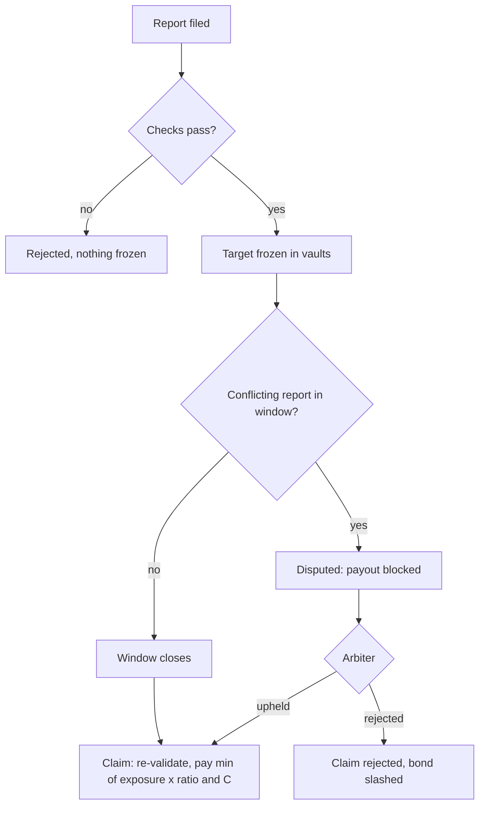
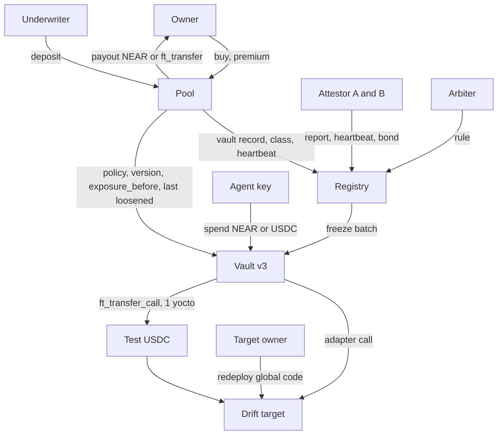
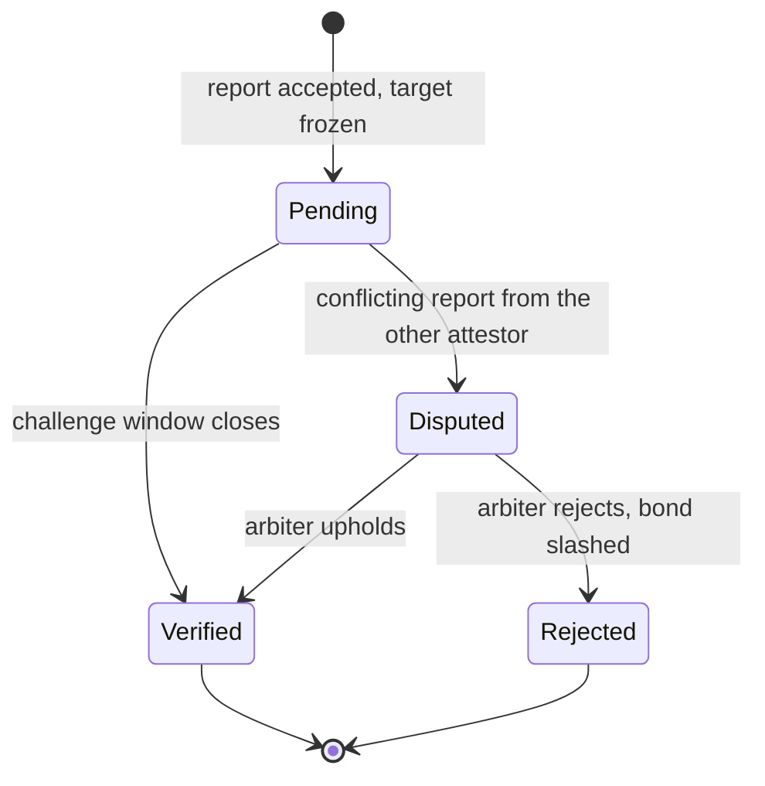

# Coverage Loop on Testnet - Plan

## Goal Capsule

- **Objective:** an owner can buy coverage, in NEAR or in USDC, on one agent's exposure to one target, at a price their agent's policy visibly moves. When that target's executed code changes without any transaction touching it, the owner is paid by a formula anyone can recompute. All of it runs on testnet, reproducibly, with every economic number labelled as an assumption.
- **Means:** a fresh coverage stack on testnet (registry, factory, pool, a new vault version) plus an attestor daemon, proven by sandbox tests and one scripted testnet run (KTD1, KTD2).
- **Product authority:** `docs/CONTRACTS.md` (registry, pool, vault), `docs/ATTESTOR.md`, `docs/BUILD-PLAN.md` Stage 7 acceptance, `docs/PRODUCT.md`. This plan records only its deltas from them. The surrounding areas (agent spend through SDK/MCP, indexer, migration, simulation, ABI types) are not active scope here. CLAUDE.md hard rules bind every unit.
- **Product Contract preservation:** changed: R7 — `term` clarified as the UTC days the window can touch, and AE1's numbers updated to match (confirmed by the user before planning).
- **Execution profile:** contracts first, then the attestor, then end-to-end proof; sandbox before testnet. Testnet transactions only.
- **Stop conditions:** stop and report if a vault build imports any scanned host function, if the vault would need near-sdk `Promise` or a full-access key, if a NEAR behavior the plan depends on cannot be verified in the sandbox, or if testnet funds are insufficient for the publish.
- **Open blockers:** none for planning. Testnet funding is a dependency (see Dependencies / Assumptions).

---

## Product Contract

### Summary

A pool with one book per token takes underwriter capital and sells per-target coverage to vault owners, priced from the target's class and the agent's daily cap. A bonded attestor reports code changes to the registry, the target is frozen in every subscribed vault, and after a challenge window the pool pays the owner from recorded exposure. A second attestor identity and an arbiter make disputes real. One scripted testnet run and a sandbox test per rule prove it.

### Problem Frame

Aruna's thesis is that a tighter agent policy means lower maximum exposure, which means a cheaper premium, and that a change in a target's code pays out from exposure recorded before the change. Today neither half exists outside the docs: `contracts/pool`, `packages/attestor` and the registry's drift path are empty, the vault spends only NEAR, and its exposure is one running total per target with no history. A judge or an agent-as-a-service client can verify Measurement and Protection, but the layer that turns them into a priced, transferable risk is a claim. The class this layer matters most for, `global_by_account`, is also the one where the change is invisible to `view_account.code_hash`, so the loop has to detect what ordinary monitoring cannot.

### Actors

- A1. Owner (the client): holds the vault, buys coverage, pays the premium, receives payouts.
- A2. Operator (the AaaS company): runs agents within the owner's ceiling; never pays or receives coverage money in this plan.
- A3. Agent: a function-call key on the vault that spends NEAR or USDC through named adapters.
- A4. Underwriter: deposits capital into one token book and withdraws it after lockup.
- A5. Attestor (two identities, A and B): bonded accounts that watch targets and file signed drift reports and heartbeats.
- A6. Arbiter: a designated account that rules on disputed reports.
- A7. Target owner: the account that publishes the global contract a target runs, and can redeploy it.

### Requirements

**Tokens and books**

- R1. Coverage, premiums, underwriter capital, payouts and recorded exposure are always denominated in the same token, either NEAR or USDC; no price conversion exists anywhere.
- R2. The pool keeps one book per token, and capital adequacy (`total coverage ≤ k × capital`) and concentration limits are enforced per book.
- R3. The vault can hold USDC, receive it, let agents spend it through a named adapter, and return it only to the owner, with the same containment it has for NEAR: an agent still cannot move a token itself.
- R4. The owner's ceiling and each agent's policy carry separate limits per token.
- R5. USDC on testnet is a test NEP-141 token Aruna deploys and can mint; every account that holds or moves it in the run (vault, pool, owner, underwriter, and the USDC adapter target) is registered for storage before the run starts.

**Pricing: policy to price**

- R6. Coverage is bought per target: one agent, one target, one token, a sum insured `C`, a payout ratio, and a term.
- R7. The premium is a function of the target's class, `C`, the payout ratio, the term, and the agent's `daily_cap` in that token, through the maximum reachable payout `min(daily_cap × days × payout_ratio, C)`, where `days` is the number of UTC days the coverage window can touch; `max_per_tx` is not an input, and `max_risk_class` is only a gate on whether coverage can be bought.
- R8. `P(event | class)`, `k`, the concentration limits and every loading are declared parameters shown next to each quote and labelled as underwriting assumptions.
- R9. A premium quote is a free read that returns the price and every input it used, so anyone can recompute it.
- R10. Coverage records the agent's policy version and the policy figures it was priced on; a claim is rejected if the agent's policy was loosened at any time after purchase, while tightening keeps the coverage valid.

**Purchase**

- R11. Only the owner of a factory-registered vault with a known code hash buys coverage, and the premium is paid by the owner into the book of the coverage's token.
- R12. Purchase is refused when it would breach capital adequacy, a concentration limit (per code hash, per global contract owner, per upgrade authority), or when the target's assigned attestor's heartbeat is stale.
- R13. Coverage cannot pay for a change before its waiting period ends.

**Drift reports and freeze**

- R14. A drift report names the target, the claimed `changed_at_block`, both code refs, both resolved code hashes, the channel, the attestor, a nonce and an expiry, and is signed over all of them.
- R15. The registry rejects a report that is forged, expired, replayed, signed for different fields, has identical resolved hashes, comes from an attestor without a live bond, or claims a `changed_at_block` outside `[report_block - MAX_LOOKBACK, report_block]`.
- R16. An accepted report freezes the target at once, before its challenge window closes; the freeze is pushed to subscribed vaults in batches, and a vault the push misses learns of it at its next class refresh.
- R17. A frozen target is refused by every vault for new spends (`ARUNA_TARGET_FROZEN`); a spend already in flight is not stopped.
- R18. A second, conflicting report on the same target and window from the other attestor identity marks the report `Disputed`.

**Claims and payout**

- R19. No payout is made before the challenge window closes, and none while a dispute is open.
- R20. The arbiter rules on a disputed report: upheld lets the claim proceed; rejected rejects the claim and slashes the reporting attestor's bond.
- R21. Payout is `min(exposure_before(changed_at_block) × payout_ratio, C)`, paid to the owner from the coverage's token book, with the arithmetic and every input returned alongside the result.
- R22. The vault records exposure per agent, target and token as checkpoints, so the pool can ask for exposure recorded before a given block; the pool accepts that answer only from factory-registered vaults with a known code hash.
- R23. At payout time the pool re-validates the coverage window, the waiting period, the exposure cut-off at `changed_at_block` (not the report block), the remaining limit, the dispute state, and R10; a failed check rejects the claim and records the reason.
- R24. Underwriter capital stays locked until the coverage it backs has expired, its claim reporting period has passed, and every pending claim and challenge window is closed.

**Attestor**

- R25. The attestor watches all four drift channels, including `DeployGlobalContract` on a global contract's owner, using `@aruna/classifier-core` and no second classification engine.
- R26. Each attestor identity posts a bond and a regular heartbeat; both are public and readable by anyone.
- R27. A golden test vector shared by the contract and the attestor fixes the signed report bytes, so the two cannot drift.

**Demonstration and disclosure**

- R28. One scripted testnet run executes the whole loop end to end without manual steps, prints every transaction link, and fails loudly if any step does not produce its expected result.
- R29. The run shows two quotes for the same target, token, `C`, ratio and term, differing only in `daily_cap`, where the tight policy's maximum reachable payout is below `C` and the loose policy's is not, so the two premiums differ by the ratio of their reachable payouts.
- R30. The covered target's code change in the run is real: the target runs a global contract by account, its owner redeploys, and the target's `view_account.code_hash` does not change.
- R31. The README states both trust assumptions (attestor and arbiter) and states that, with one attestor, a single party can freeze any covered target at any time, bounded only by its bond and the arbiter's slashing, as a deliberate trade-off.
- R32. Waiting period, challenge window, lookback, heartbeat staleness and lockup use short testnet values so one run completes in one session, each labelled as a testnet parameter.

### Key Flows

- F1. Underwrite
  - **Trigger:** an underwriter wants exposure to one token's book.
  - **Actors:** A4
  - **Steps:** deposit capital in NEAR or USDC; capital counts toward that book's adequacy; withdrawal is refused while locked.
  - **Covered by:** R2, R24
- F2. Quote and buy
  - **Trigger:** the owner wants coverage on an agent's exposure to one target.
  - **Actors:** A1, A3 (its policy is the input)
  - **Steps:** read a free quote with its inputs; optionally tighten the agent's `daily_cap` and re-quote; pay the premium in the coverage's token; the pool checks adequacy, concentration and heartbeat, then records the coverage with the policy version.
  - **Covered by:** R6–R13, R29
- F3. Spend and record
  - **Trigger:** an agent acts.
  - **Actors:** A3
  - **Steps:** the agent spends NEAR or USDC through a named adapter; the vault records an exposure checkpoint for agent, target and token.
  - **Covered by:** R3, R4, R22
- F4. Change, report, freeze
  - **Trigger:** the target owner redeploys the global contract the target runs.
  - **Actors:** A7, A5
  - **Steps:** the attestor sees the change on the owner's channel; files a signed report; the registry checks it and freezes the target; vaults refuse new spends to it.
  - **Covered by:** R14–R17, R25, R30
- F5. Clean claim
  - **Trigger:** the challenge window closes with no dispute.
  - **Actors:** A1
  - **Steps:** the owner claims; the pool asks the vault for exposure before `changed_at_block`, re-validates, and pays from the token's book with the arithmetic shown.
  - **Covered by:** R19, R21–R23
- F6. Dispute
  - **Trigger:** the second attestor identity files a conflicting report inside the window.
  - **Actors:** A5 (both), A6, A1
  - **Steps:** the report becomes `Disputed`; payout is blocked; the arbiter rules; upheld proceeds to F5, rejected ends the claim and slashes the bond.
  - **Covered by:** R18–R20



### Acceptance Examples

- AE1. **Covers R7, R29.** **Given** a `local_upgradeable` target, `C` = 10 NEAR, ratio 80%, and a 5-day window that touches 6 UTC days. **When** the agent's `daily_cap` is 5 NEAR, the reachable payout is `min(5 × 6 × 0.8, 10)` = 10, full price. **When** it is 1 NEAR, the reachable payout is `min(1 × 6 × 0.8, 10)` = 4.8, and the premium is 48% of the first. **Then** the run prints both and fails if they are equal.
- AE2. **Covers R7.** **Given** the same coverage, **when** only `max_per_tx` is lowered, **then** the quote is unchanged.
- AE3. **Covers R10, R23.** **Given** coverage bought at policy version 3, **when** the owner raises the agent's `daily_cap` and later lowers it back, **then** a claim on that coverage is rejected with a reason naming the loosening.
- AE4. **Covers R15.** **Given** a report whose before and after resolved hashes match, **then** it is rejected and nothing is frozen.
- AE5. **Covers R19, R18.** **Given** an accepted report, **when** the owner claims before the window closes, or while the report is `Disputed`, **then** the claim is refused and the reason recorded.
- AE6. **Covers R21, R22.** **Given** exposure of 3 NEAR recorded before `changed_at_block` and 2 NEAR recorded after it but before the report, ratio 80%, `C` = 10, **then** the payout is 2.4 NEAR, not 4.
- AE7. **Covers R1, R2.** **Given** a USDC coverage, **then** its premium enters the USDC book and its payout leaves the USDC book, and the NEAR book's capital does not count toward it.
- AE8. **Covers R12.** **Given** the target's assigned attestor's last heartbeat is older than the staleness bound, **then** a new purchase on that target is refused.
- AE9. **Covers R22.** **Given** an exposure answer from a vault the factory did not create, **then** the pool rejects the claim.

### Key Decisions

- **Per-token books, no oracle.** Paying a USDC claim from NEAR exposure would need a price feed, a third trust assumption. Governs R1–R5. (session-settled: user-directed — chosen over NEAR-only coverage: coverage must cover the token the agent actually spends.) (session-settled: user-approved — chosen over a USDC pool priced against NEAR exposure: that needs an oracle.)
- **Coverage is per target, so price follows `daily_cap`.** The docs' `Coverage` already names one agent and one target; under that shape `max_per_tx` cannot change reachable exposure and `max_risk_class` cannot change a known target's class. Governs R6, R7. The alternative, per-agent coverage across `allowed_targets`, would make `max_risk_class` and the class mix of the targets price inputs; it is deferred.
- **A loosened policy voids the claim rather than repricing it.** Repricing needs the pool to charge more after the fact; rejecting is checkable from recorded policy history and closes the buy-tight-then-loosen attack. Governs R10, R23.
- **Two attestor identities, both run by Aruna on testnet.** Without a second identity no report can become `Disputed`, so the dispute acceptance could not run; both being Aruna's is stated, not hidden. Governs R18, R20, R26.
- **Freeze at report time.** Waiting for the window would let agents keep spending into a changed target; the cost is the single-attestor freeze power R31 discloses. Governs R16, R31.
- **One new vault version for every vault change in this plan.** Vaults are immutable and each publish is a new global contract; USDC handling, exposure checkpoints, policy versions and freeze receipt ship together. Governs R3, R4, R10, R22.

### Scope Boundaries

- Mainnet, real USDC, and any coverage holding real value: excluded until release gate B.
- An attestor independent of Aruna, and attestor quorums: deferred; gate B requires the first.
- The operator paying premiums for a client: deferred; the owner is always the payer here.
- Per-agent coverage across all of an agent's targets: deferred (see Key Decisions).
- Deriving `k`, the concentration limits and `P(event)`: belongs to the simulation area; values here are labelled parameters.
- Bugs or exploits in Aruna itself: never covered (`docs/CONTRACTS.md`, "Not covered").
- Any `apps/web` surface, including the frontend premium model in micro-USDC, which will not match the contract until the frontend team adopts R7's inputs.

<!-- ce-section: work-relationships -->
### How This Work Fits Together

This plan covers the coverage loop only. The broader breakdown below is the current understanding, not a committed roadmap.

- Agent spend through SDK and MCP vault tools: can proceed independently of this plan; shares the vault version this plan defines.
- Indexer: depends on this plan's events for exposure and claim history.
- Migration between vault versions: enables moving demo vaults onto this plan's vault version.
- Simulation: still to decide its inputs; it derives the values R8 declares.
- ABI-generated types: can proceed independently.

### Dependencies / Assumptions

- Already satisfied: T5–T9 are recorded in `docs/NEAR-FACTS.md` §10; the mainnet class distribution is in `measurement/REPORT.md`; a global contract publish was measured on testnet at 23.649 NEAR for 236,478 bytes (`docs/SELF-CLASSIFICATION.md`).
- Testnet funding: the new vault version's publish (estimated near 30 NEAR, since the vault grows), pool capital in both books, two attestor bonds and the demo vault's deposit exceed the ~37 NEAR left on `arunafi.testnet`. The holder of `arunafi.testnet` tops it up before the testnet run; faucet grants are small, so this takes several requests or a funded account.
- The demo target for R30 can reuse the pattern of `fx-guser.arunafi.testnet` and `fx-gowner.arunafi.testnet` (`fixtures/README.md`), with a target that also accepts the vault's adapter calls.

### Outstanding Questions

**Deferred to Planning**

- Which account is the arbiter and which accounts are the two attestor identities on testnet.
- The exact testnet values for R32 and the declared parameters in R8.
- How the vault exposes policy history so the pool can check R10.
- How the USDC adapter target behaves (a swap-like fixture paying back the vault in USDC is the starting assumption).

### Sources / Research

- `docs/CONTRACTS.md` — registry drift reports, freeze propagation, pool, premium, payout, "Not covered".
- `docs/ATTESTOR.md` — report shape, lifecycle, what the contract can and cannot enforce, payout checks.
- `docs/BUILD-PLAN.md` — Stage 7 acceptance list; release gates A and B.
- `docs/NEAR-FACTS.md` §2 — an agent key cannot attach the 1 yoctoNEAR NEP-141 transfers need, which is why R3 routes USDC through the vault.
- `contracts/vault/src/spend.rs` — the current NEAR-only `swap` adapter and single running exposure total that R3 and R22 replace.
- `contracts/registry/src/lib.rs` — the `frozen` field reserved for the drift path.

---

## Planning Contract

### Key Technical Decisions

- KTD1. **A fresh coverage stack, the v0 stack left untouched.** The deployed factory fixes its registry at init and the registry's state shape changes, so a new registry, factory and pool are deployed under new names; `demo2.factory.arunafi.testnet`, `examples/` and README steps 1–11 keep working against the old stack. Governs R11, R22.
- KTD2. **One new vault version carries every vault change.** Per-token limits, FT custody and adapter, exposure checkpoints, policy history and freeze receipt ship in one build, published once as a global contract by hash. It keeps CLAUDE.md rules 5, 9 and 11: named adapters only, refusals return, and low-level `env::promise_*` calls for FT transfers with the 1 yoctoNEAR the vault attaches itself. Governs R3, R4, R10, R17, R22.
- KTD3. **Chain time is block height everywhere.** Coverage windows, waiting period, challenge window, lookback, heartbeat staleness and lockup are block counts, because `changed_at_block` and exposure checkpoints are blocks. For R7's `days`, the pool converts the window with a declared, deliberately low `BLOCKS_PER_DAY` assumption (fewer blocks per day means more days, so the price errs high) and adds one day for a window that starts mid-day. The real testnet block rate is measured and recorded next to the assumption.
- KTD4. **The attestor infers the channel from state differences.** A changed local code hash is `deploy_contract`; a ref that moved from local to global, or between globals, is `use_global_contract`; an unchanged `global_account` ref whose resolved hash changed is `deploy_global_contract`; any other resolved-hash change is `resolved_code`. It reads no transactions. `docs/ATTESTOR.md` is updated to say so. Governs R25.
- KTD5. **`changed_at_block` is the earliest block not ruled out.** Without archival bisection the attestor claims the block after its last unchanged observation, which never counts exposure recorded after the change; detection lag equals the polling interval. Bisection over historical RPC reads is an execution-time improvement only if the testnet endpoint serves them. Governs R14, R21.
- KTD6. **Signed bytes are one canonical encoding, fixed by a golden vector.** The registry verifies with `env::ed25519_verify` (present in near-sdk 5.30.1) over the hash of a borsh encoding of every R14 field; the attestor signs the same bytes with `node:crypto`. A committed vector file is asserted by both test suites. The attestor's signing key is registered separately from its account, so a key can rotate without invalidating past reports (`docs/DECISIONS.md` D-30). Governs R14, R15, R27.
- KTD7. **The registry class record gains the resolved code hash and the upgrade authority.** Concentration (R12) needs both. The authority is the global contract owner for `global_by_account` and the target itself otherwise. The classifier writer in `fixtures/tools.mjs` supplies them from the engine's evidence. A target whose record lacks them cannot be covered.
- KTD8. **Freeze is pushed to every factory-registered vault, in batches anyone can call.** The registry does not know vault ceilings; a vault ignores a freeze for a target outside its ceiling. A vault the push misses still learns through `refresh_class`, because the registry's class record carries `frozen`. Governs R16.
- KTD9. **A slashed bond goes to the pool's NEAR book as capital.** The docs name no destination; the book is the party exposed to a bad report.
- KTD10. **The pool reads the vault, never trusts the caller.** At purchase the pool fetches the agent's policy and policy version from the vault itself; at claim it fetches exposure-before and the last-loosened block from the vault. It accepts either answer only from a vault the new registry recorded with an allowed code hash. The pool may use near-sdk `Promise`; rule 11 binds only the vault. Governs R10, R11, R22, R23.
- KTD11. **Test USDC and the drift target are Aruna fixtures.** The token uses `near-contract-standards` 5.30.1 fungible token with an owner-only mint. The drift target is one contract that swaps NEAR and, through `ft_on_transfer`, USDC, always paying back its caller less 0.5%; v1 and v2 builds differ only in `version()`. It is published as a global contract by account under a target-owner account, so redeploying v2 is the real change R30 asks for. Governs R5, R30.

### High-Level Technical Design

Contract topology and calls in the loop:



Drift report lifecycle in the registry:



Claim checks, in order, all at payout time (R23), directional:

```text
claim(coverage, report):
  report state is Verified                      else refuse: window open / disputed / rejected
  report.target == coverage.target
  waiting_end <= changed_at_block <= coverage end
  vault.last_loosened(agent) < coverage start   else reject: policy loosened
  e = vault.exposure_before(agent, target, token, changed_at_block)
  payout = min(e * ratio, C - paid_so_far)      pay from coverage.token book
```

### Assumptions

- The sandbox (nearcore 2.14, protocol 88) supports global contracts by account and `ed25519_verify`, as the lab's global-contract tests already exercised the former.
- One claim's cross-contract chain (pool → registry → vault → payout) fits within one transaction's gas, with callbacks.
- Exposure checkpoints are appended only on settlement, so their count per key grows with settled spends; within testnet runs this is small, and the bound is noted as a risk.

### Risks

| Risk | Mitigation |
|---|---|
| The new vault build pulls in a scanned host function through an FT helper | `aruna imports` on the build is a gate in U3's verification; FT calls use `env::promise_create` only |
| Publishing the vault costs more than the ~37 NEAR left | Measure the wasm size after U3; top up before U9; do not publish twice |
| Testnet RPC rate limits stall the attestor or the demo | Reuse `@aruna/rpc` endpoint rotation; demo waits on finality, not fixed sleeps |
| Callback chains in claim or FT spend strand a reservation or a premium | Callbacks never panic, as in `cb_settle`; sandbox tests force each failure branch |
| Timeline: four days for the whole loop | Units are ordered so the sandbox loop (U1–U7) is complete before testnet work; testnet can fall back to NEAR-only coverage if USDC on testnet blocks, recorded as a gap |

---

## Implementation Units

### U1. Shared coverage types, parameters and the signing payload

**Goal:** one definition of tokens, drift reports, coverage records, testnet parameters and the canonical signed bytes, used by registry, pool, vault and attestor.

**Requirements:** R1, R8, R14, R27, R32

**Dependencies:** none

**Files:**
- `contracts/common/src/lib.rs`, `contracts/common/src/coverage.rs`, `contracts/common/src/drift.rs`
- `fixtures/golden/drift-report.json`
- `contracts/common/src/drift.rs` tests

**Approach:**
- A token identifier with two cases, NEAR and an FT contract account.
- The R14 report fields, the report states from the HTD, and a function producing the canonical bytes (KTD6).
- Testnet parameters as named constants, each documented as a testnet value or an underwriting assumption: waiting period, challenge window, lookback, heartbeat staleness, claim reporting period, `BLOCKS_PER_DAY`, `P(event)` per class in basis points, `k`, concentration limits, loadings.
- New refusal reasons, if any, go through the reason-parity test in `packages/sdk/test/reasons.test.ts`.

**Patterns to follow:** `contracts/common/src/reasons.rs` and `class.rs` for serde naming; `aruna_common::emit` for events.

**Test scenarios:**
- The canonical bytes of the golden vector's report equal the bytes stored in `fixtures/golden/drift-report.json`.
- Changing any single field (target, either ref, either resolved hash, nonce, expiry, channel, attestor, changed block) changes the bytes.
- Token identifiers round-trip through JSON in the form the TypeScript side expects.

**Verification:** common builds and its tests pass; the golden file exists and is referenced by U4 and U6.

### U2. Test USDC and the drift target fixtures

**Goal:** a mintable test NEP-141 token and a target that accepts NEAR and USDC swaps from the vault and can be redeployed as v2 under its global owner.

**Requirements:** R5, R30

**Dependencies:** none

**Files:**
- `fixtures/contracts/usdc/` (new crate), `fixtures/contracts/drift-target/` (new crate, v1 and v2 by build feature)
- `fixtures/contracts/Cargo.toml`
- `fixtures/wasm/usdc/`, `fixtures/wasm/drift-target/v1/`, `fixtures/wasm/drift-target/v2/`
- `fixtures/README.md`

**Approach:** per KTD11. The target pays output only to the caller (NEAR) or the `sender_id` (USDC), never to an argument. Commit built wasm like the existing fixtures.

**Patterns to follow:** `fixtures/contracts/swap/src/lib.rs`; `fixtures/deploy.sh` for global-by-account deployment.

**Test scenarios:**
- A NEAR swap returns the input less 0.5% to the caller and fails below `min_amount_out`.
- An FT transfer-call with a valid swap message pays the sender back less 0.5% and reports the full amount used.
- An FT transfer-call with a malformed message returns the whole amount as unused.
- `version()` returns `v1` or `v2` according to the build.
- Mint is refused for any account other than the token owner.

**Verification:** both crates build; the v1 and v2 wasm hashes differ; fixture tests pass.

### U3. Vault v3

**Goal:** the vault holds and spends USDC alongside NEAR, records exposure history, exposes policy history, and accepts freezes from its registry.

**Requirements:** R3, R4, R10, R17, R22 (KTD2)

**Dependencies:** U1, U2

**Files:**
- `contracts/vault/src/lib.rs`, `agents.rs`, `spend.rs`, `class_cache.rs`, `roles.rs`, new `tokens.rs`, new `exposure.rs`
- `contracts/vault/src/tests.rs`
- `contracts/vault/res/aruna_vault.wasm` (v2 moved to `res/aruna_vault-v2.wasm` first, keeping its hash reproducible)

**Approach:**
1. Ceiling and policy carry per-token limits; the ceiling also lists accepted tokens. Budgets and reservations are per agent and token.
2. `ft_on_transfer` accepts deposits only from listed token contracts; `withdraw_to_owner` gains a token argument and still pays only the owner.
3. A second named adapter, `ft_swap`, sends `ft_transfer_call` to the token with 1 yoctoNEAR attached by the vault; its callback reads the used amount, settles that much, and releases the rest.
4. Settlement appends a checkpoint per agent, target and token; a view returns exposure recorded before a block.
5. Each policy change bumps the agent's policy version; a loosening also records its block (the existing `loosens` check decides).
6. A registry-only method marks a cached target frozen.

**Execution note:** after each step that touches promises, build and run `aruna imports` on the wasm; stop if `scannedPresent` is not empty.

**Patterns to follow:** `contracts/vault/src/spend.rs` (`check_and_reserve`, `cb_settle` never panicking), `agents.rs` `loosens`, `class_cache.rs` `assert_self`.

**Test scenarios:**
- A spend in USDC is checked against the USDC limits only; a NEAR limit at zero does not block it.
- An agent's USDC spend over its USDC `daily_cap` returns `ARUNA_DAILY_CAP_EXCEEDED` and counts toward auto-disable.
- `ft_on_transfer` from a token not in the ceiling refunds the whole amount.
- An FT spend whose target uses only part of the amount settles that part and releases the remainder of the reservation.
- An FT spend whose transfer fails releases the reservation and records no exposure.
- Covers AE6. Checkpoints at blocks 10 (3 NEAR) and 20 (2 NEAR): exposure before 15 is 3, before 25 is 5, before 5 is 0.
- Raising `daily_cap` bumps the version and records a loosening block; lowering it bumps the version only.
- The freeze method from any account other than the registry panics; from the registry it makes the next spend to that target return `ARUNA_TARGET_FROZEN`.
- Withdrawal of USDC by the operator panics; by the owner it pays only the owner.
- Every existing role and spend test in `tests.rs` still passes with the per-token shape.

**Verification:** vault unit tests pass; the wasm imports none of the six scanned host functions; the vault code contains no near-sdk `Promise`.

### U4. Registry v2: attestors, drift reports, freeze, disputes

**Goal:** the registry accepts and enforces drift reports from bonded attestors, freezes targets, runs disputes through the arbiter, and records vault versions and enriched class records.

**Requirements:** R12 (heartbeat side), R14–R20, R26 (KTD6, KTD7, KTD8, KTD9)

**Dependencies:** U1

**Files:**
- `contracts/registry/src/lib.rs`, new `contracts/registry/src/attestors.rs`, new `contracts/registry/src/drift.rs`
- `contracts/registry/src/tests.rs` (new)
- `contracts/registry/res/aruna_registry.wasm`

**Approach:**
1. Attestors register with a bond attached, a signing key and later key rotation; heartbeats record the block; the owner assigns each target an attestor and names the arbiter and the pool.
2. `report_drift` runs every R15 check, stores the report as Pending, sets the class record frozen, and emits an event.
3. A second report on the same target inside the window from a different attestor, with a different `changed_at_block` or after hash, moves the first to Disputed.
4. Anyone may push a freeze batch to registered vaults (KTD8); the arbiter rules on disputes; rejection slashes the bond to the pool (KTD9).
5. Views return a report's state, accounting for the window having closed.
6. Vault code hashes allowed for coverage are an owner-maintained list.

**Patterns to follow:** existing classifier-set authorization in `contracts/registry/src/lib.rs`; `aruna_common::emit`.

**Test scenarios:**
- Covers AE4. A report with identical resolved hashes is rejected and the target stays unfrozen.
- A report whose `changed_at_block` is older than the lookback bound is rejected; one at exactly the bound is accepted.
- A forged signature, an expired report, a replayed nonce, and a valid signature over different fields are each rejected.
- A report from an account with no bond, or after its bond was slashed, is rejected.
- An accepted report freezes the target; `get_class` shows `frozen: true`.
- The report state reads Pending before the window closes and Verified after, with no transaction in between.
- A conflicting report from the second attestor moves the first to Disputed; the same attestor reporting again does not.
- The arbiter upholding makes it Verified; rejecting makes it Rejected and moves the bond to the pool; a non-arbiter ruling panics.
- A freeze batch with a start index and a limit reaches only that slice of vaults.
- Covers AE8 (registry side). A heartbeat older than the staleness bound reads as stale.
- Signature verification accepts the golden vector from `fixtures/golden/drift-report.json`.

**Verification:** registry unit tests pass, including the golden vector.

### U5. Pool

**Goal:** per-token books that take capital, sell priced coverage with every purchase check, and pay claims after re-validation.

**Requirements:** R1, R2, R6–R13, R19, R21–R24 (KTD3, KTD10)

**Dependencies:** U1, U3, U4

**Files:**
- `contracts/pool/Cargo.toml`, `contracts/pool/src/lib.rs`, `books.rs`, `pricing.rs`, `coverage.rs`, `claims.rs`, `tests.rs`
- `contracts/Cargo.toml` (workspace member)
- `contracts/pool/res/aruna_pool.wasm`

**Approach:**
1. Books per token: NEAR deposits attach value; USDC deposits and premiums arrive through `ft_on_transfer` with a message naming the action.
2. A pure quote view implements R7 under KTD3 and returns every input and declared parameter.
3. Purchase is owner-only for that vault and gathers the vault record, class record and heartbeat from the registry and the policy from the vault (KTD10). It refuses `unknown` targets (D-14), a class above the agent's `max_risk_class`, adequacy or concentration breaches, and a stale heartbeat. It then records the coverage with the policy version and the figures priced.
4. A claim follows the HTD's check order, records the reason on rejection, and pays NEAR by transfer or USDC by `ft_transfer`.
5. Withdrawal is refused while lockup (R24) holds.
6. Callbacks refund a premium whose purchase checks failed.

**Patterns to follow:** `contracts/factory/src/lib.rs` for `Promise` chains with a `#[private]` callback that refunds on failure.

**Test scenarios:**
- Covers AE1. Quotes for `daily_cap` 5 and 1 NEAR with `C` 10, ratio 80%, a window touching 6 days: reachable payouts 10 and 4.8, premium ratio 48%.
- Covers AE2. Two policies differing only in `max_per_tx` quote the same.
- A `max_risk_class` below the target's class refuses purchase; at or above it allows it at an unchanged price.
- Purchase for an `unknown` target is refused.
- Purchase that would push the book over `k` × capital is refused; one just under is accepted.
- Purchase that would exceed the concentration limit for one resolved code hash is refused even when the targets are different accounts.
- Covers AE7. A USDC purchase's premium raises only the USDC book; a NEAR deposit does not count toward USDC adequacy.
- A purchase by the operator or a stranger is refused; the premium is returned.
- Covers AE5. A claim against a Pending or Disputed report is refused with the reason recorded.
- Covers AE3. A claim after the policy was loosened and tightened back is rejected.
- Covers AE6. Exposure before `changed_at_block` of 3 NEAR, ratio 80%, `C` 10 pays 2.4 NEAR.
- A change inside the waiting period is rejected; a second claim cannot exceed the remaining limit.
- Covers AE9. A claim whose vault is not in the registry, or runs a code hash not allowed, is rejected.
- Underwriter withdrawal during lockup is refused and succeeds after it.

**Verification:** pool unit tests pass; the integration tests in U7 exercise the cross-contract paths.

### U6. Attestor daemon

**Goal:** `@aruna/attestor` watches assigned targets on all four channels with the shared engine, files signed reports and heartbeats, and can file the conflicting report the dispute path needs.

**Requirements:** R14, R25, R26, R27 (KTD4, KTD5, KTD6)

**Dependencies:** U1, U4

**Files:**
- `packages/attestor/package.json`, `tsconfig.json`, `src/index.ts`, `src/watch.ts`, `src/report.ts`, `src/sign.ts`, `src/submit.ts`
- `packages/attestor/test/watch.test.ts`, `packages/attestor/test/sign.test.ts`
- `packages/attestor/README.md`

**Approach:**
1. Each poll classifies each target with `@aruna/classifier-core` over `@aruna/rpc` and keeps the last observation per target in a local state file outside the repo.
2. A difference becomes a report per KTD4 and KTD5; heartbeats go on a fixed interval; transactions go through near-api-js signed by the attestor's account key, while reports are signed with the separate attestor key (KTD6).
3. A command files a deliberately conflicting report from the second identity, for the dispute run.
4. Keys are read from `~/.near-credentials`, never the repo.

**Patterns to follow:** `fixtures/drift-demo.mjs` for reading both hashes; `packages/cli/src/index.ts` for the CLI shape; `examples/lib.ts` for near-api-js signing.

**Test scenarios:**
- A local code hash change yields `deploy_contract` with both resolved hashes.
- A `global_account` target whose ref is unchanged and resolved hash changed yields `deploy_global_contract`.
- A local-to-global move yields `use_global_contract`.
- No change yields no report; a failed RPC read yields no report and no state update.
- `changed_at_block` equals the last unchanged observation plus one.
- The signer reproduces the golden vector's signature bytes from its fixed test key.

**Verification:** attestor tests pass; `--help` lists watch, heartbeat and dispute commands.

### U7. Sandbox integration: the whole loop and every Stage 7 rule

**Goal:** prove the loop and each acceptance rule on a local sandbox before testnet.

**Requirements:** R1–R24, R30; BUILD-PLAN Stage 7 acceptance

**Dependencies:** U2, U3, U4, U5

**Files:**
- `contracts/integration/src/lib.rs` (extend the environment helper with the coverage stack)
- `contracts/integration/tests/coverage.rs`, `contracts/integration/tests/drift.rs`
- `contracts/integration/Cargo.toml`

**Approach:** extend the existing `Env` with test USDC, the drift target as a global contract by account, pool, two attestor identities and an arbiter; fast-forward blocks for windows. Report signing in the tests uses the golden vector's scheme.

**Patterns to follow:** `contracts/integration/tests/spend.rs` and its fast-forward test; `lab/owed` hand-signing helper reached through `contracts/integration/src/lib.rs`.

**Test scenarios:**
- Covers F2–F5. NEAR loop: underwrite, quote twice, buy at the tight price, wait, agent swaps on the target, the target owner redeploys v2 (target `code_hash` unchanged), report, freeze refuses the next spend, window closes, claim pays `min(exposure × ratio, C)`.
- Covers AE7. The same loop in USDC pays from the USDC book.
- Covers F6. A conflicting report from attestor B blocks the claim; arbiter upholds and the claim pays; in a second run the arbiter rejects and the bond moves to the pool.
- Covers AE8. With attestor A's heartbeat stale, a new purchase on its target is refused.
- A vault the freeze batch skipped refuses the target after `refresh_class`.
- A spend already sent before the report settles normally.
- Exposure recorded between `changed_at_block` and the report block does not count toward the payout.

**Verification:** integration tests pass from a clean build of every contract.

### U8. SDK and MCP read the new vault shape

**Goal:** `readVault` and `aruna_read_vault` read both the v2 and v3 vault shapes, including per-token limits and exposure.

**Requirements:** R4 (read side), R22 (read side)

**Dependencies:** U3

**Files:**
- `packages/sdk/src/vault-view.ts`, `packages/sdk/test/vault-view.test.ts`
- `packages/mcp/src/tools.ts`, `packages/mcp/test/tools.test.ts`

**Approach:** detect the shape from `get_config`; v2 maps to a single NEAR limit set. Exposure lists entries per token.

**Patterns to follow:** the existing old-version handling in `readVault` for vaults without `get_exposure`.

**Test scenarios:**
- A v2 config reads as NEAR-only limits, as today.
- A v3 config with NEAR and USDC limits reads both, and the MCP summary names each token's limits.
- Exposure per token lists NEAR and USDC entries separately.

**Verification:** SDK and MCP tests pass; `aruna_read_vault` on `demo2.factory.arunafi.testnet` still answers.

### U9. Testnet deployment, the demo run, and the docs

**Goal:** the coverage stack is live on testnet and one command runs the whole loop with every transaction link, and the docs say what is now true.

**Requirements:** R5, R28, R29, R30, R31, R32

**Dependencies:** U6, U7, U8

**Files:**
- `scripts/testnet-coverage-setup.sh`
- `examples/coverage-demo.ts`, `examples/README.md`
- `fixtures/tools.mjs` (class-args with code hash and authority, KTD7)
- `README.md` (new numbered step, trust assumptions, freeze trade-off sentence)
- `docs/CONTRACTS.md`, `docs/ATTESTOR.md`, `docs/DECISIONS.md` (new entries for KTD1–KTD11 that change settled text), `docs/SELF-CLASSIFICATION.md` (vault v3), `docs/BUILD-PLAN.md` (Stage 7 checklist)

**Approach:**
1. The setup script deploys the fresh stack, publishes vault v3 once, deploys the token and the target under its owner, registers NEP-145 storage for every R5 account, classifies the target into the registry, registers both attestors with bonds, and funds the books.
2. The demo script runs F1–F5 against a new demo vault and prints a link per step, failing loudly on any unexpected result. It runs the dispute path (F6) when asked.
3. The attestor runs as a separate process during the demo.
4. The recorded run goes into `examples/README.md`.
5. The vault v3 demo vault is classified with the CLI and must read `immutable_verified`.

**Execution note:** dry-run the whole script against the sandbox environment from U7 before spending testnet NEAR.

**Patterns to follow:** `scripts/testnet-setup.sh` (idempotent steps, keychain signing), `examples/injected-agent.ts` (recorded output with links).

**Test scenarios:**
- Covers AE1, R29. The demo prints two different premiums and exits non-zero if they are equal.
- Covers R30. Before and after the redeploy the demo prints the target's `view_account.code_hash` (unchanged) and resolved hash (changed).
- A second run of the setup script changes nothing that already exists.

**Verification:** the demo completes on testnet; the README step's command proves each claim it makes; secret scan is clean.

---

## Verification Contract

| Gate | Command | Applies to |
|---|---|---|
| TypeScript build, tests, types | `pnpm -r build`, `pnpm -r test`, `pnpm -r typecheck` | U6, U8, U9 |
| Contract unit tests | `cargo test -p aruna-common -p aruna-vault -p aruna-registry -p aruna-pool` in `contracts/` | U1, U3, U4, U5 |
| Fixture tests | `cargo test` in `fixtures/contracts/` | U2 |
| Wasm builds | `cargo near build non-reproducible-wasm --no-abi` per contract and fixture | U2–U5 |
| Vault import gate | `node packages/cli/dist/index.js imports contracts/vault/res/aruna_vault.wasm` shows `"scannedPresent": []` | U3 |
| Sandbox loop | `cargo test -p aruna-integration -- --nocapture --test-threads 2` in `contracts/` | U7 |
| Reason parity | `packages/sdk/test/reasons.test.ts` passes after any new reason | U1 |
| Testnet loop | `node examples/coverage-demo.ts` completes with links | U9 |
| Self-classification | `node packages/cli/dist/index.js classify <v3 demo vault> --network testnet` reads `immutable_verified` | U9 |
| Secrets | `pnpm secret-scan` clean | all |

---

## Definition of Done

- Every unit's verification holds, and every Stage 7 acceptance item in `docs/BUILD-PLAN.md` maps to a passing test in U4, U5 or U7.
- AE1–AE9 each have a passing test that cites them.
- The testnet demo run is recorded with transaction links, and the README step that points to it runs from a fresh clone.
- README steps 1–11 still pass against the v0 stack.
- The vault v3 wasm imports no scanned host function, uses no near-sdk `Promise`, and the demo vault has no full-access key.
- `lab/` is unchanged; no key, seed phrase or `.env` is committed.
- Code from abandoned attempts is removed from the diff.
