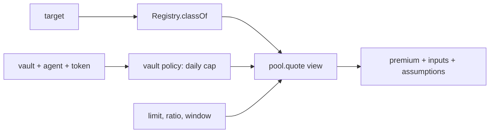

# SDK and MCP, complete - Plan

## Goal Capsule

- **Objective:** an agent developer or an integrator can do everything Aruna offers from `@aruna/sdk` and `@aruna/mcp` alone: measure a target, spend through a vault, see the price of coverage that policy implies, and (as the owner) buy and claim coverage. Each of those is proven against real testnet contracts, and `docs/SDK.md` and `docs/MCP.md` describe exactly what exists.
- **Means:** Registry and Pool clients and an owner coverage client in the SDK, a keyless `watch` on `Classifier`, a coverage quote in the SDK and in MCP, TypeScript types generated from the contract ABIs, then one testnet proof on a fresh pool and vault v4 (KTD1 to KTD6).
- **Product authority:** `docs/SDK.md`, `docs/MCP.md`, `docs/CONTRACTS.md`, `docs/DECISIONS.md` (D-54 to D-63 for coverage). CLAUDE.md hard rules bind every unit.
- **Product Contract preservation:** none upstream (bootstrap). The user confirmed the scope in this session; see Carrying Forward below.
- **Execution profile:** types first, then read clients, then owner actions, then MCP, then docs, then the live proof. Everything before U7 needs no testnet funds.
- **Stop conditions:** stop and report if coverage purchase would become reachable from an agent key or from MCP, if a client would reimplement a classification check, or if testnet funds are short for U7 (U7 then waits; U1 to U6 stand alone).
- **Open blockers:** none for U1 to U6. U7 needs about 40 NEAR of testnet top-up from the user.

---

## Product Contract

### Summary

The SDK gains the coverage half it lacks today (registry, pool, owner actions) and a keyless `watch`. MCP gains read-only coverage tools and a quote. Types come from the ABI, so a changed contract signature breaks the SDK build. A live run on testnet shows the same calls work against deployed contracts, not only the sandbox.

### Problem Frame

The vault half of the SDK and MCP is finished: three role clients, refusals as results, version checks, four agent tools. The coverage half exists only as ad hoc calls inside `examples/coverage-demo.ts`. So the product's headline chain, policy to price to payout, cannot be reached by an integrator. `docs/MCP.md` also promises a premium impact in `aruna_simulate` that is not built, and `docs/SDK.md` lists `Classifier.watch`, `Registry` and `Pool` clients that do not exist. Hand-written clients for those would drift from the contracts silently, which is the failure `docs/SDK.md` says the ABI step exists to prevent.

### Carrying Forward (session-settled)

- Coverage purchase is an owner action, never reachable by an agent key or by MCP (project rule). Chosen over exposing it to agents.
- Coverage is per token with no price conversion (D-54). Chosen over one quote currency.
- MCP creates no keys and has no free-form `(target, method, args)` path (docs/MCP.md).
- Indexer, migration, pool simulation, apps/web, public repo, hosting and submission are out of this plan.
- Priority order was SDK/MCP first; the user confirmed this plan's scope, including pulling ABI types forward.

### Requirements

- **R1.** Types for the vault, registry and pool method arguments and results are generated from each contract's ABI at build time, and the SDK clients use them. A contract signature change fails the SDK build or a test.
- **R2.** A keyless `Registry` client reads a target's class record, a drift report by id, and the latest report for a target.
- **R3.** A keyless `Pool` client reads a token's book, a coverage by id, an underwriter's shares, and the coverages of an owner or a vault.
- **R4.** A coverage quote composes the target's recorded class, the agent's daily cap for the token (from the vault policy), and the pool's `quote` view, returning the premium with every input and labelled assumption the contract returns. It never invents a limit, ratio or window.
- **R5.** An `OwnerCoverage` client buys coverage in NEAR (attached deposit) and in a fungible token (`ft_transfer_call`), and starts a claim. A contract refusal resolves as `{ ok: false, reason }`; an authorization failure throws. Neither client is constructible from an agent key's transport.
- **R6.** `Classifier.watch(target)` returns the resolved code hash, the channels the classifier read, whether the target changed since the registry's recorded hash, and the latest drift report if any. It reuses the classifier engine and adds no check of its own.
- **R7.** MCP exposes read-only coverage tools: a quote, a pool book, a coverage, a drift report. `aruna_simulate` accepts an optional coverage shape and then also returns its quote. No tool buys, claims, or holds a key.
- **R8.** `docs/SDK.md` and `docs/MCP.md` state what is built, with no claim that lacks a command or test that proves it.
- **R9.** On testnet, the SDK runs a full loop on a fresh pool and a vault v4: quote, buy, drift, claim, and an agent spends through MCP against the real vault.

### Success Criteria

- A stranger can follow `examples/` and the README to quote, buy and claim coverage using only `@aruna/sdk`, with no copy of the demo's ad hoc calls.
- Every R has a passing test or a recorded testnet transaction.

### Scope Boundaries

- **Not in this plan:** the indexer (so a coverage list is a client-side scan), migration of existing vaults, pool simulation, apps/web, the public repo, hosting, the demo video and submission.
- **Considered and not built:**
  - A pool view that lists an owner's coverages: a client scan over `coverage_count` is enough on testnet; evidence that would change this is a pool with more than a few hundred coverages, which is the indexer's job.
  - A slippage guard on `buyCoverage`: the contract already refunds the excess and refuses a changed class, so nothing is lost; the quote is shown before the call.
  - Per-agent premium impact inside plain `aruna_simulate`: price depends on a limit, ratio and window a spend does not fix, and the pool does not index coverage by agent (KTD4).
- **Deferred to follow-up work:** an owner-facing MCP profile (buy and claim behind an explicit owner key), if the user wants one after this plan.

---

## Planning Contract

### Key Technical Decisions

- **KTD1. Types come from `cargo near abi`, committed, with a drift test.** Each contract's ABI JSON is committed under `contracts/<name>/res/`, TypeScript types are generated from it into `packages/sdk/src/generated/`, and a test fails when the committed types do not match the committed ABI. A verification gate re-runs `cargo near abi` and diffs. Chosen over hand-written types (silent drift) and over generating at install time (breaks offline builds). Needs the `abi` feature path to work for our common types; if it does not, U1 stops and reports (see Risks).
- **KTD2. Coverage lives in one new entry point, `@aruna/sdk/coverage`.** Read clients are keyless and take a read transport; `OwnerCoverage` takes a signing transport. The keyless root entry stays signer-free, as for `@aruna/sdk/vault`.
- **KTD3. Refusals come from receipt logs.** A refused purchase refunds and emits `coverage_refused` with a reason in a callback receipt; the return value carries no reason. So `CallResult` gains the logs of every receipt in the outcome, and the clients parse the aruna events from them. Chosen over inferring a refusal from the refund amount.
- **KTD4. Premium impact is a quote, asked for explicitly.** `quote` takes a limit, a payout ratio and a window, and `aruna_simulate` accepts them as optional input and then includes the quote. This differs from `docs/MCP.md`, which promised it unconditionally; R8 updates that text. Chosen over defaulting a limit and window, which would invent numbers.
- **KTD5. `watch` reuses the classifier, not the attestor.** `check()` already returns the resolved hash and the channel evidence; `watch` adds the registry's recorded hash and latest report. The attestor daemon's `observe` stays in the attestor package (hard rule 10 and the zero-dependency rule for the core).
- **KTD6. The live proof is the last unit and can wait.** It needs the vault v4 publish and a fresh pool (the review changed the pool's stored records, so an in-place redeploy cannot work). It may be run after the user tops up; U1 to U6 do not depend on it.

### Output Structure

    packages/sdk/src/coverage/        registry.ts, pool.ts, quote.ts, owner.ts, index.ts
    packages/sdk/src/generated/       vault.ts, registry.ts, pool.ts   (generated, committed)
    packages/mcp/src/coverage-tools.ts

### High-Level Technical Design

The quote is the one place three sources meet, so it is worth drawing.

### Implementation Units

### U1. Types from the ABI

**Goal:** the vault, registry and pool method shapes come from the contracts.
**Requirements:** R1.
**Dependencies:** none.
**Files:** `contracts/common/Cargo.toml`, `contracts/vault/Cargo.toml`, `contracts/registry/Cargo.toml`, `contracts/pool/Cargo.toml` (abi feature if needed), `contracts/vault/res/aruna_vault.abi.json`, `contracts/registry/res/aruna_registry.abi.json`, `contracts/pool/res/aruna_pool.abi.json`, `scripts/gen-abi-types.mjs`, `packages/sdk/src/generated/*.ts`, `packages/sdk/package.json`, `packages/sdk/test/abi-drift.test.ts`.
**Approach:**
- Produce the ABI per contract, commit it, and write a small generator that turns each ABI's function list and schemas into TypeScript argument and result types.
- Add a `gen:types` script and a test asserting the committed types equal the generator's output for the committed ABI.
- Point the existing role clients' method names and argument shapes at the generated types where this removes a hand-written duplicate; leave behavior unchanged.
**Execution note:** try `cargo near abi` on the pool first, since it has the most custom types; its result decides whether the generator can depend on a schema library or needs a minimal mapper.
**Patterns to follow:** the `res/` wasm layout; `packages/sdk/src/reasons.ts` and its parity test for "a test asserts the sets match".
**Test scenarios:**
- Happy path: regenerating from the committed ABI yields byte-identical files.
- Error path: editing one committed ABI entry makes the drift test fail with the function name.
- Integration: the vault client's `spend` argument type is the generated one, and a deliberate rename in the ABI fails `typecheck`.
**Verification:** `pnpm --filter @aruna/sdk typecheck test` passes, and a fresh `cargo near abi` per contract equals the committed ABI.

### U2. Registry and Pool read clients

**Goal:** an integrator reads the coverage state without the demo's ad hoc code.
**Requirements:** R2, R3.
**Dependencies:** U1.
**Files:** `packages/sdk/src/coverage/registry.ts`, `packages/sdk/src/coverage/pool.ts`, `packages/sdk/src/coverage/transport.ts`, `packages/sdk/src/coverage/index.ts`, `packages/sdk/package.json` (new export `./coverage`), `packages/sdk/test/coverage-read.test.ts`.
**Approach:**
- A narrow `ReadTransport` with one `view` method; `nearViewTransport({ network, rpcUrl })` is a keyless implementation, and the existing signing transport satisfies it too.
- `Registry`: `classOf`, `report(id)`, `latestReport(target)`.
- `Pool`: `book(token)`, `coverage(id)`, `shares(account, token)`, and `coverages({ owner | vault })` as a bounded client scan over `coverage_count`.
- Surface `ReportState` and coverage fields with the contract's names, amounts as strings.
**Patterns to follow:** `packages/sdk/src/vault/clients.ts` for transports and error classes; `vault-view.ts` for string amounts.
**Test scenarios:**
- Happy path: `classOf` for a recorded target returns class, hash and authority; for an unrecorded target returns null, not a throw.
- Happy path: `coverages({ owner })` over three stored coverages returns only that owner's, in id order.
- Edge case: an empty pool returns an empty list without a view call per missing id.
- Edge case: `latestReport` returns the effective state (a closed window shows `verified`).
- Error path: an RPC failure throws `ArunaRpcError`, never a partial list.
**Verification:** tests pass with a fake transport; U7 later runs them against testnet.

### U3. Coverage quote

**Goal:** the price a policy implies, from the three sources, with every input shown.
**Requirements:** R4.
**Dependencies:** U2.
**Files:** `packages/sdk/src/coverage/quote.ts`, `packages/sdk/test/coverage-quote.test.ts`.
**Approach:**
- `quoteCoverage({ target, vault, agent, token, limit, payoutRatioBps, windowBlocks })`: read the class from the registry, the agent's per-token daily cap through `readVault`, call the pool `quote`.
- Return the contract's `Quote` untouched plus `inputs` naming where each came from; a target with no class record, or an agent with no daily cap for the token, resolves as a refusal result with a reason, never a zero premium (D-61 / the review's free-coverage finding).
**Patterns to follow:** refusals as results in `vault/clients.ts`; D-54 to D-63.
**Test scenarios:**
- Happy path: for a `global_by_account` target and a known daily cap, the premium equals the pool view's output and `inputs` lists class, daily cap, and the three caller values.
- Edge case: a token the agent has no budget for returns a refusal naming that, not a quote.
- Edge case: an unrecorded target returns a refusal.
- Edge case: the vault runs a version without per-token policy (v1/v2): NEAR is quoted from the legacy fields, an FT token refuses.
- Integration: the quote equals the number the sandbox `buy_coverage` charges for the same inputs (reuse an integration fixture; no second pricing implementation).
**Verification:** tests pass; the SDK contains no pricing arithmetic.

### U4. Owner coverage client

**Goal:** the owner buys and claims through the SDK.
**Requirements:** R5.
**Dependencies:** U1, U3.
**Files:** `packages/sdk/src/coverage/owner.ts`, `packages/sdk/src/vault/transport.ts` (logs on `CallResult`), `packages/sdk/src/vault/near-transport.ts`, `packages/sdk/test/coverage-owner.test.ts`.
**Approach:**
- `OwnerCoverage.buy({ …request, token })`: NEAR through `buy_coverage` with the quoted premium attached; an FT through `ft_transfer_call` on the token with the `buy` message and 1 yoctoNEAR.
- Parse aruna events from every receipt's logs (KTD3); a `coverage_refused` event becomes `{ ok: false, reason }`, a purchase becomes `{ ok: true, coverageId, premium }`.
- `claim(coverageId, reportId)` attaches at least the contract's minimum gas, taken from the shared parameter, and returns the paid amount from the claim event or a refusal.
- The client takes a signing transport and refuses, at construction, a signer that is a registered vault (an agent key signs as the vault), checked with the registry's vault record; a test shows an agent-key transport is rejected. The contract's own owner check remains the real gate.
**Execution note:** write the event-parsing test from the real log strings the sandbox tests print, not from imagined ones.
**Test scenarios:**
- Happy path: a NEAR purchase returns the new coverage id and the premium charged.
- Happy path: an FT purchase moves the token and returns the coverage id.
- Error path: a refused purchase (stale class, class too loose, no capacity) resolves `{ ok: false, reason }` and the refund is visible; nothing throws.
- Error path: a non-owner caller throws `ArunaAuthError`.
- Edge case: a claim with too little gas is refused by the SDK before sending.
- Integration: sandbox buy then claim after a drift report returns the paid amount the contract computed.
**Verification:** sandbox-backed test passes; the construction check test passes and `buyCoverage`/`OwnerCoverage` appear only under `packages/sdk/src/coverage/`.

### U5. `Classifier.watch`

**Goal:** the keyless "has it changed" answer, with the registry's record beside it.
**Requirements:** R6.
**Dependencies:** U2.
**Files:** `packages/sdk/src/classifier.ts`, `packages/sdk/test/classifier-watch.test.ts`.
**Approach:**
- `watch(target)` runs `check`, then, when a `Registry` is supplied, compares the evidence's resolved hash with the recorded one and attaches the latest report. Without a registry it returns the live view only, and says so.
**Test scenarios:**
- Happy path: the resolved hash and channels match `check()`'s evidence.
- Edge case: recorded hash differs from live, so `changedSinceRecorded` is true and the latest report is attached.
- Edge case: no registry supplied returns `registry: "not consulted"`.
- Edge case: an unclassifiable target returns the classifier's own refusal, not a throw.
**Verification:** tests pass; `git grep` shows no new classification logic in the SDK.

### U6. MCP coverage tools and quote in simulate

**Goal:** an agent reads prices and coverage state, and can see a price beside a simulation.
**Requirements:** R7.
**Dependencies:** U2, U3.
**Files:** `packages/mcp/src/coverage-tools.ts`, `packages/mcp/src/agent-tools.ts`, `packages/mcp/src/index.ts`, `packages/mcp/test/coverage-tools.test.ts`, `packages/mcp/test/agent-tools.test.ts`.
**Approach:**
- Keyless tools: `aruna_coverage_quote`, `aruna_pool_book`, `aruna_coverage`, `aruna_drift_report`, registered with the existing keyless set.
- `aruna_simulate` gains optional `coverage` (limit, payout ratio, window) and, when given, returns the quote beside the verdict.
- A test lists every registered tool name and fails if any contains `buy`, `claim` or `key`.
**Patterns to follow:** `registerAgentTools` in `agent-tools.ts`; refusals are successful results.
**Test scenarios:**
- Happy path: each tool returns structured content matching the SDK type.
- Happy path: `aruna_simulate` with a coverage shape returns verdict and quote; without it, as before.
- Error path: an unknown target returns a refusal result, not a tool error; an RPC failure is a tool error.
- Integration: the server started with no vault env exposes only keyless tools; with the env, also the four agent tools.
**Verification:** `pnpm --filter @aruna/mcp test typecheck` passes.

### U7. Live proof on testnet

**Goal:** show the same calls work on deployed contracts.
**Requirements:** R9.
**Dependencies:** U1 to U6; the user's NEAR top-up.
**Files:** `examples/coverage-demo.ts` (move onto the SDK clients), `scripts/testnet-coverage-setup.sh` (vault v4, fresh pool), `examples/mcp-smoke.mjs`, `examples/README.md`, `README.md`.
**Approach:**
- Publish vault v4 and deploy a fresh pool; redeploy the registry in place. Record the new hashes and accounts in the script's header.
- Rewrite the demo's coverage calls with the SDK; keep its drift and attestor steps.
- `mcp-smoke.mjs` starts the built server with a real agent key against the real vault and calls `aruna_simulate`, `aruna_spend`, `aruna_coverage_quote` through the MCP protocol.
- Follow README steps 1 to 12 from a clean clone and fix what breaks.
**Execution note:** testnet transactions only; stop if funds are short.
**Test expectation:** none new; this unit is the run itself, recorded with transaction links.
**Verification:** the demo completes with links, the smoke script prints the three results, `pnpm secret-scan` is clean.

### U8. Docs aligned with what exists

**Goal:** `docs/SDK.md` and `docs/MCP.md` say what is built.
**Requirements:** R8.
**Dependencies:** U1 to U6 (U7 adds links).
**Files:** `docs/SDK.md`, `docs/MCP.md`, `docs/DECISIONS.md`, `docs/BUILD-PLAN.md`.
**Approach:**
- Mark each documented method as built or not, add "As built" for coverage, replace the unconditional premium-impact line with KTD4's explicit-shape rule and record it in `DECISIONS.md`.
**Test expectation:** none -- documentation; a final grep checks every method named in SDK.md is exported.
**Verification:** the grep passes and a reader can run each documented command.

---

## Risks and Dependencies

- **`cargo near abi` may not work on our types.** The pool and common types use custom serializers. Mitigation: U1 tries the pool first; if the abi feature cannot be satisfied, U1 stops and reports, and the fallback is a generated method table from the contract source plus tests, decided with the user.
- **Refusal reasons live in logs.** If a receipt's logs are truncated or absent on some RPC providers, a refusal could look like success. Mitigation: U4 also checks the refund amount, and a test covers a missing event.
- **Client scan for coverages** is linear. Accepted for testnet, recorded under Considered and not built.
- **Funds for U7.** About 40 NEAR; the user tops up. Nothing else depends on it.
- **A vault v4 not yet on testnet** means `aruna_simulate` works only in tests until U7.

## Verification Contract

| Gate | Command | Applies to |
|---|---|---|
| Build, types, tests | `pnpm -r build`, `pnpm -r typecheck`, `pnpm -r test` | all |
| ABI parity | `cargo near abi` per contract equals the committed ABI | U1 |
| Contracts unchanged in behavior | `cargo test -p aruna-pool -p aruna-registry -p aruna-vault` in `contracts/` | U1 |
| Sandbox coverage tests | `cargo test -p aruna-integration` in `contracts/` | U3, U4 |
| No purchase on agent surfaces | MCP tool-name test (U6) and a grep for `buyCoverage` outside `@aruna/sdk/coverage` | U4, U6 |
| Live loop | `examples/coverage-demo.ts`, `examples/mcp-smoke.mjs` | U7 |
| Secrets | `pnpm secret-scan` | all |

## Definition of Done

- R1 to R9 each have a passing test or a recorded testnet transaction.
- No pricing, classification or purchase logic exists in the SDK beyond calls to the contracts and the classifier engine.
- `docs/SDK.md` and `docs/MCP.md` match the exported surface.
- `lab/` and `apps/web` are unchanged; no key or `.env` is committed.
