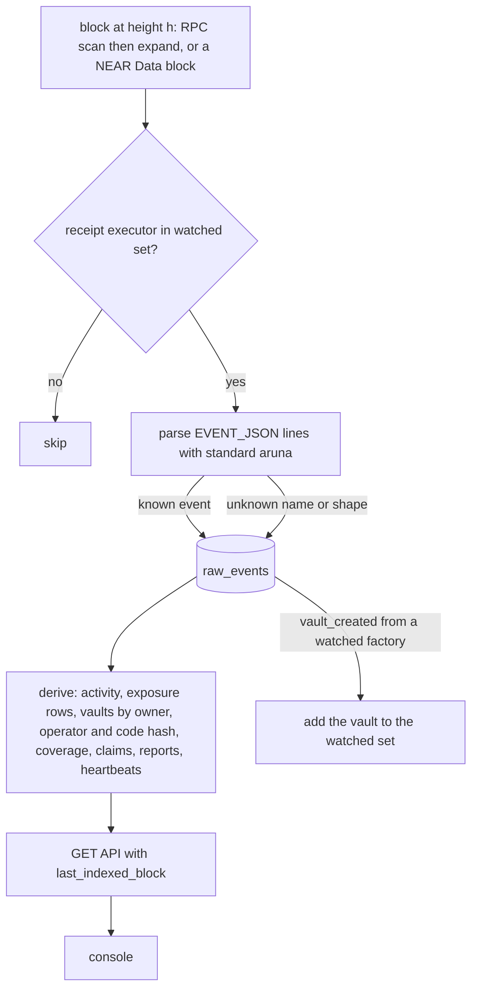
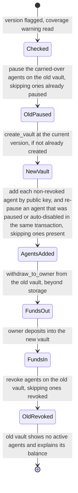
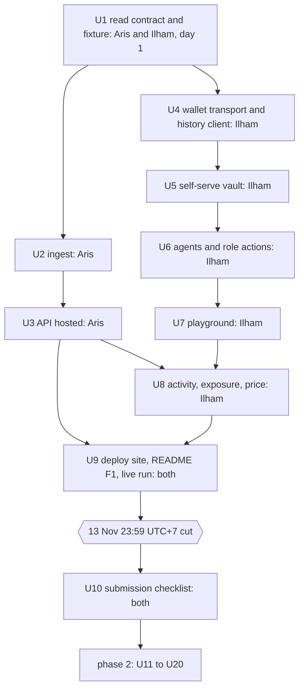

# Live console, indexer, migration and pool simulation - Plan

## Goal Capsule

- **Objective:** anyone with a funded testnet wallet can experience Aruna end to end in the browser, on real contracts: create their own vault, add an agent, watch an injected agent get refused and auto-disabled, see that in the vault's history, and see the premium move when the policy tightens. After v0, owners, operators and underwriters can also buy and claim coverage, supply capital, follow targets and attestors, migrate a vault to a newer version and read a pool solvency simulation, all from the console with nothing mocked.
- **Scope:** BUILD-PLAN stages 5, 6 and 8 together. The core flow (F1) ships in release v0 on 14 November 2026. Everything else follows v0.
- **Product authority:** `docs/BUILD-PLAN.md` (acceptance criteria for stages 5, 6 and 8), `docs/FRONTEND.md` (non-negotiables, amended by R44), `docs/CONTRACTS.md`, `docs/DECISIONS.md`, and the hard rules in `CLAUDE.md`, which bind every requirement here.
- **Means:** a hosted indexer reading the public testnet block archive (KTD1–KTD5), the SDK's role clients behind a wallet transport and a browser agent-key transport (KTD6, KTD7), a resumable migration shared by the CLI and the console (KTD10), and an offline simulation checked against the pool's own numbers (KTD11).
- **Execution profile:** two developers in parallel. Aris owns lane A (indexer, contracts, CLI, SDK orchestration, sim). Ilham owns lane B (console). U1 is done together first, so both lanes build against the same read contract from day one. Phase 1 units (U1–U10) are v0; phase 2 units (U11–U20) follow v0.
- **Who finishes:** each lane's owner lands their units. Both run U9 and U10 together. Shipping v0 means the submission in U10, not a merge.
- **Product Contract preservation:** changed: R2 (rebuild from chain data, including factory `create_vault` arguments) and R36 (pause carried-over agents first). Both were approved in document review, to keep the indexer able to list vaults by operator and to stop a key spending on two vaults. Otherwise restructured, no scope change. The "Parallel work" table names the two developers, and the Outstanding Questions answered by research are resolved in place: event source → KTD1, registry mapping → KTD9, migration without a vault change → KTD10, test USDC funding → KTD15, browser key storage → KTD7.
- **Stop conditions:** stop and report if the core flow needs a contract change, if any path gives an agent key or the console a free-form call, if the console would reimplement a classification check, or if testnet funds are short for a publish.
- **Open blockers:** the hosting account for the indexer and the static site must exist on day one (U3, U9). The judging end date for R48 is still to be supplied, and it does not block the start.

---

## Product Contract

### Summary

The console in `apps/web/console` stops using mock data. It reads current state and sends every owner, operator and underwriter action through `@aruna/sdk` and the connected wallet, and it reads history from a new hosted indexer with a public API. A visitor creates their own vault through the factory, adds agents whose keys are made in the browser, and runs honest and injected scenarios from the playground. Migration between vault versions (stage 6) and the pool simulation (stage 8) are built in the same plan and surface in the same console.

### Problem Frame

Aruna's claims about the vault and coverage are proven today on a sandbox, by scripts in `examples/`, and on testnet accounts that only the project owner controls. Every console screen except Lookup and the public agent page runs on canned data (`apps/web/src/console/data/*-mock.ts`), and README step 5b says so. A judge or a prospective AaaS customer cannot check for themselves, from the browser, that an injected agent is stopped by the contract, that exposure is recorded with the target's class, or that a tighter policy is cheaper to cover. To see any of that, they have to clone the repo, install Rust and Node, and run scripts against vaults they cannot act on.

There is no pilot customer yet. The first users are the hackathon judges, whose screening is done by Claude Code and Codex following the README, and the project owner. So the browser experience and the README steps that prove it are the product's first impression.

History cannot be read from RPC per page load (D-31), and `packages/indexer` is empty. Stage 5's "each exposure row carries the class at the time it was recorded" is unmet on chain, since vault checkpoints hold only (block, cumulative). However, the `exposure_recorded` event already carries the class (`contracts/vault/src/spend.rs:261`). Vaults are immutable, so the vaults already deployed can never be patched. Without migration tooling (stage 6), a fix to the vault strands every owner on the old version. `k` and the concentration limit are still labelled ASSUMPTION in `contracts/common/src/params.rs`, and the console's simulation screen runs a prototype model in the browser (`apps/web/src/console/data/simulation.ts`), not `@aruna/sim`.

### Actors

- A1. Visitor: a judge or anyone holding a funded testnet wallet. In the core flow they are the owner and the operator of a vault they create.
- A2. Owner (client): holds the funds, sets the ceiling, resumes auto-disabled agents, withdraws, buys and claims coverage, migrates.
- A3. Operator (AaaS company): adds agents within the ceiling, pauses, revokes, tightens. It cannot loosen, resume an auto-disabled agent, change the owner or withdraw.
- A4. Agent: a function-call key on the vault. Either held in the visitor's browser and driven by the playground, or held by a program using `examples/` or the MCP server.
- A5. Underwriter: supplies and withdraws pool capital and reads the pool's exposure.
- A6. Indexer: the hosted service that records every Aruna event and serves history. It holds no keys.
- A7. Attestor and arbiter: they exist already and run as they do today. The console only reads them.
- A8. Project owner: runs the indexer, the demo vaults and the testnet deployments.

### Key Decisions

- **Stages 5, 6 and 8 are one plan.** Governs R35–R43. (session-settled: user-directed — chosen over planning stage 5 alone, and over building only the migration and simulation screens with stages 6 and 8 planned separately: the user wants the console complete with nothing mocked, with the deadline tradeoff in view.)
- **The core flow F1 ships in v0, before 14 November 2026, 23:59 UTC; the rest follows v0.** Governs R46. (session-settled: user-directed — chosen over submitting v0 as it is and over a read-only slice: the user wants judges to run the flow themselves.)
- **History comes from the hosted indexer from v0 on, not from the transactions a tab sent.** Governs R1–R8, R24. (session-settled: user-directed — chosen over showing session-only activity in v0 with the indexer added later: one architecture from the start, with the uptime and deadline risk accepted.)
- **The indexer runs as a hosted service with a public read API; the console stays a static site that calls it.** Governs R6, R9. (session-settled: user-approved — chosen over a static snapshot regenerated by a command, and over running both: actions taken in the console must show up in history without a rebuild.)
- **The class on each exposure row comes from the `exposure_recorded` event, through the indexer; no new vault version for it.** Governs R3. (session-settled: user-approved — chosen over a vault v5 that stores the class in each checkpoint: no contract change, and it covers vaults already deployed. Accepted cost: a view-method reader without the indexer still sees only the latest class.)
- **The console sends every role's actions through the connected wallet.** Governs R13–R22, R28–R32, R36. (session-settled: user-directed — chosen over read-only, and over operator actions only.)
- **Visitors create their own vault through the factory.** Governs R15–R17. (session-settled: user-directed — chosen over visitors only watching a recorded demo, and over adding a visitor as operator of a demo vault.)
- **Agent keys can be made in the browser or brought from the CLI or MCP.** Governs R18–R19. (session-settled: user-directed — chosen over browser-only and over CLI-only: quick trial in the tab, real agents unchanged.)
- **The core flow is: connect wallet, create vault, add agent, injected agent refused and auto-disabled, refusal in history, premium moves when the policy tightens.** Governs R46. (session-settled: user-approved — proposed as the one flow that must survive any cut; the user confirmed it.)
- **A hard cut on 13 November 2026, 23:59 UTC+7.** Whatever state the core flow is in at that time, the remaining time goes to the submission checklist in `docs/BUILD-PLAN.md`. Governs R47.
- **The indexer covers every Aruna testnet deployment, earlier ones included** (`registry`, `factory`, `pool` and their vaults, as well as `registry2`, `factory2`, `pool2` and theirs), because README steps name `demo2` and `demo4`. Governs R1.
- **Visitor vaults are always created at the current vault version, from the current factory**, never on a version that lacks the fixes in `docs/AUDIT-v0.md`. Governs R15.
- **A visitor can only put targets the registry has already classified into a ceiling.** Only authorized classifiers write classes, and the console does not become one. Governs R16.
- **Migration keeps each agent's public key and policy, and does not move active coverage.** Agents running elsewhere only need the new vault id. Coverage stays bound to the vault it was bought for. Governs R39, R40.
- **The simulation runs offline and publishes its output; the console displays it.** The browser no longer runs a pool model. Governs R42, R43.
- **Derived `k` and concentration values are written to `docs/DECISIONS.md`, not into contract constants.** Locking them with no admin key is release gate B. Governs R43.

### How data reaches the console

```mermaid
flowchart TB
  CH[Testnet contracts: vaults, factory, registry, pool] -->|view calls, signed transactions| SDK[@aruna/sdk]
  CH -->|NEP-297 aruna events| IDX[Hosted indexer and public read API]
  CORE[@aruna/classifier-core] -->|live class and evidence| WEB[Static console in apps/web]
  SDK -->|current state, actions, refusals as results| WEB
  IDX -->|history, lists, last indexed block| WEB
  SIM[@aruna/sim, run offline] -->|published output| WEB
```

### Requirements

**Indexer (stage 5)**

- R1. The indexer records every NEP-297 event with `standard: "aruna"` emitted by Aruna's testnet contracts and by every vault their factories created, with its block height, timestamp, transaction and receipt.
- R2. One command rebuilds the indexer's whole store from an empty start using chain data alone (the Aruna events, plus the `create_vault` arguments of watched factories), and the rebuilt activity and exposure history match what was served before.
- R3. Every exposure row carries the agent, target, token, amount, running total, the target's class at the time it was recorded, the block and the transaction.
- R4. Events from every vault version (v1 to v4 and later) are parsed. An event of an unknown name or shape is kept raw and reported, never dropped silently.
- R5. The indexer never signs or sends a transaction and holds no keys.
- R6. The indexer is hosted and reachable from any browser origin with no login, for as long as R48 requires.
- R7. The public read API serves at least the following, and its contract is agreed and published before either lane builds against it:
  - activity per vault and per agent: allowed, refused with reason code and class at refusal, failed, auto-disabled, and status and policy changes
  - exposure rows per vault, target and agent
  - vaults by owner, by operator and by code hash
  - coverages and claims per vault and per pool
  - drift reports, freezes and heartbeats per target and per attestor
  - class changes per target
- R8. Every API response states the last block it has indexed.

**Console foundation**

- R9. The console stays a static export. The classifier page `/` stays backend-free, keyless and wallet-free (FRONTEND non-negotiable 1). Only `/console/` calls the indexer.
- R10. When the indexer is unreachable or behind, current state and every action still work through the SDK. History panels then say that history is unavailable and give the last indexed block they know. They do not show an empty list or an error.
- R11. The connected wallet's role on a vault is read from the vault's on-chain owner and operator, never from the indexer. The wallet's list of vaults comes from the indexer.
- R12. The console signs and sends on testnet only, and refuses to sign anything on mainnet.
- R13. Before every wallet prompt, the console shows the method, the vault, and any deposit to be attached.
- R14. Policy refusals are shown as normal outcomes with their reason code and the target's class, never as errors (FRONTEND non-negotiable 4). Authorization and transport failures are shown as failures.

**Self-serve vault**

- R15. A visitor can create a vault through the current factory, as owner, with themselves or another account as operator. Before signing, they see the required deposit. If their balance is short, they get a link to a testnet faucet and no transaction is sent.
- R16. When a ceiling is set at creation or later, the console offers only targets the registry has classified. Each is shown with its class and its evidence one click away (FRONTEND non-negotiable 5).
- R17. The owner can deposit NEAR into the vault from the console.

**Agents**

- R18. When the operator or owner adds an agent, the console can generate the keypair in the browser and register its public key with a policy inside the ceiling. The private key stays in that browser only, is labelled "testnet agent key, limited to this vault", and can be exported.
- R19. Instead of generating one, the operator can paste a public key. The console then shows the commands to drive that agent from `examples/` or through the MCP server.
- R20. The operator can pause, revoke and tighten from the console. The owner can additionally resume, loosen a policy, set or remove the operator, change the ceiling and withdraw.
- R21. Actions the connected role cannot take are shown disabled, each with the reason. For the operator this covers loosening, resuming an auto-disabled agent, changing the owner and withdrawing (FRONTEND surface 2).
- R22. The playground signs spends with a browser-held agent key and runs two scenarios. The honest scenario makes in-policy swaps. The injected scenario makes the same attempts as `examples/injected-agent.ts` and continues until the agent is auto-disabled on chain. Every attempt shows its outcome and reason code.
- R23. An agent whose key is not in this browser is shown as such, and the playground does not offer to sign for it.

**History, exposure and price (stage 5)**

- R24. Each vault and agent has an activity view from the indexer, covering every kind listed in R7, each entry linked to its transaction.
- R25. The exposure view shows current totals from the vault and per-row history from the indexer, with the class at record. It says that recorded exposure is what was sent, not the value of a position.
- R26. Exposure before a given block, from the vault's `exposure_before`, is readable in the console for any agent, target and token.
- R27. The owner's policy-to-price panel shows the premium from the pool's quote for the vault's real policy. Changing the daily cap or the riskiest class allowed moves the premium in the same view, beside every input and declared assumption. The panel is labelled "testnet, assumed numbers" until release gate B (FRONTEND non-negotiable 2).

**Coverage and claims**

- R28. The owner can buy coverage for an agent and target from the console, in NEAR and in the test USDC. The coverage's waiting period, window, ratio, limit and status are shown.
- R29. The owner can file a claim against a drift report. A claim refused during the challenge window, or because of a dispute, is shown as a normal outcome. A paid claim shows `min(exposure before the claimed block × ratio, remaining limit)` with each term.
- R30. The two trust assumptions, the attestor and the arbiter, are stated where coverage is bought (non-negotiable 7). A stale attestor heartbeat is visible wherever coverage is sold or displayed (non-negotiable 8).

**Pool and underwriter**

- R31. The underwriter view shows, per token book, capital deployed and locked, concentration per code hash and per upgrade authority against its limit, claims pending, disputed and paid, and whether each assigned attestor is alive.
- R32. An underwriter can deposit and withdraw capital from the console.

**Targets and attestor**

- R33. The targets view shows each target's live class and evidence from `@aruna/classifier-core`, its class in the registry, its class-change history, its drift reports with their status, and whether it is frozen. `local_upgradeable` always shows its basis, and `unknown` stays unknown (non-negotiables 6 and 9).
- R34. The attestor view shows each attestor's heartbeats, assigned targets and filed reports, read-only. Attestors keep acting through `packages/attestor`.

**Migration (stage 6)**

- R35. The registry maps a vault code hash to the vaults running it and their owners, readable on chain.
- R36. A CLI command and a console flow move a vault to the current version. The flow:
  1. pauses, on the old vault, every agent being carried over, so no key can spend on both vaults
  2. creates the new vault with the same owner, operator and ceiling
  3. re-adds every non-revoked agent with the same public key and policy
  4. moves the funds
  5. revokes the agents on the old vault
- R37. After a migration, the old vault has no active agents. The console shows its remaining balance and the reason, such as storage it must keep.
- R38. The SDK supports every published vault version and refuses an unknown code hash loudly. A new version is added to the SDK's known list in the same change that publishes it.
- R39. Before a migration starts, the owner is told that active coverage stays with the old vault and is not moved.
- R40. A vault on a version missing fixes in `docs/AUDIT-v0.md` is flagged in the console, with a link to migrate.

**Pool simulation (stage 8)**

- R41. `@aruna/sim` simulates 200 agents over 60 days across five scenarios: normal operation, one target changes, mass correlated claims, underwriter withdrawal, and insufficient capital. It applies the pool contract's own premium, adequacy and concentration rules.
- R42. Every input assumption is shown, and `P(event)` is named as an underwriting assumption. The outputs are ending capital, claims paid and unpaid, solvency ratio, maximum drawdown, probability of insolvency and time to insolvency. One scenario breaks the pool, and it is shown as it is. One command rebuilds every chart from raw data.
- R43. The console's simulation screen shows the published output of R42, and the in-browser prototype model is removed. The derived `k` and concentration limit are written into `docs/DECISIONS.md`.

**Docs and release**

- R44. `docs/FRONTEND.md` is amended: the console may generate testnet agent keys in the browser, under R18. `docs/BUILD-PLAN.md` records that stages 5, 6 and 8 are planned together, and records each stage's status.
- R45. Every new claim in the README has a numbered "do X, see Y" step with an expected result. That includes the self-serve flow, the indexer rebuild, migration and the simulation rebuild.
- R46. Release v0 contains F1 working on testnet for a visitor with a fresh wallet, plus R1–R18, R20–R25 and R27, and the README steps that prove them.
- R47. The v0 submission checklist in `docs/BUILD-PLAN.md` is completed before the deadline, whatever the state of R46: public repo, demo post, payout account, tracks, submission.
- R48. The indexer stays up at least until hackathon judging ends.

### Key Flows

- F1. Core flow (v0)
  - **Actors:** A1, A4, A6
  - **Steps:**
    1. Connect a testnet wallet.
    2. Create a vault with self as owner and operator (R15).
    3. Pick classified targets for the ceiling (R16) and deposit NEAR (R17).
    4. Add an agent with a browser-made key and a policy (R18).
    5. Run the injected scenario in the playground (R22): refusals arrive with reason codes until the agent is auto-disabled. Switching to the operator role shows "resume" disabled with its reason (R21). As owner, resuming works.
    6. Open the vault's activity: each refusal is there with its reason, class and transaction (R24).
    7. Open the policy-to-price panel and tighten the daily cap: the premium falls in the same view (R27).
  - **Covered by:** R11–R18, R20–R22, R24, R27

- F2. Agent run outside the browser
  - **Actors:** A3, A4
  - **Steps:** paste a public key and add the agent (R19); run `examples/` or the MCP server with the matching private key; the spends appear in the console's activity view.
  - **Covered by:** R19, R24

- F3. Coverage bought and claimed
  - **Actors:** A2, A7
  - **Steps:** quote and buy for an agent and target (R27, R28); the target changes and a report is filed; the target shows frozen (R33); a claim inside the challenge window is refused as a normal outcome; after the window, the claim is paid with its arithmetic shown (R29).
  - **Covered by:** R27–R30, R33

- F4. Underwriter
  - **Actors:** A5
  - **Steps:** read the books and their concentration (R31); deposit capital; withdraw within what is not locked (R32).
  - **Covered by:** R31, R32

- F5. Migration
  - **Actors:** A2
  - **Steps:** the console flags the vault's version (R40); the owner reads the coverage warning (R39) and confirms; the steps in R36 run, with each transaction shown before signing (R13); the old vault ends as R37 describes.
  - **Covered by:** R35–R40

- F6. Simulation published
  - **Actors:** A8
  - **Steps:** run the one command (R42); commit the output; the console's simulation screen shows it (R43); write the derived values to `docs/DECISIONS.md`.
  - **Covered by:** R41–R43

### Acceptance Examples

- AE1. **Covers R21, R22.** Given a visitor's vault with one browser-key agent, when the injected scenario runs, then each attempt returns a refusal such as `ARUNA_TARGET_NOT_ALLOWED`, the agent ends `Paused` with `auto_disabled: true`, the operator sees "resume" disabled with a reason, and the owner can resume it.
- AE2. **Covers R10.** Given the indexer is unreachable, when the visitor opens their vault, then the balance, agents and policy show and every action can be sent, and the activity panel says that history is unavailable, with the last indexed block known.
- AE3. **Covers R27.** Given an agent with a 2 NEAR daily cap, when the owner sets the cap to 1 NEAR in the panel, then the quoted premium falls in the same view, and the quote's inputs and assumptions are visible.
- AE4. **Covers R15.** Given a wallet holding less than the factory's required deposit, when the visitor tries to create a vault, then the console shows the required amount and a faucet link, and no transaction is sent.
- AE5. **Covers R18, R23.** Given an agent whose key was made in another browser, when the visitor opens the playground here, then that agent is marked "key not in this browser" and cannot be signed for, while revoking it and adding a new agent still work.
- AE6. **Covers R2, R3.** Given an indexer store wiped empty, when the rebuild command runs to the current block, then activity and exposure for `demo2.factory.arunafi.testnet` and `demo4.factory2.arunafi.testnet` match the rows served before the wipe, each exposure row with its class at record.
- AE7. **Covers R29.** Given a verified report whose challenge window is open, when the owner claims, then the refusal is shown as a normal outcome with its reason. After the window closes, the claim pays, and the console shows the exposure before the claimed block, the ratio, the remaining limit and their minimum.
- AE8. **Covers R36, R37, R39.** Given a vault with two active agents, one revoked agent and an active coverage, when the owner migrates, then they are told first that the coverage stays behind. The new vault then holds the two active agents with the same public keys and policies, the funds have moved, and the old vault shows no active agents and explains its remaining balance.
- AE9. **Covers R38.** Given a vault whose code hash the SDK does not know, when the console opens it, then it shows "unsupported vault version" with the hash, and no balances or actions.
- AE10. **Covers R4.** Given an event name the indexer does not recognise, when it is indexed, then it is stored raw and appears in the indexer's report of unparsed events, and every other event from the same receipt is still indexed.

### Success Criteria

- A stranger with a fresh testnet wallet, the deployed site and the README completes F1 without help.
- An action sent from the console appears in history within one minute while the indexer is healthy.
- A Claude Code or Codex run that follows the README's new steps gets every expected result.

### Parallel work

Two people can work in parallel along these lanes. Each item names its dependency. The read contract in R7 is written on day one and both lanes work against it. Until the indexer serves it, the console uses a fixture that follows the same contract, not the old mocks.

| Lane | Before v0 | After v0 | Depends on |
|---|---|---|---|
| A (Aris): backend (indexer, contracts, CLI, sim) | R7 contract; R1–R6 and R8 hosted; indexer README steps | R35 registry mapping, R36 CLI, R38 SDK versions; R41–R43 sim and published output | Event source (resolved: KTD1) |
| B (Ilham): console | R9–R18, R20–R25, R27, against the R7 fixture, then live | R19; R28–R34 coverage, pool, targets, attestor; R36 console flow, R37, R39, R40; R43 screen | R7 contract; SDK clients that already exist |
| Both | R45 steps for F1; R47 checklist after the cut | R44 docs; R45 steps for F2–F6 | |

Lane B needs no backend from lane A for current state or actions, because `@aruna/sdk` already has role clients, `readVault`, the coverage clients and the quote. Lane A's migration work has to land before lane B's migration flow can run end to end.

### Scope Boundaries

- Mainnet transactions of any kind. The console stays testnet-only (CLAUDE.md rule 3, R12).
- Changes to vault contract code. If R36 turns out to need one, it is raised before it is built (Goal Capsule stop conditions).
- Locking `k` and the concentration limit into contract constants, and any other release gate A or B item.
- Attestor and arbiter actions from the console. They stay with `packages/attestor` and the arbiter account.
- Classifying new targets from the console, or making the console a classifier.
- Moving active coverage between vaults during migration.
- The guided demo (`story`) and developers screens, which keep their current content.
- An owner-facing MCP profile for buying and claiming. It was already deferred by `docs/plans/2026-11-11-1526-feat-sdk-mcp-complete-plan.md`.
- Drift frequency measured on mainnet history (open question 1), which belongs to release gate B.

### Dependencies / Assumptions

- The testnet contracts behind `registry2`, `factory2` and `pool2` keep running in their current form. `factory2` creates vaults at v4.
- Anyone can call `create_vault` on the factory if they attach at least `MIN_DEPOSIT` (`contracts/factory/src/lib.rs:46`).
- `@hot-labs/near-connect`, already in `apps/web`, exposes `signAndSendTransaction` with function-call actions and returns the final execution outcome. Whether every wallet it lists attaches a deposit correctly on testnet is unverified until U4 proves it with at least one wallet.
- The project owner provides a hosting account for the indexer and the testnet NEAR for any publish that R35–R38 need. A vault publish costs about 29 NEAR (`scripts/testnet-coverage-setup.sh`).

### Outstanding Questions

**Resolve Before Planning**

- None.

**Deferred to Planning**

- When does hackathon judging end? R48 depends on it, and the user supplies the date. Until then the indexer stays up indefinitely.

### Sources / Research

- `docs/BUILD-PLAN.md` stages 5, 6 and 8: the acceptance criteria this plan carries.
- `docs/FRONTEND.md`: the four surfaces, data sources and non-negotiables.
- `contracts/vault/src/exposure.rs`: checkpoints and `exposure_before` exist already.
- `contracts/vault/src/spend.rs:204-261`: `execution_allowed`, `execution_failed` and `exposure_recorded`, which carries the class.
- `contracts/registry/src/lib.rs:152`: `register_vault(vault, owner, code_hash)`, with no lookup by code hash.
- `packages/sdk/src/vault/versions.ts`: known versions v1 to v4, with unknown hashes refused.
- `packages/sdk/src/vault/clients.ts`: `OperatorVault` and `OwnerVault` actions.
- `contracts/common/src/params.rs:50-54`: `k` and `CONCENTRATION_BPS`, both marked ASSUMPTION.
- `apps/web/src/console/data/`: the mock adapters and the prototype simulation this plan replaces.
- `docs/AUDIT-v0.md`: vault versions and the fixes each one lacks.
- `docs/plans/2026-11-11-1526-feat-sdk-mcp-complete-plan.md`: the SDK surface the console consumes.

---

## Planning Contract

### Key Technical Decisions

- KTD1. **The indexer reads over JSON-RPC from a QuickNode testnet archive endpoint, block by block, from the block of the first Aruna deployment to the head, then follows the head.** (session-settled: user-directed — chosen over `testnet.neardata.xyz` with a FastNear key: the project owner supplied a QuickNode endpoint, and keyless neardata serves 30 blocks a minute, below testnet's block rate.) One `EXPERIMENTAL_changes_in_block` call per block lists the accounts it touched. Only for a block that touches a watched account, the indexer then asks for the receipts that changed those accounts, each receipt's transaction (`EXPERIMENTAL_receipt_to_tx`) and its outcomes with logs (`EXPERIMENTAL_tx_status`), and builds the same block shape a NEAR Data block has, so one parser serves both. The endpoint URL carries its token, so it is read from the environment and never logged. `neardata` stays in the code as the fallback when no endpoint is set. A full rebuild covers about 260,000 blocks and takes hours; the README states it, and the per-method credit cost on the owner's plan is still to be checked. Governs R1, R2.
- KTD2. **Only events whose executor is a watched Aruna account are trusted.** The watched set starts from configured seeds (the registries, factories and pools, and the demo vaults). It grows from each factory's own `vault_created` events. This mirrors the SDK's rule of trusting events only from the contract they belong to (commit `7b4ffbe`), so a contract outside the set cannot forge Aruna history. Governs R1, R4.
- KTD3. **One SQLite file holds raw chain records, and every derived table is a pure function of them.** The records are the Aruna events, plus the `create_vault` arguments of receipts executed by a watched factory. These are needed because no event names a vault's initial operator: `vault_created` carries only the vault, owner and code hash. Both come from the same neardata blocks. Rebuilding means replaying the raw records into an empty file. R2 then holds by construction and is checked by comparing exports. Unknown events stay in the raw table and are flagged. Governs R2, R3, R4.
- KTD4. **The read API is GET-only JSON with open CORS, and every response carries `last_indexed_block`.** Its request and response types are defined once in `packages/indexer` and imported by `apps/web` through a client entry. Lane B's fixture is generated against those same types. Governs R6, R7, R8.
- KTD5. **The indexer ships as one container with the SQLite file on a volume, deployable on any host.** The project owner picks the provider. A health endpoint reports the head lag and the count of unparsed events. Governs R6, R48.
- KTD6. **The console signs through a wallet transport that implements the SDK's existing `VaultTransport` over `@hot-labs/near-connect`.** `OwnerVault`, `OperatorVault` and the coverage clients are reused unchanged, so refusal parsing, version checks and event trust stay in one place. The transport lives in `apps/web`, and the SDK stays wallet-agnostic. Governs R12–R14, R20.
- KTD7. **Browser agent keys are ed25519 keypairs made in the tab and kept in `localStorage`, keyed by network, vault and public key.** Spends are signed through the SDK's `nearApiTransport`, with the vault as signer and the agent key. Export is a download of the key string. Clearing site data loses the key (R23). Governs R18, R22, R23.
- KTD8. **The injected agent's attempts are defined once and used by both `examples/injected-agent.ts` and the playground.** The browser then demonstrates exactly what the README's recorded run did. Governs R22.
- KTD9. **R35 is a view over the registry's existing `vault_list` and `vaults` records, deployed in place on `registry2`, with no change to the state layout.** `register_vault` already stores `code_hash` and `owner`, and the audit notes that the registry's logic can be redeployed in place. The owner returned is the owner at registration, so the console reads the current owner from the vault itself (audit pool L1). Governs R35.
- KTD10. **Migration is one resumable orchestrator in `@aruna/sdk`, used by a new signing command `aruna migrate` and by the console.** Before each step, it reads chain state and skips work already done. Funds steps cannot be recognised from chain state alone, because withdrawn NEAR lands in the owner's general balance and a vault deposit emits no event. So the orchestrator also keeps a migration journal: a local file for `aruna migrate`, and `localStorage` keyed by the old vault for the console. The journal records the new vault id, the amount planned per token, and the tx hash of each withdrawal and deposit. On resume, a recorded hash is confirmed by tx status before its step is skipped. A run that stops halfway can then be re-run without double-adding an agent or double-moving funds. It needs no vault change: funds go out through `withdraw_to_owner` and in through the owner's deposit, and agents are re-added by public key. Governs R36–R39.
- KTD11. **`@aruna/sim` is a seeded, deterministic TypeScript model whose premium, adequacy and concentration rules are checked against golden vectors exported from the pool's Rust unit tests.** Results are written to `packages/sim/results/<date>/` and imported by `apps/web` at build time. Governs R41–R43.
- KTD12. **Each console screen's mock adapter is deleted in the unit that makes that screen live.** Recorded fixtures stay only inside tests. Governs R9.
- KTD13. **The static site is built with the indexer URL taken from a build-time environment variable, defaulting to the hosted indexer, and is published to a static host the project owner picks.** Governs R9, R46.
- KTD14. **The CLI's "never signs" header changes to "read-only except `aruna migrate`".** The new command reads its key the way `near-cli-rs` stores it, never from an argument. Governs R36.
- KTD15. **Test USDC reaches a visitor's vault through the existing fixture tools, not the console.** In the console, a USDC coverage purchase is the owner's own `ft_transfer_call` to the pool, and R17 stays NEAR-only. Governs R17, R28.

### High-Level Technical Design

**Indexer pipeline**



**Migration as a resumable sequence**



**Two-lane schedule**



### Sequencing and time budget

The v0 core is about 2.5 working days, from 11 November evening to the 13 November cut. U1 takes the first half day for both developers. Aris then has U2 and U3 to finish by the end of 12 November, so lane B switches from the fixture to the live indexer on 13 November. If U3 is not live by 13 November midday, U9 records the run against the hosted site as it stands, and R46's history step is reported as not met, not faked. Phase 2 starts after submission. Lane A and lane B phase 2 units run in parallel except where listed below.

### Assumptions

- Testnet throughput is about one block per second, so the backfill covers the blocks since the first Aruna deployment on testnet in November 2026. The exact start height is read from that deployment's transaction during U2.
- The QuickNode endpoint serves historical testnet blocks at a rate that lets the backfill finish within a working day. U2 measures this against the owner's plan. If it is throttled, the backfill slows down, and nothing in its design changes.
- A visitor's wallet holds enough testnet NEAR for the factory's `MIN_DEPOSIT`, the vault deposit and gas. The console states the total before signing (R15).

---

## Implementation Units

### Unit Index

| U-ID | Title | Lane | Key files | Depends on |
|---|---|---|---|---|
| U1 | Indexer read contract and fixture | Both | `packages/indexer/src/api.ts`, `apps/web/src/console/data/indexer-fixture.ts` | none |
| U2 | Indexer ingest and rebuild | A (Aris) | `packages/indexer/src/ingest/*`, `packages/indexer/src/store.ts` | U1 |
| U3 | Indexer read API, container and hosting | A (Aris) | `packages/indexer/src/server.ts`, `packages/indexer/Dockerfile` | U2 |
| U4 | Wallet transport, transaction preview, history client | B (Ilham) | `apps/web/src/console/wallet-transport.ts`, `apps/web/src/console/history.ts` | U1 |
| U5 | Self-serve vault creation | B (Ilham) | `apps/web/src/console/screens/CreateVault.tsx` | U4 |
| U6 | Agents and role actions, live | B (Ilham) | `apps/web/src/console/agent-keys.ts`, `screens/AgentWizard.tsx` | U5 |
| U7 | Playground, live | B (Ilham) | `screens/Playground.tsx`, `examples/scenarios.ts` | U6 |
| U8 | Activity, exposure and policy-to-price, live | B (Ilham) | `screens/Overview.tsx`, `ui/PolicyFields.tsx` | U3, U7 |
| U9 | v0 deploy, README F1 and the live run | Both | `README.md`, `docs/FRONTEND.md`, `docs/BUILD-PLAN.md` | U3, U8 |
| U10 | Submission | Both | `docs/SUBMISSION.md`, `docs/BUILD-PLAN.md` | the 13 Nov cut (starts even if U9 is incomplete) |
| U11 | Coverage and claims, live | B (Ilham) | `screens/Coverage.tsx`, `screens/CoverageBuy.tsx`, `screens/Claims.tsx` | U8 |
| U12 | Pool and underwriter, live | B (Ilham) | `screens/Pool.tsx` | U8 |
| U13 | Targets and attestor, live | B (Ilham) | `screens/Targets.tsx`, `screens/TargetDetail.tsx`, `screens/Attestor.tsx` | U8 |
| U14 | Registry lookup by code hash | A (Aris) | `contracts/registry/src/lib.rs` | none |
| U15 | Migration orchestrator and `aruna migrate` | A (Aris) | `packages/sdk/src/vault/migrate.ts`, `packages/cli/src/migrate-cmd.ts` | none |
| U16 | Migration in the console | B (Ilham) | `screens/Migration.tsx` | U15 |
| U17 | `@aruna/sim` and published results | A (Aris) | `packages/sim/src/*`, `contracts/pool/src/tests.rs` | none |
| U18 | Simulation screen on published output | B (Ilham) | `screens/Simulation.tsx` | U17 |
| U19 | Agents brought from the CLI or MCP | B (Ilham) | `screens/AgentWizard.tsx` | U6 |
| U20 | Phase 2 docs and README steps | Both | `README.md`, `docs/*.md` | U11–U19 |

Paths under `screens/` and `ui/` are relative to `apps/web/src/console/`.

### Phase 1: release v0 (by 13 November 2026, 23:59 UTC+7)

### U1. Indexer read contract and fixture

- **Goal:** both lanes build against one typed API from day one.
- **Requirements:** R7, R8; KTD4.
- **Dependencies:** none.
- **Files:**
  - create `packages/indexer/package.json`
  - create `packages/indexer/tsconfig.json`
  - create `packages/indexer/tsconfig.build.json`
  - create `packages/indexer/src/api.ts` (route list, request and response types)
  - create `packages/indexer/src/client.ts` (typed fetch client)
  - create `packages/indexer/README.md`
  - create `apps/web/src/console/data/indexer-fixture.ts`
  - test `packages/indexer/test/client.test.ts`
- **Approach:**
  1. List the routes R7 names. Each returns `{ last_indexed_block, items }`, paginated by block.
  2. Each activity item carries the event name, block, timestamp, tx hash, vault, agent and the event's own fields. Refusals carry the reason code and the class.
  3. Export the client from the package's `./client` entry, so `apps/web` imports types and not server code.
  4. Fill the fixture from the recorded `demo2` and `demo4` runs (`examples/README.md`) so lane B's screens look like real data.
- **Patterns to follow:** `packages/sdk/package.json` subpath exports; `packages/sdk/src/coverage/transport.ts` for a thin injected transport.
- **Test scenarios:**
  - The client builds each route URL with its query parameters, and parses a fixture response into the typed shape.
  - A response missing `last_indexed_block` is rejected as a transport failure, not returned as data.
  - A non-200 response surfaces as an "indexer unavailable" error type that the console can tell apart from an empty list.
- **Verification:** the types compile in both `packages/indexer` and `apps/web`, and both developers have agreed the route list in `packages/indexer/README.md`.

### U2. Indexer ingest and rebuild

- **Goal:** every Aruna event since the first deployment is stored with its context, and the store can be rebuilt from nothing.
- **Requirements:** R1–R5; KTD1–KTD3; AE6, AE10.
- **Dependencies:** U1.
- **Files:**
  - create `packages/indexer/src/ingest/neardata.ts` (block fetch, retries, head follow)
  - create `packages/indexer/src/ingest/watch.ts` (seeds plus `vault_created` discovery)
  - create `packages/indexer/src/ingest/parse.ts` (EVENT_JSON lines, per-version shapes)
  - create `packages/indexer/src/store.ts` (raw events and derived tables)
  - create `packages/indexer/src/derive.ts`
  - create `packages/indexer/src/cli.ts` (`index`, `rebuild`, `export`)
  - create `packages/indexer/config/testnet.json` (seeds and start height)
  - create `packages/indexer/test/fixtures/` (recorded neardata blocks)
  - test `packages/indexer/test/parse.test.ts`
  - test `packages/indexer/test/derive.test.ts`
  - test `packages/indexer/test/rebuild.test.ts`
- **Approach:**
  1. Read heights sequentially with bounded concurrency, and commit a cursor after each contiguous range so a restart resumes.
  2. Keep a receipt's logs only when its `executor_id` is in the watched set (KTD2).
  3. Parse lines that start with `EVENT_JSON:` and whose `standard` is `aruna`. Unknown names and shapes go to raw with a flag (R4).
  4. When a watched factory emits `vault_created`, add the vault, then continue from that block. Also store that receipt's `create_vault` arguments as a raw record, so the vault's initial operator and ceiling are known (KTD3). Later `operator_changed` and `owner_changed` events update them.
  5. Derive each exposure row from `exposure_recorded`, keeping its `class` (R3).
  6. `rebuild` deletes the store and replays from the start height. `export` writes a canonical, sorted JSON of the derived tables, so two stores can be compared.
- **Execution note:** record two or three real neardata blocks first, including 277069040. Write the parser test against them before writing the fetch loop.
- **Patterns to follow:** `packages/attestor/src/watch.ts` for polling and retry; `packages/sdk/src/coverage/events.ts` for event-trust filtering; `contracts/common/src/events.rs` for the NEP-297 shape.
- **Test scenarios:**
  - Block 277069040 yields exactly one `class_refreshed` event from `demo2.factory.arunafi.testnet`, with tx `At17sV6yJpARbtH9w4rPkT5w3qpATRxcddfeqZ1ALLrZ` and the right block height.
  - A receipt from an unwatched account that logs a valid-looking `aruna` event is ignored.
  - A `vault_created` from a watched factory adds the new vault, and a later event from that vault is kept.
  - A `vault_created` from an unwatched account adds nothing.
  - A vault created with a separate operator, and no later `operator_changed`, is listed under that operator.
  - An `exposure_recorded` event becomes one exposure row with agent, target, token, amount, total, class and tx. Covers AE6.
  - A v2 vault's event without a `token` field parses with the token defaulted to NEAR.
  - Covers AE10. An unknown event name is stored raw, flagged and counted, and the other events in the same receipt are still derived.
  - A malformed `EVENT_JSON` line is stored raw and flagged, and ingest does not stop.
  - A restart after a crash mid-range resumes from the last committed cursor without duplicating any event.
  - Covers AE6. Replaying the fixture blocks into two empty stores produces byte-identical exports.
- **Verification:** a local `rebuild` up to the current head produces activity for `demo2` and `demo4` that matches `examples/README.md`, and the unparsed-event count is reported.

### U3. Indexer read API, container and hosting

- **Goal:** the console and anyone else can read Aruna history over HTTP from a hosted service.
- **Requirements:** R5–R8, R48; KTD4, KTD5; AE2.
- **Dependencies:** U2.
- **Files:**
  - create `packages/indexer/src/server.ts`
  - create `packages/indexer/src/routes.ts`
  - create `packages/indexer/Dockerfile`
  - create `packages/indexer/.env.example`
  - modify `packages/indexer/README.md` (run, rebuild, deploy)
  - test `packages/indexer/test/routes.test.ts`
- **Approach:**
  1. Serve each U1 route from the derived tables, GET only, with open CORS.
  2. Add `/health`, reporting the indexed block, the head lag and the unparsed count.
  3. Run ingest and serve in one process.
  4. Deploy the container with a volume to the host the project owner provides, then point the default URL in KTD13 at it.
  5. The service holds no keys (R5).
- **Patterns to follow:** the U1 client types are the contract. Responses must type-check against them.
- **Test scenarios:**
  - Each route returns items matching U1's types from a store seeded with the fixture blocks, and the `last_indexed_block` equals the store's cursor.
  - `vaults?owner=` returns the vaults whose `vault_created` named that owner. `vaults?code_hash=` returns those created at that hash.
  - Pagination by block returns no duplicates and no gaps across pages.
  - A POST to any route is refused.
  - A browser-origin request receives CORS headers.
  - `/health` reports a lag above a threshold as not healthy.
- **Verification:** the hosted URL answers `/health` from a browser on another origin, and the console fixture can be swapped for the live URL with no type errors.

### U4. Wallet transport, transaction preview and history client

- **Goal:** the console can sign any SDK call with the connected wallet, show what will be signed, and read history with a visible freshness state.
- **Requirements:** R9–R14; KTD6, KTD13; AE2.
- **Dependencies:** U1.
- **Files:**
  - create `apps/web/src/console/wallet-transport.ts`
  - modify `apps/web/src/console/WalletContext.tsx` (expose the connector for signing)
  - modify `apps/web/src/console/ui/TxDialog.tsx` (method, receiver, deposit, gas)
  - create `apps/web/src/console/history.ts` (U1 client plus freshness and unavailable state)
  - modify `apps/web/src/console/ui/Freshness.tsx`
  - test `apps/web/src/console/wallet-transport.test.ts`
  - test `apps/web/src/console/history.test.ts`
- **Approach:**
  1. Implement `VaultTransport.call` as one function-call action through `signAndSendTransaction`, and map the outcome to `CallResult` with logs and receipts by executor, as `nearApiTransport` does.
  2. Implement `view` and `account` over the existing `@aruna/rpc` reader.
  3. Refuse to build a transport when the network is not testnet (R12).
  4. The preview shows the method, receiver and deposit before the wallet opens (R13).
  5. SDK refusals render through the existing refusal display (R14).
  6. History calls return one of three states (R10):
     - live
     - "behind": the last indexed block is older than the block of a transaction this tab sent, and the client polls until it catches up
     - "unavailable since block N"
  7. Each transaction sent from this tab shows as a pending row until the indexer returns it.
  8. `TxDialog` shows pending, confirmed (with an explorer link) and failed states after signing, beside the existing cancel case.
- **Execution note:** before building screens on the transport, prove one real 1 yoctoNEAR call from one testnet wallet, such as `set_ceiling` with the current ceiling. (`pause_agent` attaches no deposit, so it proves nothing here.)
- **Patterns to follow:** `packages/sdk/src/vault/near-transport.ts` for the outcome mapping and auth-failure classification; `apps/web/src/console/WalletContext.tsx` for client-only imports.
- **Test scenarios:**
  - A successful outcome with logs from two receipts maps to `CallResult` with both receipts keyed by executor.
  - A `Failure` status maps to `ArunaAuthError`, and a rejected wallet promise maps to a cancel, not an error.
  - A mainnet network setting throws before any wallet prompt.
  - The preview for `withdraw_to_owner` shows 1 yoctoNEAR attached and the vault as receiver.
  - Covers AE2. When the history client gets a network error, it returns "unavailable" with the last known block, and the panel renders that text rather than an empty list.
  - A refusal result from `OperatorVault` renders as an outcome with its reason code, not a toast error.
  - When the last indexed block is below the block of a transaction this tab just sent, the history client reports "behind" and keeps that transaction as a pending row until it is indexed.
- **Verification:** a connected testnet wallet pauses an agent on a test vault from the console, and the transaction appears on the explorer.

### U5. Self-serve vault creation

- **Goal:** a visitor creates their own vault, sets a ceiling from classified targets and funds it.
- **Requirements:** R11, R15–R17; AE4.
- **Dependencies:** U4.
- **Files:**
  - create `apps/web/src/console/screens/CreateVault.tsx`
  - modify `apps/web/src/console/nav.ts` (entry when the wallet has no vault)
  - create `apps/web/src/console/data/factory.ts` (create call, deposit requirement)
  - modify `apps/web/src/console/useVault.ts` (live `readVault`)
  - modify `apps/web/src/console/walletRole.ts` (role from on-chain owner and operator)
  - keep `apps/web/src/console/data/vault-mock.ts` for now. Overview, the agent screens, Migration, the claims mock and `story.ts` still import it. Each later unit removes its own screen's import. `vaultStore` moves into a story-local fixture, since the guided demo stays as it is. The file is deleted when no importer remains.
  - test `apps/web/src/console/screens/CreateVault.test.tsx`
  - test `apps/web/src/console/data/factory.test.ts`
- **Approach:**
  1. Read the factory's minimum deposit and the wallet balance, and show the total needed. If the balance is short, show the faucet link and send nothing (AE4).
  2. The ceiling picker lists only targets with a registry class, each with a link to its evidence (R16). The ceiling is passed in the `create_vault` call itself, which takes `name`, `owner`, `operator` and `ceiling`. It defaults to a playground-ready ceiling that contains `swap.arunafi.testnet`.
  3. After creation, list the wallet's vaults from the indexer (`vaults?owner=` and `?operator=`). Derive the role on each vault from on-chain state (R11).
  4. The deposit is a plain NEAR transfer to the vault, previewed like any other call.
  5. A new vault shows a setup checklist derived from chain state: created, ceiling set, funded, first agent added. A half-set-up vault resumes at the first step not done.
- **Patterns to follow:** `scripts/testnet-coverage-setup.sh` for the `create_vault` arguments and the ceiling shape; `apps/web/src/console/screens/Lookup.tsx` for live `readVault`.
- **Test scenarios:**
  - Covers AE4. A balance below the factory minimum shows the shortfall and the faucet link, and no transaction is built.
  - A vault name that already exists under the factory is caught before signing.
  - The ceiling picker omits a target with no registry class.
  - A vault that was created but not funded opens with the checklist at "fund the vault".
  - After a successful creation with the indexer down, the new vault still opens from the creation result, and the vault list shows "history unavailable".
  - The role is owner and operator when both are the connected account, and neither when the wallet is a stranger to the vault.
- **Verification:** a fresh testnet wallet creates a vault, sets a ceiling containing `swap.arunafi.testnet`, deposits NEAR and sees the vault's balance.

### U6. Agents and role actions, live

- **Goal:** owners and operators manage agents from the console, with browser-made keys, and see plainly what their role cannot do.
- **Requirements:** R18, R20, R21, R23; KTD7; AE1, AE5.
- **Dependencies:** U5.
- **Files:**
  - create `apps/web/src/console/agent-keys.ts` (generate, store, list, export)
  - modify `apps/web/src/console/screens/AgentWizard.tsx`
  - modify `apps/web/src/console/screens/AgentDetail.tsx`
  - modify `apps/web/src/console/screens/AgentsList.tsx`
  - modify `apps/web/src/console/useActions.tsx`
  - modify `apps/web/src/console/data/mock.ts` (remove the agent mock)
  - test `apps/web/src/console/agent-keys.test.ts`
  - test `apps/web/src/console/useActions.test.tsx`
- **Approach:**
  1. Generate the keypair with near-api-js in the tab, and register the public key with `OperatorVault.createAgent`.
  2. Store the key under its network, vault and public key, with the label R18 requires.
  3. Owner-only actions come from `OwnerVault`.
  4. Each action's availability is a function of the role and the agent's state. A disabled action carries its reason (R21).
  5. When the connected wallet is both owner and operator, the existing role switch (`RoleContext`) lets the visitor view the vault as the operator. In that view, the operator's disabled actions and their reasons are shown, which F1 step 5 needs. Signing still uses the same wallet.
  6. The wizard defaults to a playground-ready policy: `swap.arunafi.testnet` allowed, and a per-transaction cap and daily cap that make the shared injected attempts (KTD8) return their recorded reason codes.
  5. An agent whose key is absent from this browser is marked so (R23).
- **Patterns to follow:** `packages/sdk/src/vault/clients.ts` role classes; `apps/web/src/console/ui/PolicyFields.tsx` for policy inputs.
- **Test scenarios:**
  - A generated key is stored under its vault and network, and survives a reload of the store module.
  - A key stored for a mainnet vault is never returned for a testnet vault with the same name.
  - Covers AE1. For an operator, "resume" on an auto-disabled agent is disabled with the reason "only the owner can resume an auto-disabled agent". For the owner, it is enabled.
  - For an operator, loosening a policy, withdrawing and changing the owner are disabled with reasons.
  - With one wallet that is both owner and operator, switching to the operator view shows "resume" disabled with its reason. Switching back to owner enables it.
  - Covers AE5. An agent whose key is not in this browser shows "key not in this browser", and revoke stays available.
  - A policy outside the ceiling is refused before signing, with the field named.
- **Verification:** on a self-serve vault, an agent is added with a browser key, paused, resumed by the owner and revoked, and each change shows on chain.

### U7. Playground, live

- **Goal:** a visitor watches an honest agent settle and an injected agent get refused until the contract auto-disables it.
- **Requirements:** R22; KTD8; AE1.
- **Dependencies:** U6.
- **Files:**
  - create `examples/scenarios.ts` (the injected attempts and the honest swap)
  - modify `examples/injected-agent.ts`
  - modify `examples/honest-agent.ts`
  - modify `examples/package.json` (export `scenarios`)
  - modify `apps/web/src/console/screens/Playground.tsx`
  - test `examples/scenarios.test.ts`
  - test `apps/web/src/console/screens/Playground.test.tsx`
- **Approach:**
  1. The playground builds an `AgentVault` with the SDK's `nearApiTransport`, the vault as signer and the stored agent key.
  2. It runs the shared scenario list one attempt at a time and shows each result.
  3. It stops when the vault reports `agent_auto_disabled`, and shows the agent's new state from `readVault`.
  4. Each attempt shows a run state: queued, sending, then its outcome. A Stop button halts the run before the next attempt.
  5. After a reload mid-run, the playground reads the agent's state again from `readVault` and shows "previous run interrupted", with the current status.
  6. Before a run, it checks that the agent is active, its key is in this browser, the swap target is in the ceiling and the vault has enough balance. A failed check shows its reason and a link to fix it, and the run does not start.
- **Patterns to follow:** `examples/lib.ts` and `examples/injected-agent.ts` for the attempt order and the expected reason codes.
- **Test scenarios:**
  - The shared scenario list yields the same attempts, in the same order, as the recorded run in `examples/README.md`.
  - Covers AE1. Against a stubbed transport returning the recorded refusals, the playground shows each reason code and ends in "paused, auto-disabled".
  - An attempt that fails with an auth error, such as an exhausted allowance, is shown as a failure and stops the scenario.
  - The playground offers no agent whose key is not in this browser.
  - With the swap target missing from the ceiling, the run does not start, and the reason links to the ceiling editor.
  - Stop pressed during attempt 2 sends no attempt 3, and the shown state matches `readVault`.
  - A reload mid-run shows "previous run interrupted" with the agent's on-chain status.
- **Verification:** on a self-serve vault, the injected scenario ends with the agent `Paused` and `auto_disabled: true` on chain, and `examples/injected-agent.ts` still reproduces its recorded run.

### U8. Activity, exposure and policy-to-price, live

- **Goal:** the owner sees what the agents tried and what was refused, what is exposed and to which class, and how the policy sets the price.
- **Requirements:** R24, R25, R27; AE2, AE3. R26 moves to U11, because R46 keeps it out of v0.
- **Dependencies:** U3, U7.
- **Files:**
  - modify `apps/web/src/console/screens/Overview.tsx`
  - modify `apps/web/src/console/screens/AgentDetail.tsx` (activity tab)
  - create `apps/web/src/console/ui/ActivityList.tsx`
  - create `apps/web/src/console/ui/ExposureHistory.tsx`
  - modify `apps/web/src/console/ui/PolicyFields.tsx` and `apps/web/src/console/pricing.ts` (pool quote, not the local model)
  - modify `packages/sdk/src/coverage/quote.ts` (optional proposed policy)
  - test `packages/sdk/test/coverage-quote.test.ts`
  - test `apps/web/src/console/ui/ActivityList.test.tsx`
  - test `apps/web/src/console/pricing.test.ts`
- **Approach:**
  1. Activity and exposure rows come from the U4 history client. Current totals come from `readVault`.
  2. Give `quoteCoverage` an optional proposed policy: a daily cap and a riskiest class allowed. Today it reads the cap from the vault's on-chain policy, so an edited field would not move the premium until a transaction was signed.
     - The proposed cap is passed to the pool's own `quote` view, which takes `daily_cap` as an argument, so no pricing arithmetic moves into the SDK or the browser.
     - A proposed riskiest class is applied as a filter: the panel quotes each allowed target whose registry class it still admits.
  3. The panel edits a draft policy. For the selected agent and each allowed target, it shows the on-chain quote and the draft quote side by side, the draft labelled "proposed, not yet signed", and requotes on change with a debounce.
  4. The quote's other inputs (limit, payout ratio, window) are declared defaults, shown as assumptions. The default limit is set above `daily cap × days × ratio` for the current cap, so the premium follows the cap and is not held flat by the limit. The quote's reachable payout is shown beside the premium.
  5. An "Apply" action sends the tighten call through the U4 preview (R20).
  6. Every quote carries the "testnet, assumed numbers" label (R27).
  7. `pricing.ts` stops computing premiums itself.
- **Patterns to follow:** `packages/sdk/src/coverage/quote.ts`; `apps/web/src/console/ui/CoverageNotes.tsx` for the assumption labels.
- **Test scenarios:**
  - A refused activity row shows its reason code, the class at refusal and a link to its transaction.
  - An exposure row shows the class recorded with it, which can differ from the target's current class.
  - Covers AE3. Lowering the draft daily cap from 2 NEAR to 1 NEAR requests a new quote through the proposed-policy path, and the draft premium falls before anything is signed, with both quotes' inputs visible. After the tighten call is signed, the on-chain quote matches the draft.
  - The SDK's proposed-policy quote passes the proposed cap to `quote`, and equals the pool's own `quote` result for those inputs.
  - With the default limit, the reachable payout is bound by the cap, not by the limit, at both 2 NEAR and 1 NEAR.
  - A quote refused by the pool, such as a zero cap, is shown as an outcome with its reason, not a crash.
  - Covers AE2. With the history client unavailable, totals and the price panel still render, and the activity list says "history unavailable since block N".
- **Verification:** after the U7 run, the vault's activity lists each refusal within one minute, and the draft premium moves when the cap changes.

### U9. v0 deploy, README F1 and the live run

- **Goal:** a stranger can open the deployed console, complete F1, and find each step proven in the README.
- **Requirements:** R44 (FRONTEND amendment), R45 (F1 steps), R46; KTD13; success criteria.
- **Dependencies:** U3, U8.
- **Files:**
  - modify `README.md` (new steps for F1 and the indexer, expected results, the hosted URLs)
  - modify `docs/FRONTEND.md` (browser agent keys, R18)
  - modify `docs/BUILD-PLAN.md` (stages 5, 6 and 8 planned together; v0 status)
  - modify `packages/indexer/README.md`
  - modify `examples/README.md` (record the F1 run's transaction links)
- **Approach:**
  1. Build `apps/web` with the hosted indexer URL and publish `apps/web/out` to the chosen static host.
  2. Run F1 once with a fresh testnet wallet and record every transaction link.
  3. Write each README step as "do X, see Y". Every claim gets a command or a click path and an expected result, including `rebuild` and its expected duration.
- **Test expectation:** none, beyond the suites of U1–U8; this unit is release work and documentation. Proof is the recorded live run.
- **Verification:** a Claude Code or Codex run following the new README steps on a clean clone gets every expected result, and the F1 run is recorded.

### U10. Submission

- **Goal:** v0 is submitted before the deadline, whatever the state of U1–U9.
- **Requirements:** R47.
- **Dependencies:** the 13 November cut. It starts then, even if U9 is incomplete.
- **Files:**
  - modify `docs/SUBMISSION.md`
  - modify `docs/BUILD-PLAN.md` (checklist ticks)
- **Approach:**
  1. Make the repo public, after `pnpm secret-scan` and a check of the history for keys.
  2. Record the demo video from the F1 run.
  3. Publish the post on X.
  4. Set up the mainnet payout account.
  5. Select the tracks `security`, `agents`, `defi` and `open`.
  6. Submit before 14 November 2026, 23:59 UTC.
  7. If R46 is not fully met, the README and the submission say exactly which step is missing.
- **Test expectation:** none; this is release work.
- **Verification:** every item in the `docs/BUILD-PLAN.md` submission checklist is ticked, with the submission confirmation recorded.

### Phase 2: after v0

### U11. Coverage and claims, live

- **Goal:** the owner buys coverage and claims from the console, with the trust assumptions and the payout arithmetic in view.
- **Requirements:** R26, R28–R30; KTD15; F3; AE7.
- **Dependencies:** U8.
- **Files:**
  - create `apps/web/src/console/ui/ExposureBefore.tsx` (R26, moved from U8)
  - modify `apps/web/src/console/screens/Coverage.tsx`
  - modify `apps/web/src/console/screens/CoverageBuy.tsx`
  - modify `apps/web/src/console/screens/Claims.tsx`
  - modify `apps/web/src/console/screens/ReportDetail.tsx`
  - modify `apps/web/src/console/useCoverage.ts`
  - modify `apps/web/src/console/useClaims.ts`
  - delete `apps/web/src/console/data/coverage-mock.ts`, `apps/web/src/console/data/claims-mock.ts` and their tests
  - test `apps/web/src/console/screens/CoverageBuy.test.tsx`
  - test `apps/web/src/console/screens/Claims.test.tsx`
- **Approach:**
  1. Purchases and claims go through `OwnerCoverage` (`@aruna/sdk/coverage`) over the U4 transport. USDC purchases are the owner's `ft_transfer_call` (KTD15).
  2. Coverage and claim lists come from the indexer.
  3. A paid claim shows each term of the payout formula (R29).
  4. The attestor and arbiter statement, and the heartbeat state, sit on the purchase screen (R30).
  5. The wallet's test USDC balance is shown beside the token choice. When it is below the premium, the USDC option is disabled, with the reason and a link to the README step that funds test USDC.
  6. `exposure_before` is asked through the SDK for any agent, target, token and block the owner enters (R26).
- **Patterns to follow:** `examples/coverage-demo.ts` for the purchase and claim order; `packages/sdk/src/coverage/owner.ts`.
- **Test scenarios:**
  - A NEAR purchase previews its premium as the attached deposit, and the coverage then appears with its waiting period, window, ratio and limit.
  - A purchase refused by the pool, such as a stale heartbeat, shows the reason and leaves no coverage.
  - Covers AE7. A claim inside the challenge window shows the refusal as an outcome. A paid claim shows the exposure before the block, the ratio, the remaining limit and the minimum.
  - A disputed report shows its claim as blocked with the reason.
  - With a stale heartbeat, the purchase screen shows the stale state beside the buy action.
  - A wallet with less test USDC than the premium sees the USDC option disabled, with the reason and the funding link.
  - Exposure before a block entered by the owner equals the vault's `exposure_before` for that agent, target and token.
- **Verification:** on a self-serve vault, the owner buys NEAR coverage from the console and sees it, with its numbers, in the list.

### U12. Pool and underwriter, live

- **Goal:** an underwriter sees the books and concentration, and moves capital from the console.
- **Requirements:** R31, R32; F4.
- **Dependencies:** U8.
- **Files:**
  - modify `apps/web/src/console/screens/Pool.tsx`
  - modify `apps/web/src/console/data/pool.ts`
  - delete `apps/web/src/console/data/pool-mock.ts` and its test
  - test `apps/web/src/console/screens/Pool.test.tsx`
- **Approach:**
  1. Books and capital come from `Pool` reads in `@aruna/sdk/coverage`. Claims by state and heartbeats come from the indexer.
  2. Deposit and withdraw call the pool's `deposit` and `withdraw` through the U4 transport.
  3. Concentration per code hash and per upgrade authority is shown against `CONCENTRATION_BPS`, as the pool reports it, never recomputed.
- **Patterns to follow:** `packages/sdk/src/coverage/pool.ts`.
- **Test scenarios:**
  - A book shows deployed, locked and free capital that sum to the pool's reported total.
  - A withdrawal larger than the free capital is refused by the pool and shown as an outcome.
  - A concentration at or above its limit is highlighted, with the limit shown.
- **Verification:** an underwriter wallet deposits and withdraws testnet NEAR from the console, and the book updates.

### U13. Targets and attestor, live

- **Goal:** anyone sees each target's live class, its class history, drift reports and freezes, and each attestor's health.
- **Requirements:** R33, R34.
- **Dependencies:** U8.
- **Files:**
  - modify `apps/web/src/console/screens/Targets.tsx`
  - modify `apps/web/src/console/screens/TargetDetail.tsx`
  - modify `apps/web/src/console/screens/Attestor.tsx`
  - modify `apps/web/src/console/useTargets.ts`
  - modify `apps/web/src/console/data/attestor.ts`
  - remove the `classify` mock in `apps/web/src/console/data/types.ts`
  - test `apps/web/src/console/screens/TargetDetail.test.tsx`
- **Approach:**
  1. The live class comes from `@aruna/classifier-core` through the existing classifier adapter.
  2. The registry class and reports come from `Registry` reads. Class changes and heartbeats come from the indexer.
  3. The non-negotiables on evidence, `unknown` and basis (R33) are kept by reusing `ClassTag` and `Evidence`.
- **Patterns to follow:** `apps/web/src/landing/lib/classifier-adapter.ts`; `apps/web/src/shared/Evidence.tsx`.
- **Test scenarios:**
  - A target whose live class differs from its registry class shows both, with their blocks.
  - A frozen target shows the report that froze it.
  - An `unknown` target is shown as unknown, with no score or safe colour.
  - An attestor whose last heartbeat is older than the staleness bound shows as stale.
- **Verification:** `fx-guser.arunafi.testnet` shows `global_by_account`, its verified report and its class history.

### U14. Registry lookup by code hash

- **Goal:** anyone can ask the registry which vaults run a given code hash, and who registered them.
- **Requirements:** R35; KTD9.
- **Dependencies:** none. It can start in phase 1 if lane A has slack.
- **Files:**
  - modify `contracts/registry/src/lib.rs` (paginated view over `vault_list`, filtered by `code_hash`)
  - modify `contracts/registry/src/tests_drift.rs`, or add `contracts/registry/src/tests_vaults.rs`
  - modify `packages/sdk/src/coverage/registry.ts`
  - regenerate `packages/sdk/src/generated/`
  - test `packages/sdk/test/coverage-read.test.ts`
- **Approach:**
  1. Add a view only, with no new state, so a redeploy in place keeps every stored record.
  2. Paginate the view so it stays within the gas for a view call as `vault_list` grows.
  3. Redeploy `registry2.arunafi.testnet` with its owner's key.
  4. Regenerate the ABI types (D-64).
- **Patterns to follow:** existing registry views (`get_vault`, `vault_count`); `scripts/gen-abi-types.mjs`.
- **Test scenarios:**
  - Three vaults at two hashes return only the two at the requested hash, with owners and registration blocks.
  - Pagination with `from` and `limit` returns every match exactly once.
  - An unknown hash returns an empty list.
  - The SDK's ABI drift test fails before the types are regenerated, and passes after.
- **Verification:** after the redeploy, the existing vault records still read back, and the new view lists `demo4.factory2.arunafi.testnet` under its hash.

### U15. Migration orchestrator and `aruna migrate`

- **Goal:** an owner can move a vault to the current version from the CLI, and a stop halfway can be resumed safely.
- **Requirements:** R36–R39; KTD10, KTD14; F5; AE8, AE9.
- **Dependencies:** none. Migration reads the old vault's own state and does not use the U14 view.
- **Files:**
  - create `packages/sdk/src/vault/migrate.ts`
  - modify `packages/sdk/src/vault/index.ts`
  - modify `packages/sdk/src/vault/versions.ts` (current version; refusal of unknown hashes kept)
  - create `packages/cli/src/migrate-cmd.ts`
  - modify `packages/cli/src/index.ts` (usage and header, KTD14)
  - create `contracts/integration/tests/migrate.rs`
  - test `packages/sdk/test/migrate.test.ts`
  - test `packages/cli/test/migrate-cmd.test.ts`
- **Approach:**
  1. The orchestrator takes an old vault, an owner transport and a required new vault name. It yields the steps of the state diagram, each checking chain state and the journal (KTD10) first.
  2. The first step records each carried-over agent's current status in the journal, then pauses it on the old vault (R36 step 1). An agent already paused is skipped on re-run.
  3. "Already created" counts only when the vault at the new name runs the current known code hash and its `get_config` owner, operator and ceiling equal the old vault's. Otherwise the run stops, names the mismatch and sends nothing.
  4. Each agent's status before step 2 is recorded in the journal, so the pause in step 2 does not hide it. Agents that were paused or auto-disabled before migration are re-added and paused again in the same transaction (`add_agent`, then `pause_agent`), so they are never active on the new vault. The pre-migration notice says that an auto-disable becomes an owner pause on the new vault.
  5. Funds move per token in the old vault's ceiling: NEAR through `withdraw_to_owner` and a transfer, and each fungible token through `withdraw_to_owner` with that token, then a storage registration for the new vault at the token if needed, then the owner's `ft_transfer_call`. This mirrors the fixture tools (KTD15).
  6. Calls on the old vault follow a per-version deposit rule kept in `CAPABILITIES` in `versions.ts`. A v1 vault takes no deposit on its owner methods.
  7. It warns about active coverage before the first step (R39).
  8. It leaves storage balance in the old vault and reports it (R37).
  9. The CLI prints each step and asks for confirmation before signing.
  10. The sandbox test drives the same contract calls end to end.
- **Execution note:** write the sandbox migration test first, with a vault holding two active agents, one revoked agent and funds. Build the orchestrator to pass it.
- **Patterns to follow:** `contracts/integration/tests/vault_factory.rs` for the factory and vault setup; `packages/sdk/src/vault/clients.ts`.
- **Test scenarios:**
  - Covers AE8. Two active agents and one revoked agent: the new vault holds the two with the same public keys and policies, the funds have moved, and the old vault's active agents are zero.
  - A run stopped after the agents were added, then re-run, does not add an agent twice or create a second vault.
  - A run stopped after the withdrawal, then re-run, deposits once and does not withdraw again.
  - An active coverage triggers the warning, and the run waits for confirmation.
  - Covers AE9. A vault at an unknown code hash is refused before any step, naming the hash.
  - A non-owner transport is refused at the first owner-only step, with nothing changed.
  - A paused agent and an auto-disabled agent both end `Paused` on the new vault, and neither can spend there.
  - In a run stopped after the agents were added, a spend with a carried-over key on the old vault is refused with `ARUNA_AGENT_NOT_ACTIVE`.
  - A vault already at the new name with a different operator stops the run before any funds move.
  - A vault holding test USDC ends with that balance in the new vault.
  - A v1-shaped old vault is withdrawn from without an attached deposit.
- **Verification:** on testnet, `aruna migrate` moves a demo vault to the current version, and `classify` on the new vault reports `immutable_verified`.

### U16. Migration in the console

- **Goal:** the owner sees which vaults should migrate, and runs the same migration from the console.
- **Requirements:** R36, R37, R39, R40; F5; AE8.
- **Dependencies:** U15.
- **Files:**
  - modify `apps/web/src/console/screens/Migration.tsx`
  - modify `apps/web/src/console/screens/Overview.tsx` (version flag)
  - test `apps/web/src/console/screens/Migration.test.tsx`
- **Approach:**
  1. Drive the U15 orchestrator with the U4 transport, one previewed transaction per step.
  2. Flag a vault whose version lacks audit fixes, using a table built from `docs/AUDIT-v0.md` and kept beside `versions.ts` (R40).
  3. Once an agent is added to the new vault, copy its browser key record to the new vault id. Keep the old record until the old agent is revoked.
  4. The screen lists every step as done, pending or failed, and shows where the funds currently are between the withdrawal and the deposit.
- **Patterns to follow:** `apps/web/src/console/ui/StageBar.tsx` for step progress.
- **Test scenarios:**
  - A v1 vault shows the flag and the migrate link. A current-version vault does not.
  - The coverage warning is shown before the first step, and cancelling there changes nothing.
  - A reload mid-migration resumes at the first step that the chain and the journal show is not done.
  - A migrated browser-key agent is still signable on the new vault.
- **Verification:** a self-serve vault migrates from the console, and the old vault ends as R37 describes.

### U17. `@aruna/sim` and published results

- **Goal:** pool solvency is simulated across the five scenarios with the pool's own rules, and `k` and the concentration limit are derived from it.
- **Requirements:** R41–R43; KTD11.
- **Dependencies:** none. It runs in parallel with all of phase 2.
- **Files:**
  - create `packages/sim/package.json`
  - create `packages/sim/tsconfig.json`
  - create `packages/sim/src/model.ts`
  - create `packages/sim/src/scenarios.ts`
  - create `packages/sim/src/run.ts` (one command, writes results)
  - create `packages/sim/src/charts.ts` (chart data from raw)
  - create `packages/sim/README.md`
  - modify `contracts/pool/src/tests.rs` (export golden vectors for premium, adequacy and concentration)
  - create `packages/sim/test/golden.test.ts`
  - create `packages/sim/test/model.test.ts`
  - create `packages/sim/results/<date>/`
  - modify `docs/DECISIONS.md` (open question 2 answered with the derived values)
- **Approach:**
  1. Every input is a named assumption printed into the results, with `P(event)` labelled as an underwriting assumption.
  2. The outputs are the six R42 measures per scenario, plus the scenario that breaks the pool.
  3. Derive `k` and the concentration limit as the smallest values that keep the probability of insolvency under a stated bound in the normal and single-change scenarios. Write them, with that bound, to `docs/DECISIONS.md`.
  4. The contract constants are not changed (Scope Boundaries).
- **Execution note:** generate the golden vectors from the pool tests before writing the model, so the model is built to match them.
- **Patterns to follow:** `measurement/report.mjs` for one-command regeneration from raw data; `apps/web/src/console/data/simulation.ts` for the scenario list it replaces.
- **Test scenarios:**
  - The model's premium, adequacy and concentration results equal the pool's golden vectors for every vector.
  - The same seed produces identical results twice.
  - The insufficient-capital scenario ends insolvent, with a time to insolvency reported.
  - Underwriter withdrawal after a correlated event lowers the solvency ratio below the normal scenario's.
  - Each result file lists every input assumption it used.
- **Verification:** the one command regenerates every result and chart from raw data, and `docs/DECISIONS.md` carries the derived values with their bound.

### U18. Simulation screen on published output

- **Goal:** the console shows the published simulation instead of running a model in the browser.
- **Requirements:** R43; KTD11.
- **Dependencies:** U17.
- **Files:**
  - modify `apps/web/src/console/screens/Simulation.tsx`
  - delete `apps/web/src/console/data/simulation.ts` and `apps/web/src/console/data/simulation.test.ts`
  - test `apps/web/src/console/screens/Simulation.test.tsx`
- **Approach:**
  1. Import the latest `packages/sim/results/<date>/` at build time.
  2. Show the assumptions in a fixed block above the results, with `P(event)` labelled as an underwriting assumption.
  3. Show one comparison table, with the scenarios as columns and the six R42 measures as rows. The scenario that breaks the pool is set apart and shown as it is.
  4. When a scenario stays solvent, its time to insolvency reads "not insolvent within 60 days".
- **Patterns to follow:** `apps/web/src/landing/lib/measurement.ts`, which imports published measurement results the same way.
- **Test scenarios:**
  - The screen renders each scenario from the published file, with its assumptions listed.
  - The breaking scenario is shown without being softened or hidden.
  - A scenario that stays solvent shows "not insolvent within 60 days" for time to insolvency.
- **Verification:** the console's simulation numbers equal the published results file.

### U19. Agents brought from the CLI or MCP

- **Goal:** an operator can register an agent whose key lives elsewhere and get the commands to run it.
- **Requirements:** R19; F2.
- **Dependencies:** U6.
- **Files:**
  - modify `apps/web/src/console/screens/AgentWizard.tsx`
  - modify `apps/web/src/console/screens/Developers.tsx`, only if the commands live there
  - test `apps/web/src/console/screens/AgentWizard.test.tsx`
- **Approach:**
  1. Accept a pasted `ed25519:` public key and validate it.
  2. Show the `examples/` command and the MCP configuration for that vault, using the existing `CopyBlock`.
- **Patterns to follow:** `packages/mcp/README.md` and `examples/README.md` for the exact commands.
- **Test scenarios:**
  - A malformed public key is refused before signing, with the field named.
  - After registration, the copy block shows the vault id and the label in the command.
- **Verification:** an agent registered this way and run from `examples/` shows its spends in the console's activity.

### U20. Phase 2 docs and README steps

- **Goal:** every phase 2 claim has a README step with an expected result, and the stage docs show each stage's status.
- **Requirements:** R44, R45.
- **Dependencies:** U11–U19.
- **Files:**
  - modify `README.md`
  - modify `docs/BUILD-PLAN.md`
  - modify `docs/SDK.md` (migrate)
  - modify `docs/CONTRACTS.md` (registry view)
  - modify `docs/FRONTEND.md`
  - modify `docs/UI-PLAN.md` (data ports live)
- **Approach:**
  1. Add steps for F2 to F6, each with an expected result.
  2. Remove the README line saying that console screens run on mock data.
- **Test expectation:** none; documentation. Proof is a README run on a clean clone.
- **Verification:** a clean-clone README run reaches every new expected result.

---

## Verification Contract

| Gate | Command or check | Applies to | Done signal |
|---|---|---|---|
| TypeScript build and tests | `pnpm -r build` then `pnpm -r test` | every unit touching `packages/` or `apps/web` | every package passes, including the new `@aruna/indexer` and `@aruna/sim` suites |
| Contract tests | `cargo test` in `contracts/` | U14, U15, U17 | registry unit tests and the pool golden-vector tests pass |
| Sandbox integration | `cargo test -p aruna-integration -- --test-threads 2`, after the builds in README step 10 | U15 | `migrate.rs` passes beside the existing five tests |
| ABI drift | `pnpm --filter @aruna/sdk check:types` | U14 | the generated types match the rebuilt registry ABI |
| Static export | `pnpm --filter @aruna/web build`, then serve `apps/web/out` | U4–U9, U11–U19 | the site loads from a plain static host and `/` makes no indexer request |
| Indexer rebuild | `packages/indexer` `rebuild`, then `export` twice from separate stores | U2, U3 | the exports are identical, and the unparsed-event count is reported |
| Secret scan | `pnpm secret-scan` | every commit; U10 before the repo goes public | clean |
| Live proof | F1 run with a fresh testnet wallet on the deployed site | U9 | every step's transaction is recorded in `examples/README.md` |
| README run | a Claude Code or Codex run following the README on a clean clone | U9, U20 | every expected result is reached |

---

## Definition of Done

**Global**
- Every R-ID is met or explicitly reported as not met in the README. Phase 1 must be done by the 13 November cut, and phase 2 after v0.
- The CLAUDE.md hard rules hold: no key, seed or `.env` committed, testnet-only transactions, no free-form vault call, and classification only through `@aruna/classifier-core`.
- No mock adapter remains in `apps/web/src/console/data/` for a screen that is live (KTD12). Fixtures live only under tests.
- Dead-end and experimental code from abandoned attempts is removed from the diff.
- Every claim in the README added by this work has a step with an expected result.

**Per phase**
- Phase 1: F1 completes on the deployed site with a fresh wallet. The indexer is hosted and healthy. The submission checklist is complete (U10).
- Phase 2: F2–F6 complete on testnet. `aruna migrate` and the console migration both pass AE8. `docs/DECISIONS.md` carries the derived `k` and concentration limit.

**Per unit:** its test scenarios pass, its verification outcome is observed, and its lane owner has landed it.

---

## Risks and Dependencies

| Risk | Effect | Mitigation |
|---|---|---|
| The RPC endpoint throttles, or its plan runs out of credits | backfill or head-follow stalls | resumable cursor (U2); `/health` shows lag (U3); the console degrades per R10 |
| A wallet in near-connect mishandles attached deposits | owner actions fail for that wallet | U4 proves one wallet first; the README names the wallet used |
| The hosting account is not ready on day one | U3 slips, and so does the history step of F1 | U9 reports the gap honestly; the console still works per R10 |
| 2.5 days is tight for lane B | U8 or U9 slips past the cut | U10 starts at the cut regardless; the unmet steps are named |
| The registry redeploy needs `registry2`'s owner key | U14 blocks | the key is held by the project owner; U14 is phase 2 |
| A visitor's wallet lacks testnet NEAR | F1 stops at vault creation | AE4 shows the shortfall and the faucet link |
| `vault_list` grows past a view call's gas | the U14 view fails | pagination in U14 |

## Scope Boundaries (plan-local)

### Deferred to Follow-Up Work
- An automated browser end-to-end suite for F1. v0 relies on unit and component tests and one recorded live run.
- Making the indexer redundant across hosts.

### Considered and not built
- Reading every receipt of every block over RPC (`block` plus a `chunk` per shard, about eleven calls a block). The state-change scan needs one call per block and was checked against the recorded blocks. It would be reconsidered if an Aruna contract ever emitted from a method that does not write its state.
- A static history snapshot shipped with the site. It was rejected upstream in favour of the hosted indexer, and the R10 degraded state covers outages.
