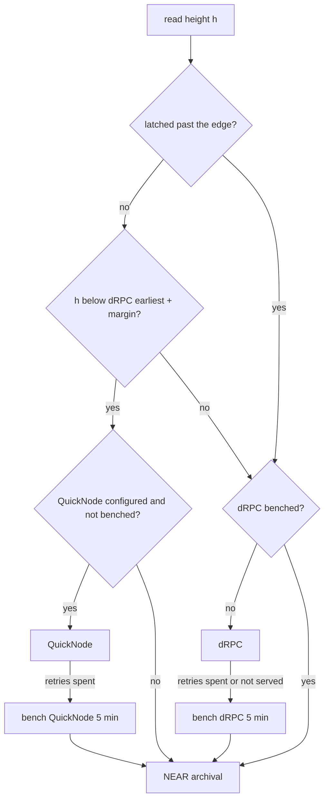

# Indexer on free, self-switching sources - Plan

## Goal Capsule

**Objective.** From 13 November 2026, 16:59 UTC, through 14 November 2026, 23:59 UTC, the console shows every Aruna vault's activity and exposure. The data is complete from the indexer's start block and current to within minutes, the indexer keeps running if a paid quota runs out, and no one has to watch it.

**Means.** A new QuickNode trial key closes only the part of the history gap that dRPC no longer serves; keyless dRPC then catches up and follows the head; a keyless archival source stands behind both.

**Product authority.** Aris (lane A) owns the indexer. The Railway deployment and its keys stay with the user: this work changes code and docs, and never deploys or handles a key.

**Open blockers.** None for planning. Running it needs a fresh QuickNode trial key in Railway's env, set by the user.

**Stop conditions.** Stop and report if dRPC stops answering testnet `status` without a key, or if a recorded block reads differently through the new path than through the current one (R10). Before the key is spent, stop and report to the user if the credit gate in Dependencies / Assumptions comes out above the trial's remaining credits.

**Execution profile.** One branch off `main` and one PR, in the order U1 → U5. Each unit runs with `pnpm --filter @aruna/indexer test` green. No transactions; the live checks are read-only.

**Who finishes and ships.** The executor opens the PR. The user merges it, sets the Railway env and deploys.

## Product Contract

### Summary

The hosted indexer reads from more than one source and moves between them by itself. QuickNode is spent only on blocks dRPC no longer holds; once the cursor is inside dRPC's window, it switches to keyless dRPC, and credit use stops. A source that keeps failing gives way to a keyless archival fallback, and `/health` says which source is in use and whether the indexer is catching up.

### Problem Frame

On 12 November the hosted indexer at `aruna-near-indexer.up.railway.app` stopped: its QuickNode key ran out of credits, `/health` reported `healthy: false`, and the head was last seen about 8 hours earlier. The cursor sat at block 276968439 against a head near 277316159, a gap of about 348,000 blocks.

Research on 12 November found no free source that closes that gap alone:

- dRPC is free and fast but not archival: it keeps about the last 150,000–200,000 blocks.
- The keyless archival endpoints run slower than the chain's roughly 60 blocks a minute. `archival-rpc.testnet.near.org` gave about 19 calls a minute.
- No free-key provider offers testnet history for good. All That Node lists NEAR archive data as N/A, GetBlock's free plan has no archive, and Tatum's archive allows 2 requests a minute.
- Two FastNear key accounts were invalid, so FastNear is excluded.
- QuickNode is archival, but its free offer is a one-month trial of 10M credits, and NEAR calls cost 50 credits each.

The indexer needs about one call per block that touches no Aruna account. Closing the whole gap through QuickNode would cost about 17M credits, which is more than one trial holds.

The console's L5 lane (activity and exposure) and the submission's "do X, see Y" steps depend on this service being current and complete.

### Key Decisions

- **A new QuickNode trial key closes the history outside dRPC's window, and nothing else.** (session-settled: user-directed — chosen over a sparse backfill from NearBlocks v3 plus NEAR archival, and over restarting from a recent block: least new code before the deadline.) Governs R1, R2.
- **Keyless dRPC is the source for catch-up inside its window and for following the head.** It is free, measured at 244 calls a minute sequential and 733 at concurrency 4, and needs no key. (session-settled: user-approved — the hybrid of an archive for history and dRPC for the head was approved in the earlier ce-plan scoping.) Governs R2, R3.
- **The keyless NEAR archival RPC is the fallback, not a primary.** It is correct for any height but slow, so it keeps the indexer moving rather than catching it up. Governs R5.
- **The existing Railway database is continued, not rebuilt.** Blocks already indexed stay. Governs R8.

### Requirements

**Source selection**

- R1. While the next block to index is older than what dRPC serves, the indexer reads it from the configured QuickNode endpoint.
- R2. Once the next block is inside dRPC's window, the indexer reads from keyless dRPC and makes no further QuickNode calls for the rest of the run.
- R3. Following the head uses keyless dRPC with no key configured.
- R4. With no QuickNode key configured, the indexer still runs on dRPC and the archival fallback alone.

**Failure handling**

- R5. When the current source keeps failing on rate limits, exhausted credits or server errors, the indexer continues from the keyless NEAR archival RPC instead of retrying the same source in a loop.
- R6. A request that hangs is abandoned after a bounded time and counts as a failure.
- R7. A failure while reading the chain head does not stop indexing from blocks already known to be final.

**Continuity and correctness**

- R8. The indexer resumes from the existing database's cursor; no block already indexed is read or committed again.
- R9. Blocks are still committed strictly in height order whichever source served them, so a vault created mid-gap is watched from its creation block onward.
- R10. The events and exposure produced from any source are identical to what the current indexer produces for the same blocks.

**Visibility**

- R11. `/health` reports which source is serving blocks and whether the indexer is catching up or following the head.
- R12. Logs and `/health` never contain an API key or the secret part of an endpoint URL.

**Operations**

- R13. The deploy doc and `.env.example` describe the source settings, which ones need a key, and the expected order of events: QuickNode phase, dRPC catch-up, then following.

### Acceptance Examples

- AE1. Covers R1, R2. **Given** the cursor at 276968439 and dRPC serving only blocks from about 277130000, **when** the indexer runs, **then** QuickNode serves blocks up to dRPC's edge, dRPC serves every block after that, and no QuickNode call happens after the switch.
- AE2. Covers R5, R11. **Given** QuickNode starts answering every request as out of credits while the cursor is still outside dRPC's window, **when** the retries for a block are spent, **then** the indexer carries on from the NEAR archival RPC and `/health` names that source and reports it as catching up.
- AE3. Covers R4. **Given** no QuickNode key in the environment and a cursor inside dRPC's window, **when** the service starts, **then** it indexes from dRPC with no error about a missing key.
- AE4. Covers R7. **Given** the chain-head request fails three times in a row, **when** final blocks below the last known head remain, **then** the indexer keeps committing them, and `/health` shows how long ago the head was seen.
- AE5. Covers R10. **Given** a block range that has already been indexed, **when** it is indexed again from dRPC or the NEAR archival RPC into an empty database, **then** the events and exposure equal those from the original run.

### Success Criteria

- By 13 November 2026, 16:59 UTC (23:59 UTC+7), `/health` reports `healthy: true` with the cursor within a few hundred blocks of the head, and it stays so through 14 November 23:59 UTC with no manual restart.
- The QuickNode phase uses fewer credits than one trial holds. The user checks the dashboard about an hour into the run and compares it against blocks covered.

### Scope Boundaries

**Deferred for later**

- A sparse backfill that lists Aruna's transactions from NearBlocks v3 (keyless, verified on 12 November) and reads only those blocks. This is the fallback plan if the QuickNode trial runs out before the cursor reaches dRPC's window.
- Rotating or load-balancing across several sources at once.
- Alerts when the indexer falls behind.

**Not this work**

- Deploying to Railway or setting keys. The user does this.
- New API routes or console changes.
- Running a nearcore node, Substreams, SubQuery or The Graph. None fits before the deadline.
- FastNear endpoints of any kind.

### Dependencies / Assumptions

- The user can open a new QuickNode trial account and put its endpoint in Railway's env.
- dRPC's free tier keeps serving testnet without a key, with roughly the window measured on 12 November.
- **Credit gate, checked right before the key goes into Railway:** (dRPC `earliest_block_height` + 2,000 − cursor) × 50 × 1.1 must be below the trial's remaining credits. On 12 November the gap was 277126855 + 2,000 − 276968439 ≈ 160,400 blocks, about 8.0M credits, or 8.8M with the 10% allowance. The gap grows about 3,600 blocks an hour, about 180k credits, and the edge keeps moving during the roughly 3.5-hour QuickNode phase. A single 10M trial therefore only fits if the run starts by about the evening of 12 November 2026, UTC+7. If the gate fails, the user decides between starting the deferred sparse backfill and accepting slow fallback catch-up.
- The old key covered only about 16,000 blocks before it ran out, far fewer than this estimate predicts. Earlier use of that key or counted retries are likely causes, but neither is verified.

### Outstanding Questions

The four questions deferred to planning are answered in the Planning Contract: dRPC's edge (KTD1), what counts as "keeps failing" and whether to return (KTD3), and concurrency per source (KTD5). None remains.

### Sources / Research

- `packages/indexer/src/cli.ts` (`chooseSource`, the serve loop), `packages/indexer/src/ingest/rpc.ts` (retries, redaction, no fetch timeout), `packages/indexer/src/ingest/neardata.ts` (the `BlockSource` interface).
- `docs/DEPLOY-INDEXER-RAILWAY.md`, `packages/indexer/.env.example`, `packages/indexer/config/testnet.json`.
- QuickNode: [NEAR at 50 credits per call](https://www.quicknode.com/api-credits/near), [free trial of 10M credits](https://www.quicknode.com/pricing).
- [NEAR RPC providers](https://docs.near.org/api/rpc/providers.md), [All That Node supported protocols](https://docs.allthatnode.com/docs/supported-protocols-1.md), [GetBlock pricing](https://getblock.io/pricing.md), [Tatum gateway limits](https://docs.tatum.io/docs/gateway-limits).
- [NearBlocks API v3 migration](https://api-testnet.nearblocks.io/api-docs/migration), the deferred sparse-backfill source.

**Product Contract preservation:** restructured, no scope change. The four deferred questions are answered by KTD1, KTD3 and KTD5; Success Criteria times are now in UTC; the credit assumption is restated as a gate with its numbers.

---

## Planning Contract

### Key Technical Decisions

- KTD1. **dRPC's lower edge comes from its own `status` answer, plus a margin.** `sync_info.earliest_block_height` read 277126855 three times running on 12 November 2026, with head at 277318249, so the window held about 191,000 blocks. The router treats heights below `earliest + 2,000` as outside the window and re-reads `status` every 10 minutes. The margin covers dRPC balancing across nodes whose retention differs slightly. Governs R1, R2.
- KTD2. **On dRPC, `UNKNOWN_BLOCK` alone no longer means "the chain skipped this height".** Today `rpcSource.block` returns null on `UNKNOWN_BLOCK` (`packages/indexer/src/ingest/rpc.ts`), and `runIndexer` commits that height as empty. On an archive node that holds, but on dRPC the same answer means "pruned", and the block's events would be lost without a trace. A height is skipped only when a later block the same source holds has a header `prev_height` below it. `prev_height` is present in dRPC's headers (checked 12 November). If the source holds no later block either, the read fails with a "not served" error and the router sends it elsewhere. The proof is an option set only on the dRPC instance. QuickNode and NEAR archival hold every block, so they keep treating `UNKNOWN_BLOCK` as a skip, and the proof spends no QuickNode credits. Governs R9, R10.
- KTD3. **A failing source is benched for 5 minutes, not abandoned.** A read that spends its source's retries (rate limit, 5xx, 401/402/403, timeout, "not served") is repeated on the NEAR archival fallback, and the failing source is skipped for 5 minutes, then tried again. A brief dRPC hiccup costs minutes on the slow source, not the rest of the run. An exhausted QuickNode key keeps failing and stays benched in effect. Governs R5.
- KTD4. **Once a height at or above the edge has been committed, QuickNode is never called again in this process.** This makes R2 a latch rather than a comparison repeated per block, so a `status` answer that moves backwards cannot send reads back to paid credits. Governs R2.
- KTD5. **Concurrency is limited per source:** QuickNode 8 (measured peak on 11 November 2026, `RPC_CONCURRENCY` in `packages/indexer/src/cli.ts`), dRPC 4 (733 calls a minute measured, with occasional 429 code 15 that the retries absorb), NEAR archival 1 (about 19 calls a minute, no 429). `runIndexer` keeps its window of 8 heights, and the router queues reads past each source's limit. Governs R1, R3, R5.
- KTD6. **Every request carries a 30-second timeout**, and a timeout counts as a retryable failure. Today `rpc()` in `rpcSource` has none, so one hung socket stalls the whole window. Governs R6.
- KTD7. **dRPC is the default; neardata is only used when asked for.** `chooseSource` no longer falls back to neardata, and a leftover `FASTNEAR_API_KEY` is ignored with one log line, since the two FastNear keys on hand are invalid. `ARUNA_BLOCK_SOURCE=neardata` keeps the old path reachable. Governs R3, R4.
- KTD8. **`/health` gains two optional fields, `source` and `mode`.** They are optional in the `Health` type so the console's fixture in `apps/web/src/console/data/indexer-fixture.ts`, owned by lane B, needs no change. `mode` is `catching_up` while the lag exceeds `HEALTHY_LAG_BLOCKS` and `following` otherwise. Governs R11.

### High-Level Technical Design

Which source serves a height. This is a directional sketch, not an implementation spec.

Reading the chain head follows the same choice as a height at the edge, so dRPC answers it while it is healthy. If the head read fails, `runIndexer` keeps committing up to the last head it knew (R7).

### Assumptions

- A single `rpcSource` instance per endpoint stays correct as a building block. The router only chooses between instances and never changes what a block decodes to, which is what R10 rests on.
- dRPC's free tier serves `EXPERIMENTAL_changes_in_block`, `EXPERIMENTAL_changes`, `EXPERIMENTAL_receipt_to_tx` and `EXPERIMENTAL_tx_status` inside its window. `receipt_to_tx` answered with a proper `UNKNOWN_RECEIPT` on 12 November; the live smoke in U4 checks the rest against a recent block.

### Risks

| Risk | Mitigation |
|---|---|
| QuickNode credits run out before the cursor reaches dRPC's edge | KTD3 moves reads to NEAR archival, `/health` shows it (R11); the sparse NearBlocks backfill stays the deferred fallback |
| dRPC retention shrinks or varies by node | KTD1 margin and 10-minute re-read; "not served" (KTD2) routes a pruned read elsewhere instead of losing it |
| The skip proof doubles calls on skipped heights | Skipped heights are a small share of testnet blocks; the proof costs one or two extra `block` calls each |
| QuickNode signals exhausted credits as 429, so each bench expiry costs a full retry cycle (about 30 s per read) | The cost is bounded at one cycle per 5 minutes; how QuickNode signals exhaustion is unverified, and the executor records it if seen |
| A secret leaks through a new log line | All routing logs name sources by label only; the existing redaction stays on every `rpcSource` (R12) |

---

## Implementation Units

### U1. Safe reads in `rpcSource`: timeout, skip proof, edge

**Goal:** an RPC source never stalls on a hung request and never mistakes a pruned block for a skipped one.

**Requirements:** R6, R9, R10, R12 (KTD2, KTD6).

**Dependencies:** none.

**Files:** `packages/indexer/src/ingest/rpc.ts`, `packages/indexer/test/rpc.test.ts`.

**Approach:**
1. Give every fetch a 30-second abort signal, and treat an abort like a network error (retryable, redacted).
2. On `UNKNOWN_BLOCK` for height h, read the header of the next heights the source holds, a few at most. Return null only when one of them has `prev_height < h`. If the source holds none of them, throw a distinct "not served" error.
3. Add `earliestHeight()`, read from `status.sync_info.earliest_block_height`, next to the existing testnet check.
4. Clear the cached `ready()` promise when the `status` check fails for a transient reason, so a benched source can recover (KTD3). A wrong `chain_id` stays a permanent failure.
5. Make the skip proof an option (KTD2), off by default.
6. Add an optional `label` to the options, so errors and logs can name the source without its URL.

**Patterns to follow:** the existing `RpcError`, `redact` and retry loop in the same file; the `replay` helper in `test/rpc.test.ts`.

**Test scenarios:**
- With the skip proof on: a height answered `UNKNOWN_BLOCK`, whose next block has `prev_height = h − 1`, is returned as null (a real skip).
- With the skip proof on: a height answered `UNKNOWN_BLOCK` whose following heights are also unknown throws "not served", not null.
- With the skip proof off: `UNKNOWN_BLOCK` returns null with no extra call, as today.
- `status` fails once with a timeout and then succeeds: the next `block` call reads normally.
- A fetch that never resolves fails after the timeout and is retried; the error text holds no part of the URL path.
- `earliestHeight()` returns the `status` field, and a mainnet `status` still fails the testnet check.
- The recorded replay in `test/rpc.test.ts` decodes the same records as before (no regression).

**Verification:** `test/rpc.test.ts` passes with the new cases. The existing case "treats UNKNOWN_BLOCK as a height the chain skipped" keeps passing with the proof off, and gains a proof-on twin. No other existing case changes its expectation.

### U2. The routed source

**Goal:** one `BlockSource` that picks QuickNode, dRPC or NEAR archival per height, benches a failing one, and reports which one is serving.

**Requirements:** R1, R2, R3, R4, R5, R10 (KTD1, KTD3, KTD4, KTD5).

**Dependencies:** U1.

**Files:** `packages/indexer/src/ingest/routed.ts` (new), `packages/indexer/test/routed.test.ts` (new).

**Approach:**
1. Take an optional `archive`, a required `live` and a required `fallback` source, each with its concurrency limit, and expose the `BlockSource` interface plus a `state()` that returns the serving source's label.
2. Per KTD1, the edge comes from `live.earliestHeight()` plus the margin, refreshed on a timer. Per KTD4, the latch is set once a height at or above the edge is served.
3. Run `expand` on the source that served that height's `block`, falling back the same way.
4. Run `finalHeight` on `live`, falling back to `fallback`.
5. Per KTD3, a read whose source spends its retries is retried once on `fallback`, and the source is benched with a clock that tests can inject.

**Technical design:** see the flowchart in the High-Level Technical Design.

**Patterns to follow:** `memorySource` and `replay` in `test/helpers.ts` and `test/rpc.test.ts` for fake sources; the `BlockSource` contract in `src/ingest/neardata.ts`.

**Test scenarios:**
- Covers AE1. The edge sits at 1,000 and the window runs 990–1,010: 990–999 go to the archive, 1,000–1,010 go to live, and the archive gets no call after the first live read.
- Covers AE1. After the latch, a refreshed edge that moved below the cursor does not route any read back to the archive.
- Covers AE2. The archive answers every call with 429 until its retries are spent: the read is served by the fallback, `state()` names the fallback, and after 5 injected minutes the archive is tried again.
- Covers AE3. With no archive configured, a height below the edge goes to the fallback with no error.
- Live answers "not served" for a height above the edge: the fallback serves it, and live is benched.
- Covers R9. The archive answers its range slower than the fallback answers a later range: the store still commits heights strictly ascending.
- Concurrency: with live limited to 4, eight parallel reads never put more than four in flight on live.
- Covers AE5. Parity: a store built from the recorded RPC replay through the router, with the range split between two replay-backed sources, exports byte-identical JSON to one built through a single source.

**Verification:** `test/routed.test.ts` passes, and the parity case compares `store.export()` output.

### U3. Ingest keeps going without a fresh head, and reports its source

**Goal:** a failing head read no longer stops indexing, and `/health` says which source is serving and whether the indexer is catching up.

**Requirements:** R7, R8, R11 (KTD8).

**Dependencies:** U2, for `state()`; it can be built against a fake.

**Files:** `packages/indexer/src/indexer.ts`, `packages/indexer/src/store.ts`, `packages/indexer/src/api.ts`, `packages/indexer/test/review-fixes.test.ts` or a new `packages/indexer/test/ingest-resilience.test.ts`, `packages/indexer/test/routes.test.ts`.

**Approach:**
1. In `runIndexer`, when `finalHeight()` throws and the previous head is above the cursor, continue the window loop with the previous head and do not call `setHead`. With no previous head, throw as today.
2. Give the store an in-memory `setSource(label)`, like `headSeenAt`, and have the indexer call it with the source's `state()` after each window when the source offers one.
3. Add `source?` and `mode?` to `Health`, filled by `store.health()`.

**Patterns to follow:** `headSeenAt` in `src/store.ts`; the `failAt` option of `memorySource` in `test/helpers.ts`.

**Test scenarios:**
- Covers AE4. `finalHeight` succeeds once (head 120), then throws three times while the cursor is at 100: blocks 101–120 are still committed, and `head_seen_ms_ago` grows.
- `finalHeight` throws on an empty store with no previous head: `runIndexer` throws, as today.
- A restart on an existing store resumes at cursor + 1 and reads no committed height again (R8).
- `/health` with a lag above `HEALTHY_LAG_BLOCKS` reports `mode: "catching_up"` and the source label, and one within the limit reports `following`.

**Verification:** the indexer tests and `test/routes.test.ts` pass, and `apps/web` typechecks unchanged.

### U4. CLI wiring and a live smoke check

**Goal:** `serve` and `index` build the routed source from the environment, with dRPC and NEAR archival on by default and no key needed.

**Requirements:** R3, R4, R12, R13 (KTD5, KTD7).

**Dependencies:** U2, U3.

**Files:** `packages/indexer/src/cli.ts`, `packages/indexer/config/testnet.json`, `packages/indexer/test/cli.test.ts`, `packages/indexer/test/live.test.ts` (new, skipped unless `ARUNA_LIVE=1`).

**Approach:**
1. Put the public endpoints in `config/testnet.json`: `live_rpc` = `https://near-testnet.drpc.org`, `fallback_rpc` = `https://archival-rpc.testnet.near.org`. `QUICKNODE_RPC_URL` stays the only secret and becomes the optional archive.
2. Have `chooseSource` return the routed source and a label that never contains the QuickNode URL. Turn the skip proof on for the dRPC instance only (KTD2).
3. In `serve`, build the routed source once per process, outside the restart loop, so the latch, bench and edge timer survive an ingest restart (KTD3, KTD4). Unref the edge timer.
4. When `FASTNEAR_API_KEY` is set, log one line saying it is ignored. Use neardata only when `ARUNA_BLOCK_SOURCE=neardata`.
5. In `serve`, log every switch of the serving source, by label only.
6. Update USAGE.

**Patterns to follow:** the existing `chooseSource` tests in `test/cli.test.ts`, which assert that labels hold no token.

**Test scenarios:**
- With no environment at all, `chooseSource` yields a routed source whose label names dRPC and NEAR archival.
- With `QUICKNODE_RPC_URL` set, the label names QuickNode as the archive and holds no part of the token.
- With `FASTNEAR_API_KEY` set and no `ARUNA_BLOCK_SOURCE`, the source is still dRPC.
- With `ARUNA_BLOCK_SOURCE=neardata`, the old neardata source is chosen.
- After one simulated ingest failure in `serve`, the next run uses the same router, and QuickNode stays latched off.
- The live test (opt-in): dRPC `status` is testnet, and `earliestHeight()` is within 300,000 of head.
- The live test (opt-in): `EXPERIMENTAL_changes_in_block`, `EXPERIMENTAL_changes`, `EXPERIMENTAL_receipt_to_tx` and `EXPERIMENTAL_tx_status` each return a result on dRPC for a recent block that touched an account, using a transaction found by scanning back from head.
- The live test (opt-in): a block at head − 100 scans and expands through the router without error.

**Verification:** `test/cli.test.ts` passes; `ARUNA_LIVE=1 pnpm --filter @aruna/indexer test live` passes from a laptop; `node dist/cli.js index --stop-at <head−50>` on a scratch DB started near head prints dRPC as its source.

### U5. Docs for the switch

**Goal:** the user can set Railway's env from the doc alone and knows what the logs and `/health` should show in each phase.

**Requirements:** R13, Success Criteria.

**Dependencies:** U4.

**Files:** `packages/indexer/.env.example`, `docs/DEPLOY-INDEXER-RAILWAY.md`, `packages/indexer/README.md`, `README.md` (indexer test count in step 1).

**Approach:**
1. Document the env vars, which are optional and which are secret, and that `FASTNEAR_API_KEY` is now ignored.
2. Describe the three phases (QuickNode to the edge, dRPC catch-up, following), with the log lines and the `/health` `source`/`mode` values for each.
3. Add the credit gate from Dependencies / Assumptions as a step before the key is set, computed from dRPC `status` and the live `/health` cursor. Then say when to look at the dashboard: an hour into the run.
4. Add a "QuickNode ran out" entry to "If something fails": the fallback runs, the index is slow but correct, and the sparse backfill is the deferred remedy.

**Test expectation:** none — docs only. `test/deploy.test.ts` already checks the Railway files; extend it only if it asserts the env var list.

**Verification:** every env var named in `.env.example` is read in `src/cli.ts`, and the reverse holds too.

---

## Verification Contract

- `pnpm --filter @aruna/indexer typecheck`, `test` and `build` pass.
- `pnpm --filter @aruna/web typecheck` passes unchanged, proving KTD8 needs no console change.
- The parity case in U2 (Covers AE5) passes: router output equals single-source output byte for byte.
- `ARUNA_LIVE=1` smoke in U4 passes against the real dRPC and NEAR archival endpoints, read-only.
- `git grep` finds no QuickNode token, FastNear key or `.env` in the diff (CLAUDE.md rule 4).

## Definition of Done

- R1–R13 are each covered by a passing test or, for R13, by the doc check in U5.
- The README's indexer test count matches `pnpm --filter @aruna/indexer test`.
- No unused source, flag or experimental code from abandoned approaches remains in the diff.
- One PR to `main`, its body naming the env changes the user must make in Railway: set the new `QUICKNODE_RPC_URL`, and `FASTNEAR_API_KEY` may be removed.
