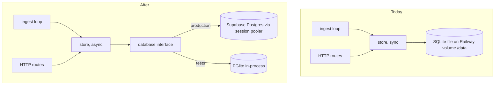
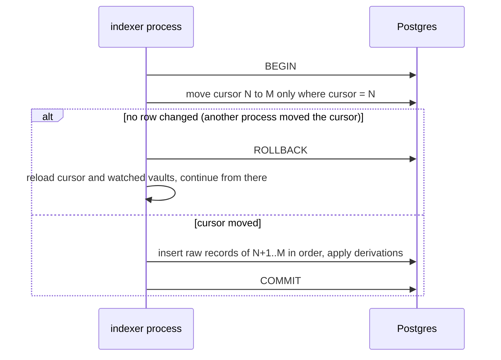

# Indexer on Supabase Postgres - Plan

## Goal Capsule

- **Objective:** Redeploying, recreating or restarting the indexer service on Railway never loses indexed history, so the console's vault activity, exposure and coverage stay available and the indexer resumes from the last block it stored.
- **Means:** The indexer keeps all its state in a Supabase Postgres database instead of a SQLite file on a Railway volume (KTD1, KTD2), and starts fresh from the block where the v2 contracts were created.
- **Product authority:** This plan covers the indexer's storage, its starting point and the configuration that goes with them. How blocks are read (the routed sources from `docs/plans/2026-11-12-1214-feat-indexer-free-reliable-sources-plan.md`) and the read API's shape are not active scope. The Product Contract wins on behavior; a KTD wins on mechanism within it.
- **Stop conditions:** Stop and ask if the read API's response shape would have to change (R10), if a Postgres behavior forces a different start block (R4), or if the Supabase session pooler turns out unreachable from Railway.
- **Execution profile:** `packages/indexer` only, plus `docs/DEPLOY-INDEXER-RAILWAY.md` and the repo-root `README.md`, `.env.example` and `pnpm-lock.yaml`. Testnet only; no transaction is sent. The Supabase URI is never written to the repo, a test fixture or a log (R9).
- **Who ships:** The implementer opens a PR to `main`. The user merges it, sets `DATABASE_URL` on Railway, removes the volume and the retired variables, and starts the backfill.
- **Open blockers:** None for planning. The user supplies the Supabase connection URI before deploy.

---

## Product Contract

Product Contract unchanged.

### Summary

The indexer stores everything in Supabase Postgres and nothing on disk. SQLite, the Railway volume and the settings that served them are removed. A fresh database starts at block 277103406 and follows only the v2 contracts. The read API the console uses is unchanged.

### Problem Frame

The indexer's history lives in one SQLite file on a Railway volume. If the service is redeployed without the volume, recreated, or the volume is lost, the indexer starts again from its first block. Getting back to the head then costs hours through a QuickNode trial that rate-limits and runs out of credits, or days through NEAR's archival RPC. Until it catches up, the console shows empty or partial vault activity.

Rebuilding is getting more expensive every day. The free dRPC endpoint keeps only about two days of blocks, and its lower edge moves up about 86,000 blocks a day. Every block below that edge must come from QuickNode. On 13 November 2026 the Railway indexer was 40 blocks past its start block, so there is no history worth keeping in the current SQLite file.

### Key Decisions

- **Postgres on Supabase is the only store; SQLite is removed entirely.** One storage path keeps the code, tests and deploy simple. (session-settled: user-directed — chosen over keeping SQLite and backing the file up to Supabase Storage: the user wants one clean store with no SQLite left.) Governs R1, R2, R7.
- **A fresh start at block 277103406, the creation of `factory2.arunafi.testnet`, following only the v2 contracts.** It keeps the complete v2 history and puts about 110,000 blocks below dRPC's edge, which fits a QuickNode trial. (session-settled: user-directed — chosen over starting at dRPC's edge, which loses the first two v2 vaults and every pool deposit, coverage and claim; starting at the head, which hides every existing vault; and starting at the v1 block 276952600, about 14M credits, beyond a 10M trial.) Governs R4, R5.
- **The FastNear/neardata block source is removed.** The user's two FastNear keys were invalid and the keyless tier (about 30 blocks a minute) cannot keep up with testnet, so the option is configuration nobody can use. Governs R8.
- **Block reading is unchanged.** QuickNode only below dRPC's edge, keyless dRPC for the rest and the head, NEAR archival as the fallback. (session-settled: user-directed — chosen over FastNear, whose two keys were invalid.)

### Requirements

**Storage**

- R1. The indexer reads and writes all its state (cursor, raw records, derived tables, head) in the Postgres database named by one connection URI.
- R2. No SQLite code, file, volume or setting remains in the indexer, its container image or its deploy docs.
- R3. A restart, redeploy or recreated service resumes ingest at the block after the stored cursor and serves the stored history at once, with no backfill.

**Starting point and scope**

- R4. On an empty database the indexer starts at block 277103406.
- R5. The indexer follows `factory2.arunafi.testnet`, `registry2.arunafi.testnet` and `pool2.arunafi.testnet` only; the v1 contracts and their vaults are no longer indexed.
- R6. The indexer creates the schema it needs in an empty database by itself on first start.

**Configuration**

- R7. Running the indexer on Railway needs one required variable, the Postgres connection URI. `QUICKNODE_RPC_URL` and `QUICKNODE_CONCURRENCY` stay optional, and `PORT` keeps its default.
- R8. `ARUNA_INDEXER_DB`, `RAILWAY_RUN_UID`, `ARUNA_BLOCK_SOURCE`, `FASTNEAR_API_KEY` and the Railway volume are removed from code and docs.
- R9. The connection URI is a secret: it never appears in a log line, an error message, `/health` or the repo.

**Behavior the console relies on**

- R10. Every read API route answers with the same shape and the same data for the same indexed blocks as before the migration.
- R11. When the database cannot be reached, `/health` still answers and reports the indexer unhealthy, and ingest retries without losing or double-committing a block.

**Tests**

- R12. The indexer's test suite runs without SQLite and without a network database: it needs no Supabase account and no URI.

### Acceptance Examples

- AE1. **Covers R3.** Given the indexer has stored blocks up to 277300000, when the Railway service is redeployed, then `/health` reports `last_indexed_block` at least 277300000 within a minute and ingest continues from 277300001.
- AE2. **Covers R4, R6.** Given an empty Supabase database, when the indexer starts, then it creates its schema, and its first committed block is 277103406.
- AE3. **Covers R11.** Given the database is unreachable for two minutes, when it comes back, then ingest resumes from the stored cursor and no block between the two is missing or stored twice.
- AE4. **Covers R9.** Given the URI holds a password, when the connection fails, then the log line names the failure without the URI or the password.

### Success Criteria

- After the backfill, `/health` shows `"healthy":true` and `"mode":"following"`, and the console shows every vault created by `factory2.arunafi.testnet`.
- A Railway redeploy after the backfill leaves the console's data intact, with no catch-up phase.
- `docs/DEPLOY-INDEXER-RAILWAY.md` lists only the variables in R7, and a stranger can deploy from it.

### Scope Boundaries

- The console, SDK, contracts and attestor do not change. The console keeps reading the indexer's HTTP API, never Supabase directly.
- How blocks are read, routed and retried does not change, apart from removing the neardata source (R8).
- No data is migrated from the current SQLite file (40 blocks past its start).
- Deferred for later:
  - Indexing v1 contracts or history before block 277103406.
  - Running more than one indexer instance against the same database on purpose. KTD5 only keeps the brief overlap of a Railway deploy safe.
  - Supabase row-level security, read replicas, backups beyond what Supabase provides by default.
- Considered and not built:
  - A database migration tool. The schema is created idempotently on start (KTD4), and the store is fresh; a migration tool becomes worth it at the first schema change on a store with history to keep.
  - A Postgres advisory lock for single-writer ingest. The conditional cursor update (KTD5) already prevents a lost or doubled block; a lock would only save duplicate reads during a deploy overlap of a minute or two.
  - An opt-in test against a real Supabase database. R12 rules out a network database in the suite, and the deploy smoke check in the Verification Contract covers the real connection once.

### Dependencies / Assumptions

- The user creates the Supabase project and provides its **Session pooler** URI (port 5432). Supabase's docs confirm the direct connection is IPv6-only without the IPv4 add-on, and recommend the session pooler for persistent IPv4 clients; the transaction pooler on 6543 is for short-lived serverless clients.
- The backfill of about 110,000 blocks below dRPC's edge needs a QuickNode trial with about 6M credits and takes hours at the trial's rate limit (`QUICKNODE_CONCURRENCY`, PR #41, merged). Each day of delay adds about 86,000 blocks, about 4.7M credits.
- The release deadline is 14 November 2026, 23:59 UTC. Rewriting the store touches the core of the indexer and its tests one day before it; the backfill must start as soon as the code is deployed.

### Sources / Research

- `packages/indexer/config/testnet.json`: `start_block` 276952600, and the v1 plus v2 factories and contracts the indexer follows today.
- `packages/indexer/src/store.ts`: the `Store` interface over `node:sqlite` `DatabaseSync`; `src/derive.ts` and `src/derive-coverage.ts` read and write the database synchronously inside a block's commit.
- `packages/indexer/src/ingest/neardata.ts`: holds the `BlockSource`, `NeardataBlock` and `ReceiptOutcome` types that `rpc.ts`, `routed.ts`, `parse.ts` and `indexer.ts` import.
- `packages/indexer/Dockerfile`: `ARUNA_INDEXER_DB=/data/aruna-indexer.sqlite`, the `/data` directory, and a build that installs without a lockfile.
- `packages/indexer/src/ingest/watch.ts:2`: vaults join the watched set only through a watched factory's `vault_created`, so a start after a vault's creation hides that vault.
- NearBlocks v3 `accounts/{a}/txns` on 13 November 2026: `factory2.arunafi.testnet` created at block 277103406 (10 Nov 18:20 UTC), `pool2.arunafi.testnet` at 277192455; dRPC's `earliest_block_height` 277213255, head about 277411600.
- Railway `/health` on 13 November 2026: `last_indexed_block` 276952640, `source` NEAR archival.
- npm on 13 November 2026: `postgres` 4.1.1 and `@electric-sql/pglite` 0.5.16 have no dependencies; `pg` 8.23.1 has six.
- Supabase, "Connect to your database" (supabase.com/docs/guides/database/connecting-to-postgres) and the Supavisor FAQ: direct connection over IPv6, session pooler on 5432 for persistent IPv4 clients, transaction pooler on 6543 for serverless.

---

## Planning Contract

### Key Technical Decisions

- KTD1. **`postgres` (postgres.js 4.1.1) is the production driver, added as the indexer's only runtime dependency.** It has no dependencies of its own, which matters because the container installs without a lockfile, and it supports parameterized raw SQL and transactions. `pg` was the alternative and brings six transitive packages. Implements R1.
- KTD2. **The store talks to Postgres through a small database interface with two implementations: postgres.js in production and PGlite (`@electric-sql/pglite` 0.5.16, dev dependency) in tests.** The interface covers parameterized query, row count and a transaction that hands a scoped handle to its callback. PGlite is real Postgres in-process, so the tests run the same SQL as production with no network and no SQLite. Implements R1, R12.
- KTD3. **The store, derivation and every caller become asynchronous; the read API's shape stays byte-identical.** `derive.ts` and `derive-coverage.ts` read and write inside a block's commit, so they take the transaction handle and await each statement in the order they run today. The guard is the existing export-parity test: the same recorded blocks must export the same bytes. Implements R10.
- KTD4. **The schema is created on start with `CREATE TABLE IF NOT EXISTS` in Postgres types; there is no migration tool.** Every SQLite `INTEGER` column becomes `BIGINT`, because SQLite's `INTEGER` is 64-bit and some values exceed 32 bits (timestamps, and `reports.nonce`, which the attestor seeds from `Date.now()`). `raw.seq` is an identity column, and the existing `meta.derived_version` rebuild stays the way derived tables change. `INSERT OR IGNORE` becomes `ON CONFLICT DO NOTHING`, `INSERT OR REPLACE` becomes `ON CONFLICT ... DO UPDATE`, and the insert's new `seq` comes back through `RETURNING`. Implements R6.
- KTD5. **Each fetch window commits in one transaction, and only if the stored cursor is still the one this process holds.** The transaction first moves the cursor from the window's first height minus one to its last height with a conditional update (or a conditional insert on an empty store), then writes the window's records in height order. If no row changed, the stored cursor is read inside the transaction: a cursor before the window is a gap and an error, and one at or past its first block means another writer moved it, so the transaction rolls back and the process reloads its cursor and watched vaults from the database. The expected cursor is the block before the window's first, so a commit never reads the cursor on the way. One transaction per window, rather than per block, keeps a backfill of about 300,000 mostly empty blocks from paying three or four network round trips per block. A second writer during a Railway deploy overlap waits on the row lock, then finds the cursor moved. Implements R3, R11.
- KTD6. **One variable, `DATABASE_URL`, names the database; the `--db` flag, `ARUNA_INDEXER_DB`, `assertWritable` and the volume go.** A missing `DATABASE_URL` fails at start with a message naming the variable and the Supabase session pooler. Every error that leaves the database module is redacted of the URI and its password, mirroring `redact` in `src/ingest/rpc.ts`. Implements R7, R8, R9.
- KTD7. **`/health` answers even when the database is down, at boot or later, and a hung connection counts as down.** `serve` starts the HTTP server before it opens the store, and the open (schema creation, derived rebuild) is retried inside the ingest loop. When the store is not open yet, or a health query fails or runs past a short timeout, `/health` answers `healthy: false` with `last_indexed_block` 0 and the other database-backed figures `null` (the existing shape: `last_indexed_block` is a number). postgres.js gets a connect timeout and a statement timeout, so a dropped connection fails into `ingestForever`'s existing restart-after-10-seconds loop instead of hanging. A failed commit is a rolled-back transaction, so no extra retry layer is added. Implements R11.
- KTD8. **The neardata source is deleted and its shared types move to a neutral module.** `BlockSource`, `NeardataBlock` and `ReceiptOutcome` move out of `src/ingest/neardata.ts` into a module named for what they are, and every importer follows. Implements R8.
- KTD9. **The `rebuild` command empties every table in the database and reads again from the start block.** It stays an explicit operator command and prints which database host it is clearing (host only, never the credentials). Implements R1.

### High-Level Technical Design

Storage before and after. The ingest loop, the routed block source and the HTTP routes keep their roles; only the store and its database change, and the store's methods become awaited.

One window's commit (KTD5), for blocks N+1 to M. Two processes may run this at once during a deploy; only one can move the cursor from N to M.

### Assumptions

- PGlite and postgres.js may return `BIGINT` columns as different JavaScript types. The store's row mappers already wrap most fields in `Number` or `String`; the implementer normalizes the remaining raw rows (the `unparsed` part of `export`) so both drivers export the same bytes.
- The Supabase project is created in the same region as the Railway service. Commit cost per window is a network round trip, so a distant region slows the backfill and, through the moving dRPC edge, raises the QuickNode credits it needs.
- Identity values are not reused after a rollback, so `seq` can have gaps after a deploy overlap. `seq` is an ordering and pagination key, not a count, so gaps change no API behavior.

### Sequencing

U1 adds the database interface and its two implementations. U2 moves the store and derivation onto it and converts the store-level tests. U3 moves the callers, the CLI and the config, and removes neardata. U4 moves the container and the docs. U1 and U4 each leave `pnpm --filter @aruna/indexer test` and `typecheck` green. U2 makes the store async, so its callers break until U3 lands: U2 and U3 are one commit series, green only after U3.

---

## Implementation Units

### U1. Database interface over postgres.js and PGlite

**Goal:** A small async database interface the store can use, with a production implementation from a URI and an in-process test implementation.

**Requirements:** R1, R9, R12; KTD1, KTD2, KTD6.

**Dependencies:** None.

**Files:**
- `packages/indexer/src/db.ts` (new)
- `packages/indexer/test/helpers.ts` (add a fresh PGlite database per test)
- `packages/indexer/test/db.test.ts` (new)
- `packages/indexer/package.json`, `pnpm-lock.yaml`

**Approach:**
1. Add `postgres` 4.1.1 as a dependency and `@electric-sql/pglite` 0.5.16 as a dev dependency, pinned exactly like the existing dev dependencies.
2. Define the interface: parameterized query returning rows and a changed-row count, a transaction that passes a scoped handle to its callback and rolls back when the callback throws, and close.
3. The production implementation opens postgres.js from `DATABASE_URL` and redacts the URI, its password and its user from every error it rethrows (KTD6).
4. The test helper opens an in-memory PGlite per test so tests never share state.

**Patterns to follow:** `redact` in `packages/indexer/src/ingest/rpc.ts`; the exact-version pinning in `packages/indexer/package.json`.

**Test scenarios:**
- A query with positional parameters returns the inserted row on PGlite.
- A transaction whose callback throws leaves no row behind.
- A transaction whose callback returns commits its rows and reports the changed-row count.
- Covers AE4. A connection error from a URI with a password produces a message that contains neither the URI nor the password.
- Opening without `DATABASE_URL` fails with a message naming the variable.

**Verification:** The interface works on PGlite in tests, and no error from the production path can carry the URI.

### U2. Store and derivations on Postgres

**Goal:** The store keeps every table in Postgres through the database interface, with the same behavior and the same exported bytes as today.

**Requirements:** R1, R3, R6, R10, R11; KTD3, KTD4, KTD5, KTD7.

**Dependencies:** U1.

**Files:**
- `packages/indexer/src/store.ts`
- `packages/indexer/src/derive.ts`
- `packages/indexer/src/derive-coverage.ts`
- `packages/indexer/test/coverage-drift.test.ts`, `test/exposure-class-history.test.ts`, `test/rebuild.test.ts`, `test/review-fixes.test.ts` (convert to the async store on PGlite)
- `packages/indexer/test/store-postgres.test.ts` (new)
- `packages/indexer/test/fixtures/export-baseline.json` (new, written from the SQLite store before it is removed)

**Approach:**
1. Before changing any code, write the current SQLite store's `export()` of the recorded window (the `FIRST`..`LAST` blocks and `SEEDS` in `test/helpers.ts`) to `packages/indexer/test/fixtures/export-baseline.json`. It is the only baseline for R10 once SQLite is gone.
2. Translate the schema to Postgres types and the statements to Postgres syntax per KTD4; keep table and column names, so the row mappers and the API shape stay as they are.
3. Opening the store becomes async: it creates the schema, then runs the existing `derived_version` rebuild from `raw` in one transaction.
4. `applyRecord` and the coverage and drift derivations take the transaction handle and await each statement in today's order (KTD3).
5. Commit becomes a per-window commit of consecutive blocks with their records (KTD5), and reports a lost race as a distinct error that the ingest loop recognizes.
6. Every read method and `health` become async; `health` follows KTD7 when the database fails. `setSource` stays in memory.
7. Pagination keeps the `seq > after ... ORDER BY seq LIMIT` shape with numbered parameters; the empty-list `IN` guard stays.

**Execution note:** Convert the existing store-level tests first and keep them failing-then-passing against PGlite. They are the characterization of today's behavior.

**Patterns to follow:** the current one-transaction-per-block commit and the `derived_version` rebuild in `packages/indexer/src/store.ts`.

**Test scenarios:**
- Covers AE2. An empty database gets its schema on open, and the cursor is unset.
- The PGlite store's `export()` of the recorded window equals `test/fixtures/export-baseline.json` byte for byte.
- Committing a window N+1..N+8 after N stores every record in height order and moves the cursor to N+8.
- A `drift_reported` event with nonce 1794314403283 commits and reads back unchanged.
- Committing a block that is not next after the cursor is refused, as today.
- Two stores on one database both try to commit a window starting at N+1: exactly one succeeds, the other reports the lost race, and the window's records appear once.
- A commit that fails halfway leaves neither records nor a moved cursor.
- Reopening a store whose `derived_version` differs rebuilds every derived table from `raw` with the same rows.
- `health` returns the last indexed block, lag and mode as today; with the database closed, it returns `healthy: false` with the database-backed figures `null` instead of throwing.
- Every existing coverage, drift, exposure-class-history, review-fix and rebuild expectation holds unchanged on PGlite.

**Verification:** All converted store-level tests pass on PGlite, and the derived rows for the recorded window match today's.

### U3. Async callers, CLI, config and removal of neardata

**Goal:** The ingest loop, the server and the CLI run on the async Postgres store, configured only by `DATABASE_URL`, starting at block 277103406 and following only the v2 contracts.

**Requirements:** R3, R4, R5, R7, R8, R10, R11; KTD3, KTD6, KTD7, KTD8, KTD9.

**Dependencies:** U2.

**Files:**
- `packages/indexer/src/indexer.ts`, `src/routes.ts`, `src/server.ts`, `src/cli.ts`
- `packages/indexer/src/ingest/rpc.ts`, `src/ingest/routed.ts`, `src/ingest/parse.ts` (import the moved types)
- `packages/indexer/src/ingest/neardata.ts` (delete; its types move to a new module under `src/ingest/`)
- `packages/indexer/config/testnet.json`
- `packages/indexer/test/neardata.test.ts` (delete)
- `packages/indexer/test/cli.test.ts`, `test/routes.test.ts`, `test/routed.test.ts`, `test/ingest-resilience.test.ts`, `test/rpc.test.ts` (convert to the async store)

**Approach:**
1. `runIndexer` awaits the store and commits one window at a time (KTD5). On a lost-race commit it reloads the cursor and adds every stored vault to its watch set before continuing, because vaults the other process found in the skipped blocks join only through their `vault_created`.
2. `serve` starts the HTTP server first, then opens the store inside the retried ingest loop (KTD7).
3. `handle` in `routes.ts` becomes async and the server awaits it; unexpected errors still answer 500 without detail.
4. `cli.ts` reads `DATABASE_URL`, drops `--db`, `assertWritable`, `removeStore` and the neardata branch of `chooseSource`, and keeps the `index`, `serve`, `rebuild` and `export` commands. `rebuild` empties the tables per KTD9. The usage text and its source list lose the neardata and `FASTNEAR_API_KEY` lines.
5. `config/testnet.json`: `start_block` 277103406, `factories` only `factory2.arunafi.testnet`, `contracts` only `registry2.arunafi.testnet` and `pool2.arunafi.testnet`, and the `neardata` field removed along with it in `IndexerConfig`.
6. Move the shared block types per KTD8.

**Patterns to follow:** `ingestForever` in `packages/indexer/src/cli.ts` for restart-on-failure; the existing route table in `src/routes.ts`.

**Test scenarios:**
- Every route returns the same status and body for the same stored data as before, including 400 on a bad query and 404 on an unknown path.
- The byte-identical export test over the recorded RPC window still passes, both for one endpoint and split across endpoints.
- Covers AE3. The database fails mid-ingest: `serve` keeps answering `/health` unhealthy, and once the database is back ingest resumes from the stored cursor with no block missing or doubled.
- Covers AE1. A store with a cursor at N: a new `runIndexer` starts at N+1, not at the start block.
- On an empty database the first block read is 277103406.
- A lost-race commit makes `runIndexer` continue from the cursor the other process stored; when the winning window held a `vault_created`, the loser records that vault's later events.
- `serve` with an unreachable `DATABASE_URL` answers `/health` with `healthy: false` and keeps retrying the open.
- `chooseSource` ignores a set `FASTNEAR_API_KEY` or `ARUNA_BLOCK_SOURCE` and builds the routed source.
- The CLI without `DATABASE_URL` exits non-zero with the message naming the variable.

**Verification:** The whole indexer suite passes on PGlite, `typecheck` passes for the indexer and `apps/web`, and no source file imports `node:sqlite` or the neardata module.

### U4. Container, deploy docs and READMEs

**Goal:** The image runs with only `DATABASE_URL` (plus the optional QuickNode variables), and every doc a stranger follows matches it.

**Requirements:** R2, R7, R8; Success Criteria on the deploy doc.

**Dependencies:** U3.

**Files:**
- `packages/indexer/Dockerfile`, `packages/indexer/.dockerignore`, `packages/indexer/railway.json`
- `packages/indexer/.env.example`, `.env.example`
- `docs/DEPLOY-INDEXER-RAILWAY.md`
- `packages/indexer/README.md`, `README.md`

**Approach:**
1. Dockerfile: the runtime stage installs the pinned `postgres` dependency; drop `ARUNA_INDEXER_DB`, the `/data` directory and the volume comments.
2. `.env.example` files list `DATABASE_URL` (Session pooler URI, as a placeholder), `QUICKNODE_RPC_URL`, `QUICKNODE_CONCURRENCY` and `PORT`; the retired variables go.
3. The deploy doc: variables per R7, how to copy the Session pooler URI from Supabase, removing the old volume and the retired variables, the credit check with the new start block (and a note to measure blocks per second after deploy and recompute, since dRPC's edge keeps moving while QuickNode reads), creating the Supabase project in the Railway service's region, and the troubleshooting rows rewritten for database errors.
4. READMEs: the start block, the v2-only scope, storage in Postgres, and the updated test count.

**Execution note:** Mostly packaging and docs; prove it with a local image build and a run against a scratch Postgres rather than unit tests.

**Test scenarios:**
- Test expectation: none -- packaging and documentation; covered by the image smoke check in the Verification Contract.

**Verification:** The image builds from `packages/indexer` alone, starts with `DATABASE_URL` pointing at a scratch Postgres, creates the schema and answers `/health`; no doc in the repo outside `lab/` and `docs/plans/` mentions SQLite, `ARUNA_INDEXER_DB`, `RAILWAY_RUN_UID`, `ARUNA_BLOCK_SOURCE` or `FASTNEAR_API_KEY`.

---

## Verification Contract

| Gate | Command or check | Proves |
|---|---|---|
| Indexer tests | `pnpm --filter @aruna/indexer test` | R10, R11, R12; every unit's scenarios on PGlite |
| Indexer typecheck | `pnpm --filter @aruna/indexer typecheck` | the async store compiles through every caller |
| Console typecheck | `pnpm --filter @aruna/web typecheck` | the indexer client the console imports did not change shape |
| No SQLite left | `git grep -il -e sqlite -e ARUNA_INDEXER_DB -e RAILWAY_RUN_UID -e ARUNA_BLOCK_SOURCE -e FASTNEAR -- ':!lab' ':!docs/plans' ':!pnpm-lock.yaml'` returns nothing | R2, R8 |
| Image smoke | `docker build -t aruna-indexer packages/indexer`, then run it with `DATABASE_URL` set to a scratch Postgres and fetch `/health` | R6, R7; the container needs no volume |
| Deploy smoke (user, on Railway) | after deploy, `/health` shows `last_indexed_block` at or above 277103406 and rising; after a manual redeploy it resumes from the same block | R3, R4, AE1 |
| Opt-in live tests | `ARUNA_LIVE=1 pnpm --filter @aruna/indexer test` | the routed sources still read real testnet blocks |

## Definition of Done

- Every unit's test scenarios exist and pass, and every gate above except the user's Railway smoke is green.
- No file outside `lab/` and `docs/plans/` refers to SQLite, the volume or the retired variables.
- The read API's responses for the recorded window are byte-identical to before (the export-parity test).
- No URI, password or token appears in the diff, a fixture or a test log.
- Code from abandoned approaches is removed from the diff.
- The PR body names the Railway steps for the user: set `DATABASE_URL`, remove the volume and the retired variables, set a fresh `QUICKNODE_RPC_URL` if the credit check needs it, then watch `/health`.
