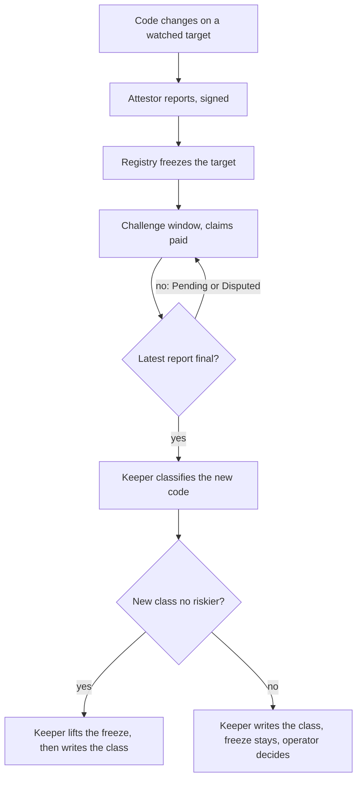
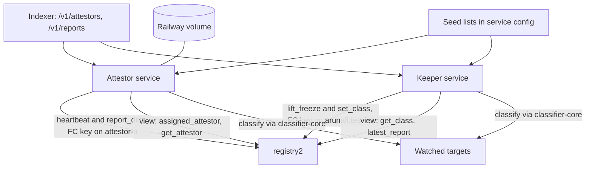
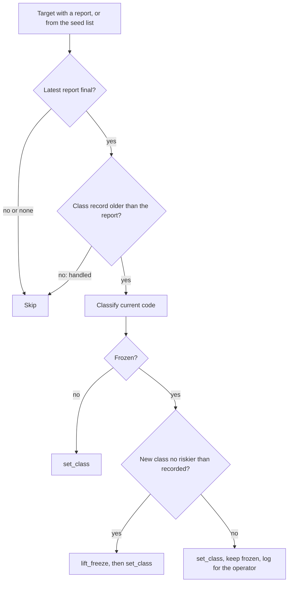

# Hosted attestor and freeze keeper - Plan

## Goal Capsule

- **Objective:** A vault owner can buy coverage from the console on every target Aruna watches whenever that target is not frozen, and when a watched target's code changes, it is reported, frozen, paid out and, when the new code measures no riskier, released again without anyone acting by hand.
- **Means:** Two Aruna-run services on Railway, built from this repository with `pnpm deploy`: the attestor (watches, heartbeats, reports) and a keeper (re-classifies a target after a final report and lifts its freeze). Each holds its own restricted key.
- **Product authority:** this Product Contract. Testnet only (CLAUDE.md rule 3). The two trust assumptions, attestor and arbiter, stay as stated; the keeper exercises the registry owner's authority and is Aruna's, not a third trust party (R15).
- **Open blockers:** none for planning or implementation. Running it needs the holder of `arunafi.testnet` and `attestor-a.arunafi.testnet` to create the two function-call keys and set them as Railway secrets.
- **Execution profile:** code and configuration in this repository (U1 to U5), proven by unit tests against fake chains; the live testnet proof runs after deploy (Verification Contract, operator checks).
- **Stop conditions:** stop and report if the registry's behavior contradicts KTD3's on-chain marker (for example `set_class` resetting `frozen`), or if a function-call key cannot call `set_class` or `lift_freeze`.
- **Who finishes:** an implementer lands U1 to U5 on branch `feat/attestor-env-keys`; the operator (A2) creates the keys, deploys both services, sends `assign_attestor` for `swap`, and runs the operator checks.

---

## Product Contract

### Summary

The attestor runs continuously on a host, watches the targets assigned to it on chain, keeps its heartbeat fresh, and reports code changes. A separate keeper waits until a target's latest report is final, classifies the new code with the same engine, writes the new class, and lifts the freeze only when the new class is no riskier than the old one. For v0 the watched targets are `swap.arunafi.testnet` and `drift-target.arunafi.testnet`.

### Problem Frame

Coverage is the layer that turns measurement into a priced, transferable risk, and on 13 November 2026 no target on testnet can be covered. The pool refuses a purchase when the target's assigned attestor has a stale heartbeat or the target is frozen (`contracts/pool/src/lib.rs:377-381`). `attestor-a.arunafi.testnet` last sent a heartbeat at block 277193168, about 313,000 blocks (3.6 days) before block 277506167, because the daemon only ran during the coverage demo. `swap.arunafi.testnet`, the target console-created vaults use, has no assigned attestor. `drift-target.arunafi.testnet` has stayed frozen since report #2 was verified, because only the registry owner's `lift_freeze` ends a freeze (`contracts/registry/src/drift.rs:121-123`, `:149`) and nobody ran it.

The console's purchase screen already reads the heartbeat from chain and tells the buyer why a purchase is refused (`apps/web/src/console/data/coverage-buy.ts:53`). The buyer sees the failure; nothing on Aruna's side keeps it from happening.

### Actors

- A1. Vault owner: buys coverage from the console for a vault they own.
- A2. Aruna operator: deploys both services, holds the full-access keys off the host, assigns targets, tops up gas, decides on freezes the keeper leaves in place.
- A3. Attestor service: watches assigned targets, sends heartbeats and drift reports as `attestor-a.arunafi.testnet`.
- A4. Keeper service: re-classifies a target after its latest report is final, writes the class and lifts the freeze, as the registry owner `arunafi.testnet`.
- A5. Target owner: changes a target's code. For `drift-target` this is the team, through `drift-owner.arunafi.testnet`.
- A6. Contracts: `registry2.arunafi.testnet` (assignment, heartbeat, reports, class, freeze) and `pool2.arunafi.testnet` (purchase checks, claims).

### Key Decisions

- **Watch both `swap` and `drift-target` in v0.** `swap` makes coverage purchasable from the console for vaults people create themselves; `drift-target` carries the invisible-change lifecycle end to end. Governs R13. (session-settled: user-directed — chosen over swap only, drift-target only, or a heartbeat with no target change: purchases and the drift lifecycle are both product, not demo.)
- **Treat a drift on a team-owned target as a real event, not a demo.** The lifecycle is the same for every target; nothing is special-cased for `drift-target`. Governs R7, R13. (session-settled: user-directed — chosen over a manual demo reset runbook, leaving it frozen, or a fresh target per demo: the product perspective, not only the demo.)
- **The watch list follows the on-chain assignment.** Adding a target is one `assign_attestor` transaction, with no redeploy. Governs R2, R3. (session-settled: user-directed — chosen over guarding every classified target or a static list in configuration.)
- **A freeze is lifted automatically after re-classification.** This replaces D-59's practice of an owner review before `lift_freeze`. Governs R7, R8. (session-settled: user-directed — chosen over a human decision by the registry owner and over per-vault owner approval, which would need a new vault version.)
- **Automatic only when the new class is no riskier.** A class that gets worse keeps the freeze for a human. Governs R8, R9. (session-settled: user-approved — chosen over always automatic and over automatic except `unknown`: an automatic release must never open spending into code that measured riskier.)
- **Two services, two keys.** The party that reports is not the party that releases, and the attestor can later be replaced by an independent one (release gate B) without touching the keeper. Governs R6, R10. (session-settled: user-approved — chosen over one service holding both keys and over a scheduled job beside the attestor.)
- **On failure, an automatic restart and the console's existing message are enough.** Governs R1, R12. (session-settled: user-approved — chosen over an alert to the team and over a public status line.)
- **Built from the repository, not from npm.** It runs before the release without waiting on the npm scope decision. Governs R16. (session-settled: user-approved — chosen over installing a published `@aruna/attestor`: the `@aruna` scope's owner is not yet known.)

### Requirements

**Attestor service**

- R1. The attestor runs continuously on a host and restarts by itself after a crash or redeploy.
- R2. It watches the targets assigned to its account in the registry, picks up a new assignment without a redeploy, and confirms each target with the registry's `assigned_attestor` before watching it.
- R3. When the source of the assignment list cannot be reached, it keeps watching the last list it confirmed.
- R4. Each target assigned to it reads `heartbeat_fresh: true` on the registry while the service runs, that is, a heartbeat at least every `HEARTBEAT_STALE_BLOCKS` (600 blocks).
- R5. Its observations and nonce survive a restart and a redeploy, so a change made while it was down is still reported when it is within the registry's lookback bound (`MAX_LOOKBACK_BLOCKS`, 600 blocks).
- R6. Its keys come from host secrets, never from the image or the repository. The account key is a function-call key limited to the registry's `heartbeat` and `report_drift`, and the service refuses to start when its signing key is not the one the registry holds.

**Keeper service**

- R7. For each frozen target whose latest report is final (Verified or Rejected), the keeper classifies the target's current code with `@aruna/classifier-core` and writes the result to the registry with `set_class`, including the new resolved code hash.
- R8. It lifts the freeze with `lift_freeze` only when the new class is the same as or less risky than the class before the report, in the order `immutable_verified < local_upgradeable < global_by_account < unknown` (`contracts/common/src/class.rs:3`).
- R9. When the new class is riskier, it writes the new class, leaves the freeze in place, and logs the target, both classes and the report id, so the operator can decide.
- R10. Its key is a function-call key on the registry owner account, limited to `registry2.arunafi.testnet` and the methods `set_class` and `lift_freeze`. It never holds the attestor's keys, and the attestor never holds its key.
- R11. It never acts on a target whose latest report is Pending or Disputed.
- R12. It restarts by itself, and running it again on a target it has already released sends no transaction.

**Setup and operation**

- R13. `swap.arunafi.testnet` is assigned to `attestor-a.arunafi.testnet`, and `drift-target.arunafi.testnet` is released by the keeper's first run (report #2 is Verified and its class stays `global_by_account`), so both are purchasable once the services run.
- R14. The repository documents, as numbered steps with an expected result each: deploying both services, every secret and variable they need, adding a target, topping up gas, and what the operator does with a freeze the keeper left in place.
- R15. The README's trust assumptions name the keeper as Aruna's automation of the registry owner's authority, and `docs/DECISIONS.md` records the automatic, class-gated release as a decision that supersedes D-59's owner review.
- R16. Both services build from this repository without any `@aruna` package being published to npm.

### Key Flows

- F1. A watched target's code changes
  - **Trigger:** A5 redeploys the target's code, or the global contract it runs.
  - **Actors:** A3, A4, A6
  - **Steps:** A3 observes the new resolved hash at its next poll and files a signed report; the registry freezes the target in every subscribed vault; the challenge window runs; claims pay from exposure before the change; the report becomes final; A4 classifies the new code; when the class is no riskier A4 lifts the freeze and then writes the class, otherwise it writes the class and leaves the freeze for A2.
  - **Outcome:** Agents spend and owners buy coverage again on the new code, or the target stays frozen with a logged reason.
  - **Covered by:** R5, R7, R8, R9, R11



- F2. A target is added
  - **Trigger:** A2 sends `assign_attestor` for a target that has a class in the registry.
  - **Actors:** A2, A3
  - **Steps:** The assignment is recorded on chain; A3 sees it in its assignment source, confirms it with `assigned_attestor`, takes a first observation and sends a heartbeat.
  - **Outcome:** Coverage on the new target is purchasable, with no redeploy.
  - **Covered by:** R2, R3, R4

### Acceptance Examples

- AE1. **Covers R4, R13.** **Given** both services run and `swap.arunafi.testnet` is assigned, **when** A1 buys coverage on it from the console, **then** the purchase is not refused for a stale heartbeat.
- AE2. **Covers R2.** **Given** the attestor runs, **when** A2 assigns a new target, **then** the attestor watches it within a few polls, without a redeploy.
- AE3. **Covers R3.** **Given** the attestor watches two targets, **when** the assignment source cannot be reached, **then** it keeps watching both and keeps their heartbeats fresh.
- AE4. **Covers R5.** **Given** the attestor is restarted, **when** a watched target changes while it is down and it comes back within 600 blocks of the change, **then** the change is reported.
- AE5. **Covers R7, R8, R13.** **Given** `drift-target` is frozen under Verified report #2 and its code still classifies `global_by_account`, **when** the keeper runs, **then** it writes the class with the current resolved hash and lifts the freeze, and coverage on `drift-target` is purchasable again.
- AE6. **Covers R9.** **Given** a frozen target classified `immutable_verified` before its report, **when** its new code classifies `local_upgradeable`, **then** the keeper writes the new class, the freeze stays, and the log names the target, both classes and the report.
- AE7. **Covers R11.** **Given** a frozen target whose latest report is Disputed, **when** the keeper runs, **then** it sends no transaction for that target.
- AE8. **Covers R12.** **Given** the keeper has released a target, **when** it runs again, **then** it sends no transaction for that target.
- AE9. **Covers R6.** **Given** the host's signing seed is not the one the registry holds for the attestor, **when** the attestor starts, **then** it stops with a message naming both public keys.

### Success Criteria

- Over any 24 hours the services run, `heartbeat_fresh` reads `true` for both v0 targets at every check.
- After the one-time assignment of `swap`, a code change on `drift-target` goes from report to released freeze with no transaction sent by a person.

### Scope Boundaries

**Deferred for later**

- An alert to the team when a heartbeat goes stale or a service's gas runs low, and a public status line for the attestor.
- Hosting attestor B and running disputes continuously.
- An attestor independent of Aruna (release gate B).
- Publishing `@aruna/*` to npm and installing the services from it.
- The console's Attestor and Pool screens, which still read mock data.
- Guarding every classified target automatically.
- Mainnet.

**Outside this product's identity**

- The keeper judging whether new code is safe or honest. It applies the classifier and the class order, nothing more; a riskier result goes to a person (R9).

### Dependencies / Assumptions

- The attestor's env-based keys, the start-up signing-key check, the state directory and the non-fatal heartbeat already exist on branch `feat/attestor-env-keys`, uncommitted, with tests passing (`packages/attestor/src/keys.ts`, `packages/attestor/src/index.ts`, `packages/attestor/test/keys.test.ts`). They cover part of R5 and R6.
- The registry has no view listing an attestor's targets. The `attestor_assigned` event (`contracts/registry/src/lib.rs:200`) is indexed (`packages/indexer/src/derive-coverage.ts:177`) and served as the assigned targets of `/v1/attestors` (`packages/indexer/src/api.ts:286`). The indexer was still catching up on 13 November 2026, so the plan assumes the list it serves is confirmed per target on chain (R2) and survives its outages (R3).
- `set_class` and `lift_freeze` take no deposit, so a function-call key can call them; the registry's owner and its only classifier are both `arunafi.testnet`.
- That key can rewrite any target's class on the registry. A leak would let an attacker record a dangerous target as `immutable_verified`. The plan accepts this on testnet; it is the main risk to weigh before mainnet.
- Both services run continuously on testnet until mainnet, and gas is topped up by hand.
- A service down for longer than the lookback bound loses the ability to report a change made in that time; a fast automatic restart (R1, R12) is the only mitigation in scope.
- `docs/DECISIONS.md` D-59 says a freeze ends when the arbiter rejects the report; the registry as built keeps it frozen until `lift_freeze` (`contracts/registry/src/drift.rs:121-123`). R15's new decision entry should correct this.

### Outstanding Questions

Every question deferred to planning is resolved in the Planning Contract: keeper schedule (KTD5), attestor state (KTD6), assignment source (KTD4), finding frozen targets and the class before a report (KTD3, KTD4), Railway layout (KTD7), heartbeat cadence and RPC endpoint (KTD8).

**Deferred to Implementation**

- The gas each of `heartbeat`, `set_class` and `lift_freeze` burns on testnet, measured once before the cadence and allowances are fixed (KTD8).

### Sources / Research

- `docs/ATTESTOR.md`: the attestor's role, channels and lifecycle.
- `docs/DECISIONS.md` D-29 (heartbeat gates coverage), D-30 (identity separate from the signing key), D-59 (freeze and its lifting).
- `contracts/registry/src/attestors.rs:52-72`: `heartbeat`, `get_attestor`, `assigned_attestor`, `heartbeat_fresh`.
- `contracts/registry/src/drift.rs:121-156`: `rule` and `lift_freeze`.
- `contracts/common/src/params.rs`: `HEARTBEAT_STALE_BLOCKS`, `MAX_LOOKBACK_BLOCKS`, `CHALLENGE_WINDOW_BLOCKS`.
- `docs/DEPLOY-INDEXER-RAILWAY.md` and `packages/indexer/Dockerfile`: the existing Railway pattern.
- `docs/plans/2026-11-10-2106-feat-coverage-loop-testnet-plan.md`: the coverage loop as first built, where the attestor ran only during the demo.

---

## Planning Contract

**Product Contract preservation:** restructured, no scope change: the Objective now states R9's exception (a riskier class is not released automatically), and F1 orders lift before write as KTD3 requires. The Outstanding Questions deferred to planning are answered in place by the KTDs below.

### Key Technical Decisions

- KTD1. **The keeper is its own package, `@aruna/keeper`, not a command of `@aruna/attestor`.** An independent attestor installs the attestor package and must never carry the code or key that releases freezes. Governs R6, R10. Implements the "two services, two keys" Key Decision (session-settled: user-approved).
- KTD2. **The registry class record is built in one place, `@aruna/sdk/coverage`.** Today `evidence_hash`, `resolved_code_hash` and `upgrade_authority` are derived only in `fixtures/tools.mjs` (`class-args`). The keeper and the fixture script both call the shared builder, which hashes with Web Crypto so the SDK still bundles for the browser. The risk-class order and an "is no riskier" check sit beside it, pinned by a test to `contracts/common/src/class.rs`. `@aruna/classifier-core` stays untouched (CLAUDE.md rule 8); classification itself is still `classify` from the core (rule 10). Governs R7, R8.
- KTD3. **The keeper keeps no state; the chain is its marker.** A target is unhandled while its registry class record is older than its latest report (`classified_at_block < reported_at_block`). For an unhandled target with a final report, the keeper classifies the current code, then:
  1. if the target is frozen and the new class is no riskier than the recorded one, it calls `lift_freeze`;
  2. it then calls `set_class` with the new record.

  A crash between the two calls leaves the record older than the report, so the next run finishes the `set_class`; a riskier result writes the class and leaves the freeze, after which the newer record marks the target handled (R9, R12). Lifting first means the record briefly shows the old resolved hash, with a class as strict or stricter than the new one. `set_class` keeps the `frozen` flag as it is (`contracts/registry/src/lib.rs:155`). Governs R7, R8, R9, R11, R12.
- KTD4. **Target lists come from the indexer plus a seed list, always confirmed on chain.** The attestor reads its assigned targets from `/v1/attestors`; the keeper reads every target with a report from `/v1/reports`, in any state, which still lists a target after its freeze is lifted, so a write left unfinished by a crash is found again, and the chain decides what is final. Both read through `@aruna/indexer/client`. Each service also takes a seed list from configuration, because on 13 November 2026 the hosted indexer was tens of thousands of blocks behind and would not yet show a new `swap` assignment. The attestor keeps a target only while `assigned_attestor` names it; the keeper acts only on what `get_class` and `latest_report` say. When the indexer cannot be reached, the attestor keeps its last confirmed list (persisted with its state) and the keeper works from the seed list. Governs R2, R3, R13.
- KTD5. **The keeper is a long-running loop, about once a minute.** Railway's cron feature was not verified for this plan, and a freeze lasts at least the 300-block challenge window, so a minute's delay costs nothing. Governs R12.
- KTD6. **The attestor's state lives on a Railway volume, through `ARUNA_ATTESTOR_STATE_DIR`.** It is one small JSON file the code already writes; moving it to the indexer's Postgres would add a database dependency and a second secret for no product gain. The volume is attached in the dashboard, never by a `VOLUME` instruction, which Railway rejects (`packages/indexer/test/deploy.test.ts`). Governs R5.
- KTD7. **Two Railway services built from the repository root with `pnpm deploy`.** Each has a Dockerfile under its package that installs and builds only its own workspace dependencies, then `pnpm deploy --prod` (pnpm 9.15.4, which needs no `inject-workspace-packages`) into a slim runtime image. Each has a `railway.json` with `restartPolicyType: ALWAYS` and no healthcheck path, since neither serves HTTP. The build context is the repository root, so a root `.dockerignore` excludes every `.env`, `node_modules`, build output and `target/`. Governs R1, R12, R16. Implements the "built from the repository" Key Decision (session-settled: user-approved).
- KTD8. **Heartbeat about every 3 minutes, gas measured before the allowances are set.** That is a third of the 600-block staleness bound at the observed ~1 block per second, against the current default of every minute. The services take their RPC endpoints from `ARUNA_RPC_TESTNET`, kept apart from the indexer's dRPC and QuickNode quota. Governs R4.

### High-Level Technical Design

Two services read the chain and the indexer; each writes to the registry with its own key.



The keeper's decision for one target, per run (KTD3):



### Output Structure

```text
packages/keeper/
  Dockerfile
  railway.json
  README.md
  package.json
  tsconfig.json
  tsconfig.build.json
  src/
    index.ts        CLI and loop
    decide.ts       the per-target decision of KTD3, pure
    keys.ts         the keeper's key from the environment or a file
  test/
    decide.test.ts
    run.test.ts
packages/attestor/
  Dockerfile
  railway.json
  src/targets.ts    assignment list: indexer plus seed, confirmed on chain
  test/targets.test.ts
```

### Assumptions

- Testnet produces about one block per second, so 600 blocks is about 10 minutes (the figure the coverage plan and README use). KTD8's cadence is checked against it when gas is measured.
- `@aruna/indexer/client` adds only the `postgres` package to the images it is installed into; the extra size is accepted.

---

## Implementation Units

### U1. Registry class record and class order in the SDK

- **Goal:** One builder for the registry's `set_class` arguments and one risk-class order, used by the keeper and the fixture script.
- **Requirements:** R7, R8 (KTD2).
- **Dependencies:** none.
- **Files:**
  - `packages/sdk/src/coverage/class-record.ts` (new)
  - `packages/sdk/src/coverage/index.ts`
  - `packages/sdk/test/class-record.test.ts` (new)
  - `fixtures/tools.mjs`
  - `fixtures/package.json`
- **Approach:**
  1. Move the `class-args` derivation from `fixtures/tools.mjs` into an async builder that takes a target and a `Classification` and returns the record arguments, hashing `JSON.stringify(evidence)` with Web Crypto SHA-256 as hex.
  2. Add the class order and a "no riskier than" comparison next to it.
  3. Make `fixtures/tools.mjs class-args` call the builder, adding `@aruna/sdk` to the fixtures package.
- **Patterns to follow:** `packages/sdk/src/coverage/registry.ts` for module shape; `packages/indexer/src/api.ts` pinning a constant to `contracts/common/src/params.rs` with a test.
- **Test scenarios:**
  - A fixed evidence object hashes to the same hex string the old `node:crypto` code produced.
  - A `global_account` code reference yields its owner account as `upgrade_authority`; a local one yields the target itself.
  - An account with no code yields a null `resolved_code_hash`.
  - The order reads `immutable_verified`, `local_upgradeable`, `global_by_account`, `unknown`, asserted against the enum in `contracts/common/src/class.rs`.
  - "No riskier": equal classes pass, and a safer class passes.
  - "No riskier": `local_upgradeable` after `immutable_verified` fails.
  - "No riskier": any class after `unknown` passes.
- **Verification:** `class-args` for `drift-target.arunafi.testnet` prints the same `evidence_hash` before and after the change for the same block's evidence.

### U2. Attestor follows its on-chain assignment

- **Goal:** The attestor watches what the registry assigns to it, without a redeploy, and survives an unreachable indexer.
- **Requirements:** R2, R3, R4, R5 (KTD4, KTD6, KTD8); AE2, AE3, AE4.
- **Dependencies:** none. Builds on the env-key work already on the branch.
- **Files:**
  - `packages/attestor/src/targets.ts` (new)
  - `packages/attestor/src/index.ts`
  - `packages/attestor/package.json`
  - `packages/attestor/test/targets.test.ts` (new)
  - `packages/attestor/README.md`
- **Approach:**
  1. Resolve the target list on start and at each heartbeat: indexer assignments for this attestor and registry, unioned with the seed list (`--targets`, now optional), each kept only if `assigned_attestor` names this attestor.
  2. Persist the last confirmed list in the state file; use it when the indexer cannot be read.
  3. Take the indexer URL from a flag or environment; without one, use the seed list alone.
  4. Raise the default heartbeat interval per KTD8; heartbeats stay independent of the target list, since `heartbeat` is per attestor.
- **Patterns to follow:** the existing `watch` loop and `loadState`/`saveState` in `packages/attestor/src/index.ts`; `createIndexerClient` as used by `apps/web/src/console/history.ts`.
- **Test scenarios:**
  - Covers AE2. An indexer page listing a new target that `assigned_attestor` confirms adds it to the list at the next refresh.
  - A seed target whose `assigned_attestor` names another attestor is dropped and logged.
  - Covers AE3. With the indexer failing, the list is the last confirmed one from state, and heartbeats continue.
  - With no indexer URL and no seed list, the attestor still sends heartbeats and logs that it watches nothing.
  - Covers AE4. A state file holding an observation from before a restart is used as the previous observation after it.
- **Verification:** run with fakes, a newly assigned target appears in the watch log within one refresh, and existing attestor tests still pass.

### U3. The keeper package

- **Goal:** A service that re-classifies frozen targets after a final report and lifts the freeze when the class is no riskier.
- **Requirements:** R7, R8, R9, R10, R11, R12 (KTD1, KTD3, KTD4, KTD5); AE5, AE6, AE7, AE8.
- **Dependencies:** U1.
- **Files:**
  - `packages/keeper/package.json`, `packages/keeper/tsconfig.json`, `packages/keeper/tsconfig.build.json` (new)
  - `packages/keeper/src/decide.ts`, `packages/keeper/src/index.ts`, `packages/keeper/src/keys.ts` (new)
  - `packages/keeper/test/decide.test.ts`, `packages/keeper/test/run.test.ts` (new)
  - `packages/keeper/README.md` (new)
- **Approach:**
  1. `decide` is pure: given the class record, the latest report and the new classification, it returns skip, write, lift-then-write, or hold-and-write, per KTD3.
  2. The loop gathers candidates (targets with a report from the indexer, plus the seed list), reads `get_class` and `latest_report` through the SDK `Registry`, classifies with `classify` and `createFetchReader`, and sends calls through the SDK's `nearApiTransport`.
  3. The key comes from `ARUNA_KEEPER_KEY` or, for local use, the legacy keychain file, with the format checks the attestor uses; the account and registry are required flags and testnet-only like the attestor.
  4. Every action and every hold is logged with the target, both classes and the report id; a transport failure logs and waits for the next run.
- **Patterns to follow:** `packages/attestor/src/keys.ts` and `src/index.ts` for CLI, keys and the loop; `packages/sdk/src/coverage/registry.ts` and `src/vault/near-transport.ts` for chain access.
- **Execution note:** Implement `decide` test-first; it carries every release rule.
- **Test scenarios:**
  - Covers AE5. Frozen target, Verified report newer than the record, new class equal to the recorded one: lift, then write.
  - A Rejected report with an unchanged class: lift, then write.
  - Covers AE6. New class riskier than the recorded one: write only, the freeze stays, and the hold is logged with both classes and the report id.
  - Covers AE7. Latest report Disputed or Pending: skip, no transaction.
  - Covers AE8. Record newer than the report: skip, no transaction.
  - Not frozen, record older than a final report (a lift landed but the write did not): write only.
  - A target with no class record or no report: skip.
  - Integration, with a fake transport: a lift that fails sends no `set_class` in that run, and the next run retries the lift.
  - Integration: the indexer failing leaves the seed list as the candidate set and the run completes.
  - Integration: for a target not in the seed list, a lift that lands followed by a failed write is finished by the next run, because the target's report keeps it a candidate.
  - A classification that rejects on transport failure sends nothing for that target.
- **Verification:** the keeper run once against fakes reproduces each case above; `@aruna/keeper` builds and has no direct dependency on `@aruna/attestor`.

### U4. Container images and Railway configuration

- **Goal:** Both services build from the repository root and restart by themselves on Railway.
- **Requirements:** R1, R5, R12, R16 (KTD6, KTD7).
- **Dependencies:** U2, U3.
- **Files:**
  - `packages/attestor/Dockerfile`, `packages/attestor/railway.json` (new)
  - `packages/keeper/Dockerfile`, `packages/keeper/railway.json` (new)
  - `.dockerignore` (new, repository root)
  - `packages/attestor/test/deploy.test.ts`, `packages/keeper/test/deploy.test.ts` (new)
- **Approach:**
  1. Build stage: enable corepack, install with the frozen lockfile filtered to the service and its workspace dependencies, build them, then `pnpm deploy --prod` the service into a self-contained directory.
  2. Runtime stage: a slim Node image, non-root user, the deployed directory, and the service's command with its flags read from environment variables.
  3. The attestor image creates its state directory owned by the runtime user; the volume mounts over it.
  4. `.dockerignore` keeps every `.env`, `node_modules`, `dist`, `apps/web/out` and Rust `target/` out of the context.
- **Patterns to follow:** `packages/indexer/Dockerfile`, `packages/indexer/railway.json`, `packages/indexer/test/deploy.test.ts`.
- **Execution note:** Mostly packaging; prove it with a local image build and a `--help` run of each image rather than unit coverage beyond the static checks.
- **Test scenarios:**
  - Neither Dockerfile has a `VOLUME` instruction.
  - Each `railway.json` names its Dockerfile by its repository path and sets `restartPolicyType` to `ALWAYS`.
  - `.dockerignore` lists `.env` and `**/.env`.
- **Verification:** both images build locally from the repository root, each prints its usage, and neither image contains a `.env` file.

### U5. Operations guide, trust statement and decision record

- **Goal:** An operator can deploy both services and add a target from numbered steps, and the release of freezes is recorded as a decision.
- **Requirements:** R13, R14, R15.
- **Dependencies:** U2, U3, U4.
- **Files:**
  - `docs/DEPLOY-ATTESTOR-KEEPER-RAILWAY.md` (new)
  - `docs/DECISIONS.md`
  - `docs/ATTESTOR.md`
  - `README.md`
  - `.env.example`
  - `CLAUDE.md`
- **Approach:**
  1. The deploy guide covers, each with an expected result: creating the two function-call keys with `near-cli-rs` (receiver `registry2.arunafi.testnet`; methods `heartbeat`, `report_drift` for the attestor, `set_class`, `lift_freeze` for the keeper), the Railway services, variables and volume, the one `assign_attestor` for `swap`, checking `heartbeat_fresh`, topping up gas, and handling a held freeze.
  2. `DECISIONS.md` gains D-67: automatic, class-gated release supersedes D-59's owner review, and it corrects D-59's statement that a rejection ends a freeze.
  3. The README's trust assumptions name the keeper as Aruna's automation of the registry owner's authority; a README step shows `heartbeat_fresh` for both targets with no key needed.
  4. `.env.example` gains the keeper's variables and the attestor's indexer URL and seed list; `CLAUDE.md`'s layout lists `packages/keeper`.
- **Patterns to follow:** `docs/DEPLOY-INDEXER-RAILWAY.md`; the README's "do X, see Y" steps.
- **Test expectation:** none -- documentation; the operator checks in the Verification Contract prove the steps.
- **Verification:** every new README claim has a command that proves it, and the deploy guide names every variable the two images read.

---

## Verification Contract

| Gate | Command or check | Proves |
|---|---|---|
| Build | `pnpm -r build` | every package, including `@aruna/keeper`, builds |
| Tests | `pnpm -r test` | U1 to U4 scenarios; existing suites unchanged |
| Types | `pnpm --filter @aruna/attestor --filter @aruna/keeper --filter @aruna/sdk typecheck` | no type errors in the changed packages |
| Secrets | `pnpm secret-scan` | no key in tracked files (the existing false positive in `apps/web/src/console/data/agent-connect.ts` is outside this plan) |
| Images | local image build of each Dockerfile from the repository root, then `--help` | U4 |
| Rule 8 | `npm ls` in `packages/classifier-core` shows no dependencies | the core stays frozen |

**Operator checks after deploy** (need the keys; run by A2):

1. `node fixtures/tools.mjs view registry2.arunafi.testnet heartbeat_fresh '{"target":"swap.arunafi.testnet"}'` and the same for `drift-target.arunafi.testnet` return `true` (AE1, Success Criteria).
2. After the keeper's first run, `get_class` for `drift-target.arunafi.testnet` shows `"frozen":false` and the current resolved hash (AE5).
3. Buying coverage on `swap.arunafi.testnet` from the console is not refused for the heartbeat (AE1).
4. Restarting the attestor service from the Railway dashboard keeps the previous observations (log shows no "first observation" line for known targets) (AE4).

---

## Definition of Done

- U1 to U5 landed; every gate in the Verification Contract passes.
- Each unit's test scenarios exist and pass.
- `classify` from `@aruna/classifier-core` is the only classification path in the keeper and the attestor (CLAUDE.md rule 10).
- No key, seed or `.env` in tracked files or images.
- The README, the deploy guide and `.env.example` name the same variables the images read.
- No dead-end or experimental code from abandoned approaches remains in the diff.
- The operator checks are run after deploy and their results recorded in the deploy guide.
