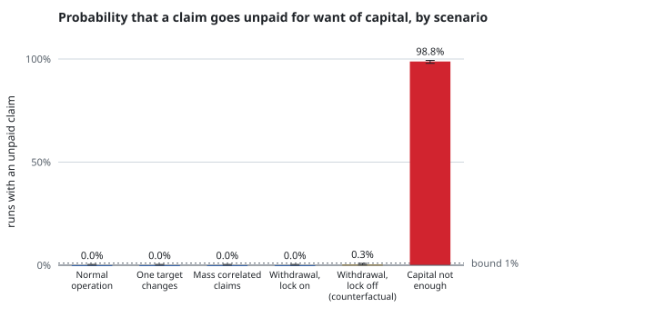
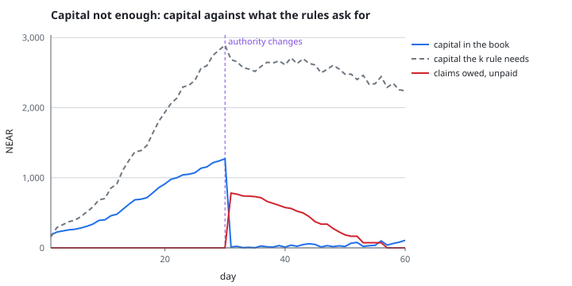
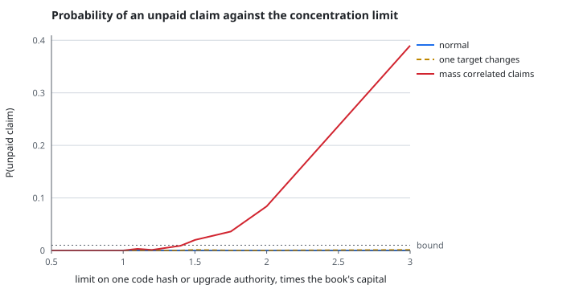

# Pool solvency simulation, 2026-11-12

**Every number below follows from assumptions listed in this file. None is measured.** In particular the chance that a contract changes (`P(event)`) is the pool's own declared **underwriting assumption**, not a measurement: how often NEAR contracts change code is open question 1 (`docs/DECISIONS.md`), and it gates mainnet coverage (release gate B). These results are for testnet design only.

200 agents over 60 days, 1000 seeded runs per scenario (seeds 1 to 1000). The pool's premium, capital adequacy, concentration, release, payout and withdrawal-lock rules are the contract's (`contracts/pool`), held to it by golden vectors the pool's own test regenerates. Everything else is a modelling assumption, listed below. One command rebuilds this file and every chart from `raw/`: `pnpm --filter @aruna/sim sim`.

## Outputs

"Insolvent" means the pool refused at least one claim because the claim was larger than the book's capital (the contract pays all of a claim or none of it). A claim refused for want of capital is retried daily, so premium income can pay it later: "most owed and unpaid at once" keeps that failure visible when "unpaid at the end" has healed. "Solvency ratio" is capital divided by claims still unpaid plus the remaining limits of coverage still open, at the end; it is against the limits, the most that could be claimed, so it sits below 1 by design (the adequacy rule keeps it at or above 0.2 while it binds). Drawdown is of capital per share, so withdrawals do not count. Medians over runs unless stated.

| Scenario | P(insolvent), 95% interval | Ending capital, NEAR (5th to 95th) | Claims paid, NEAR | Most owed and unpaid at once, NEAR | Unpaid at the end, NEAR | Solvency ratio | Max drawdown | Time to insolvency, days |
|---|---|---|---|---|---|---|---|---|
| Normal operation | 0.0% (0.0% to 0.4%) | 4,765 (3,814 to 5,105) | 115 | 0 (95th: 0) | 0 (95th: 0) | 0.44 (5th: 0.36) | 2.0% | never |
| One target changes | 0.0% (0.0% to 0.4%) | 4,165 (3,457 to 4,580) | 720 | 0 (95th: 0) | 0 (95th: 0) | 0.38 (5th: 0.32) | 15.5% | never |
| Mass correlated claims | 0.0% (0.0% to 0.4%) | 2,911 (2,183 to 3,450) | 1,950 | 0 (95th: 0) | 0 (95th: 0) | 0.29 (5th: 0.25) | 45.7% | never |
| Underwriter withdrawal | 0.0% (0.0% to 0.4%) | 3,511 (2,871 to 4,012) | 1,393 | 0 (95th: 0) | 0 (95th: 0) | 0.33 (5th: 0.27) | 29.4% | never |
| Underwriter withdrawal, lock switched off (counterfactual, not the contract) | 0.3% (0.1% to 0.9%) | 1,339 (531 to 1,857) | 1,101 | 0 (95th: 0) | 0 (95th: 0) | 0.21 (5th: 0.19) | 48.5% | 41.1 (3 runs) |
| Capital not enough | 98.8% (97.9% to 99.3%) | 108 (13 to 550) | 1,857 | 707 (95th: 1,227) | 0 (95th: 570) | 0.01 (5th: 0) | 100.0% | 30.3 (988 runs) |

## The scenario that breaks the pool

The pool starts with 100 NEAR, with no adequacy rule and no concentration limit, against all the coverage the agents want to buy. On day 30 the upgrade authority with the most coverage behind it changes everything it controls, and every exposed agent claims within two hours. This is the scenario that breaks the pool. In the normal scenario the book's limits peak at 14,718 NEAR, which is what the agents buy when nothing limits them.

It breaks the pool in 99% of runs. The first unpaid claim comes a median of 30.3 days in; the event is on day 30. At its worst a median of 707 NEAR (95th: 1,227) was owed and unpaid at once. Because refused claims are retried daily, premium income pays part of it later: at the end 0 NEAR (95th: 570) is still unpaid, with 108 NEAR left in the book. It is shown as it happens, not tuned to look better. For comparison, the mass correlated claims scenario has the same kind of event with the rules on and 3,000 NEAR of starting capital, and P(insolvent) there is 0.0%. That compares two things that differ in both the rules and the capital, so it does not say which of the two matters more.

## Underwriter withdrawal: the lock is what stops it

The contract refuses a withdrawal until every coverage in the book is past its end plus its reporting period, and every purchase pushes that date out. In this model agents renew continuously, so the book is never fully idle: the underwriter's withdrawal succeeded in **0 of 1000** runs, with a mean of 35 refused attempts. Without the lock (a counterfactual, **not** the contract) it succeeds immediately in 1000 of 1000 runs, takes 1,933 NEAR, and ending capital falls from 3,511 to 1,339 NEAR; 602 purchases on average are then refused by the adequacy rule. The lock also means capital cannot be pulled before a correlated event. The price is that underwriters cannot leave while the market is active; the model does not say whether anyone would underwrite on those terms.

## Derived values

Rule: largest grid value v such that v and every smaller value keep P(insolvency over 60 days) at or under the bound in every scenario of normal, one target changes, mass correlated claims. Bound: P(insolvency) at or under 1%. Book capital 1000 NEAR, which wants far more coverage than it may sell, so that the limits bind. 1000 runs per cell. The rule was fixed after an exploratory run showed that two scenarios never bind; it is not a prediction made in advance.

### Concentration limit

**Derived: 1.4 x capital** (the contract's declared value is 2 x). Largest value, with every smaller value also within the bound in all three scenarios. Stays under the bound at every value tried: normal operation and one target changing. Goes over the bound at some value: the mass correlated claim, where one upgrade authority changes everything it controls.

At 1.4 x the worst scenario's estimate is 0.9% (95% interval 0.5% to 1.7%) against a bound of 1%. The interval reaches above the bound, so treat this value as the edge of what the runs support, not as a safe margin; the next value down in the grid is the conservative reading.

| limit on one hash or authority, x capital | normal | one target changes | mass correlated claims |
|---|---|---|---|
| 0.5 | 0.0% | 0.0% | 0.0% |
| 0.75 | 0.0% | 0.0% | 0.0% |
| 1 | 0.0% | 0.0% | 0.0% |
| 1.1 | 0.0% | 0.0% | 0.3% |
| 1.2 | 0.0% | 0.0% | 0.1% |
| 1.3 | 0.0% | 0.0% | 0.5% |
| 1.4 | 0.0% | 0.0% | 0.9% |
| 1.5 | 0.0% | 0.1% | 2.0% **over** |
| 1.75 | 0.0% | 0.0% | 3.6% **over** |
| 2 | 0.0% | 0.0% | 8.4% **over** |
| 3 | 0.0% | 0.1% | 39.0% **over** |

Sensitivity to the unmeasured P(event): the same derivation when changes are more frequent than the pool assumes.

| P(event) multiplier | Derived concentration limit, x capital |
|---|---|
| x1 | 1.4 |
| x2 | 1.2 |
| x5 | 0.75 |

### k, the capital adequacy factor

**Not derived at the declared P(event).** These scenarios do not identify `k` there: with the concentration limit at 1.4 x, P(insolvency) is within the bound in every scenario at every `k` tried, up to 16. A likely reason, not tested here, is that the concentration limit caps the loss from any one hash or authority before `k` can matter; `k` bounds the total across many targets, which would matter when several unrelated authorities change together, and that needs a systemic-event scenario and a measured drift frequency, neither of which exists yet. The contract keeps `k` = 5; this result is no evidence for that value and no reason to change it.

| k | normal | one target changes | mass correlated claims |
|---|---|---|---|
| 2 | 0.0% | 0.0% | 0.0% |
| 3 | 0.0% | 0.0% | 0.0% |
| 4 | 0.0% | 0.0% | 0.8% |
| 5 | 0.0% | 0.0% | 0.9% |
| 6 | 0.0% | 0.0% | 0.6% |
| 8 | 0.0% | 0.0% | 0.8% |
| 10 | 0.0% | 0.0% | 0.8% |
| 12 | 0.0% | 0.0% | 0.8% |
| 16 | 0.0% | 0.0% | 0.4% |

| P(event) multiplier | Largest k within the bound in all scenarios | Bound holds at the top of the grid |
|---|---|---|
| x1 | 16 | yes |
| x2 | 3 | no |
| x5 | 3 | no |

Under stress `k` is identified: at 2x the declared P(event), the largest `k` within the bound is 3; at 5x the declared P(event), the largest `k` within the bound is 3. These runs keep the concentration limit at 1.4 x, the value derived at the declared P(event), not the value each stress would derive. The declared P(event) is not measured, so a `k` that is safe only if it is right is not yet a `k` to lock (release gate B asks for the measured frequency first).

## What the model assumes

Each scenario's full input is in `assumptions.json`. The basis case, shared by all of them:

| Assumption | Value | Kind |
|---|---|---|
| agents, days | 200, 60 | plan |
| P(event) per 30 days, by class | immutable 50 bps, local 500 bps, global 1000 bps | **UNDERWRITING ASSUMPTION** (the pool's own; not measured) |
| targets | 12 implementations under 8 upgrade authorities; agent picks target j with weight 1/(j+1)^1 | modelling |
| each agent's daily cap | lognormal, median 2 NEAR, sigma 0.8 | modelling |
| share of cap actually spent per day | uniform 30% to 90% | modelling |
| coverage | 30-day window, payout ratio 80%, limit = the most the cap can reach; renews with probability 0.8; first purchases spread over 30 days; refused purchases retried daily up to 7 times | modelling |
| starting capital (basis) | 3,000 NEAR from one underwriter | modelling |
| after a change | target frozen for 5 days: no new coverage on it | modelling |
| claims | report 60 blocks after the change, challenge window 300 blocks, filed within 43200 blocks after; a claim refused for want of capital is retried daily | modelling |
| pool rules: k, concentration, margin, capital cost, waiting period, reporting period | 5, 2 x, 2000 bps, 100 bps, 120 blocks, 600 blocks | the contract's declared values (also assumptions, `contracts/common/src/params.rs`) |

Not modelled: who may buy (vault, policy, class record, attestor heartbeat), disputes and the arbiter, the attestor being wrong or late beyond a fixed delay, several underwriters, several tokens, premium discounts, and any change in agents' behaviour after a loss. Exposure accrues evenly across the day. One implementation changing again after its freeze is allowed; the new code hash starts a new concentration bucket.

